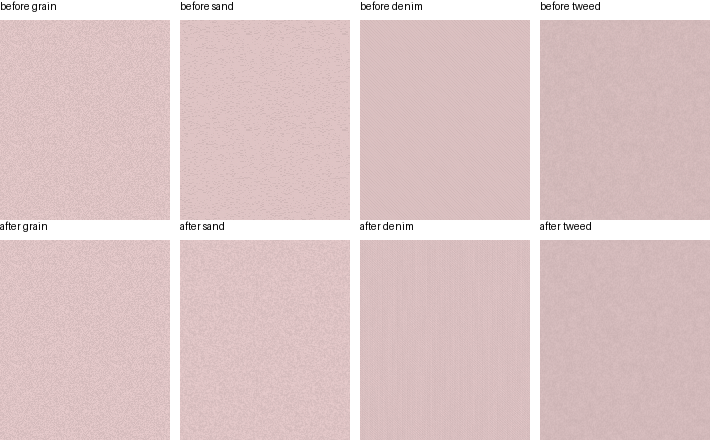

# Display blend and own-art textures (Section 4 child B)

These are Open renders only. They use the synthetic browser fixture and a
single pink editor key at intensity 1 and noise 0.8. No capture pixels,
assets, or personal browser data are included. The existing fixture files
are unchanged.

`before/` was rendered by unchanged main `3ab71a04` (fixed P3 fill, sRGB
renderer). `after/` uses the display-space composition in the capture's
embedded display profile and Open's new procedural sand/denim. Grain and
tweed keep their tile bytes; their displayed color can change with the blend.
The source command is `space-editor-render compare --spec session2-pad`.
Its generated Open `texture-*.png` outputs are copied here as review evidence,
not comparison baselines. The capture tables stay private under `.re/s4b/`.

The overview crops only Open renders and converts each embedded profile to
sRGB before assembly.

| Texture | Before | After |
|---|---|---|
| Grain | [before](before/grain.png) | [after](after/grain.png) |
| Sand | [before](before/sand.png) | [after](after/sand.png) |
| Denim | [before](before/denim.png) | [after](after/denim.png) |
| Tweed | [before](before/tweed.png) | [after](after/tweed.png) |

Choices for the lead: sand uses wrapped white noise with a Gaussian sigma
of 0.47 pt. Denim combines a fine diagonal carrier (0.40/-0.44 cycles/pt),
vertical warp at 2.5 pt, a 57-cycle-per-tile column beat, smooth per-thread
shade, and fine noise. All geometry is generated in points. The tile periods
stay grain 100, sand 96, denim 300, and tweed 128 pt. Tiles cache by texture
and backing scale; noise changes layer opacity only.

The proposed spatial limits are maximum absolute error 0.10 for box-2/4/8
standard-deviation ratios, 0.15 L* for column/row/diagonal mean spread,
and 0.15 for lag-1 H/V/D1/D2 correlation. The first two extend the existing
grain/tweed limits. Correlation admits differences from independent random
art and 8-bit raster conversion while rejecting the old sand's vertical
correlation and the old denim's diagonal pattern. The PR lists each measured
value and the negative proofs. Lead approval of these choices is pending.
