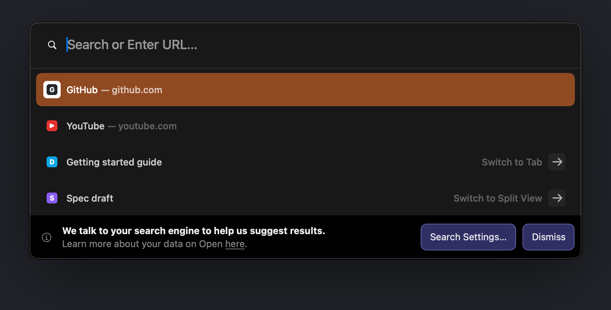
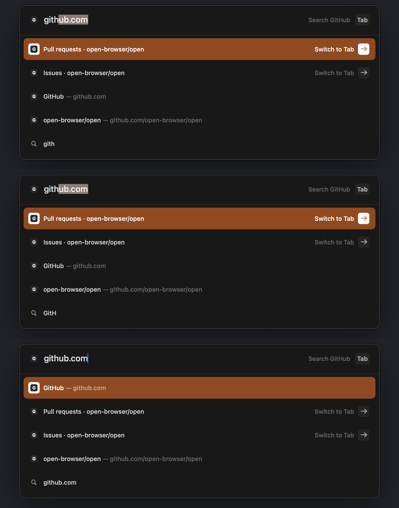
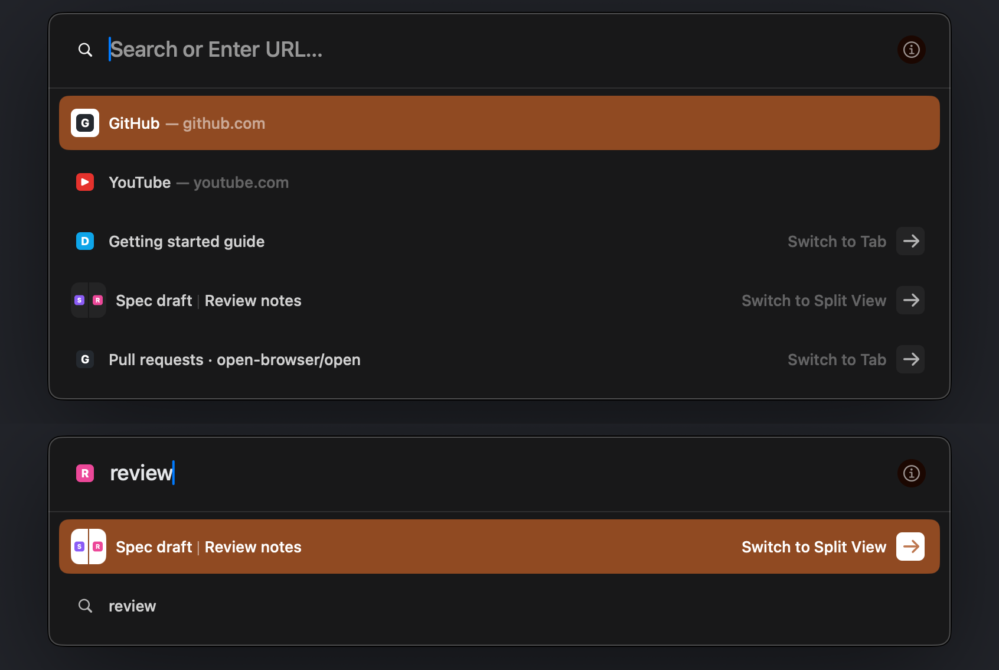

# OpenCommandBar: the command bar UI (M3)

Status: implemented. Package targets in [OpenKit](../Packages/OpenKit/Package.swift): the library `OpenCommandBar`, the tokens file `OpenDesign/CommandBarTokens.swift`, and the dev executable `commandbar-render`.
No third-party dependencies. No unit tests (AGENTS.md rule 6): the bar is checked end to end through its real views, the real `SuggestEngine`, and real AppKit key and mouse events in an offscreen window, and compared pixel by pixel with Arc's captures.

Sources: [interaction-states.md](re/interaction-states.md) §9 (captured command bar), [features-core.md](re/features-core.md) §4 (behavior), [suggest.md](suggest.md) (the engine), [design.md](design.md) (tokens and the comparison method). Frame ids (F0063, A0120) refer to the capture session indexed in `.re/runtime/sessions/index-20261024.json`. Marks: **measured**, **fitted** (chosen to minimize the comparison error), **guess**.








The screens above are our renders of synthetic data (`commandbar-render screens`): empty Cmd+T, typing "git", Cmd+L, actions with keycaps, the "Tab or Space" hint, the Site Search chip (empty and with a query), the calculator, a scrolled list, and the edge style over a white page. The first two sheets date from M3 (#43); rows and the "git" field have changed since (current tab in Cmd+T, inline completion). The completion sheet shows "gith" (completed to `github.com`, the completed part selected), "GitH" (the field keeps the candidate's case), and the text after Right accepts it. The split sheet shows the empty Cmd+T list with the split "Spec draft | Review notes" as one row, then "review" with that row selected (white plate cells, the gap shows the selection fill).

## 1. Modules

| Part | Role |
|---|---|
| `CommandBarController` | Owns the overlay. Sends each text change to `SuggestEngine.query`, applies its snapshots, handles keys and the mouse, and reports choices as `CommandBarIntent`s through `CommandBarDelegate`. No engine code. |
| `CommandBarView` | The overlay: a transparent view the App puts over the whole window content. It holds the shadow and the panel and catches clicks outside the panel. |
| `PanelView`, `MaterialView`, `EdgeView` | The panel: translucent material, input row, separator, result list, (i) footer, edge. |
| `PrivacyFooterView` | The (i) footer: Arc's search-suggestion privacy notice as a black band at the panel's bottom (CC-42). |
| `InputRowView` | Leading icon, Site Search chip, text field (own field editor), placeholder, (i) button or Site Search hint. |
| `ResultsView`, `ResultRowView` | Up to 12 rows, 5 visible, one shared selection layer. |
| `Presentation.swift` | `Suggestion` → drawn row (`CommandBarRow`), input (`CommandBarInput`), copy. |
| `FaviconStoreSource` | Synchronous favicon lookups over the `FaviconStore` actor (main-actor cache per origin, async fill). |
| `OpenDesign/CommandBarTokens.swift` | `CommandBarMetrics`, `CommandBarShadow`, `CommandBarMaterial`, `CommandBarRole`. No motion tokens: the bar does not animate (§5). |
| `commandbar-render` | Renders, comparison with Arc captures, keyboard and mouse flows, the keystroke bench, `check` for `tools/verify-all.sh`. |

## 2. API

```swift
let bar = CommandBarController(engine: suggestEngine)
bar.delegate = self                       // CommandBarDelegate
bar.favicons = FaviconStoreSource(store: faviconStore)
bar.theme = CommandBarTheme(style: sidebarContext.style(for: space))
bar.backdrop = CommandBarBackdrop(color: pageBackground, image: optionalContentSnapshot, imageScale: 2)
bar.privacyURL = nil                      // Open's privacy page for the (i) footer; nil hides that line
window.contentView?.addSubview(bar.view)  // above the web content and the sidebar, full size
bar.view.frame = window.contentView!.bounds; bar.view.autoresizingMask = [.width, .height]

bar.present(CommandBarRequest(mode: .newTab, profileID:, spaceID:, currentTabID:, currentTabURL:,
                              currentTabTitle:, allowsRemoteSuggestions:, searchEngineID:))
bar.dismiss(reason: .programmatic)
```

Intents (`CommandBarIntent`):

| Intent | When | App action |
|---|---|---|
| `.open(url, destination, modifiers)` | navigate and history rows | Open in a new Today tab (`.newTab`, Cmd+T) or the current tab (`.currentTab`, Cmd+L). |
| `.search(query:url:siteSearchID:destination, modifiers)` | typed search, suggested query, Site Search | Same, with the final search URL. |
| `.switchToTab(id, spaceID:)` | Switch to Tab rows | Switch to `spaceID` first when it is another Space, then select the tab. |
| `.runAction(id:spaceID:)` | action rows | Run the command with this id (`ActionRegistry` ids, docs/commands.md). `spaceID` is the target of "Focus on \<Space\>". |
| `.copy(text)` | calculator row | Copy the answer (and show a toast). |
| `.openSearchSettings(profileID:)` | "Search Settings…" in the (i) footer | The bar closed. Show Settings ▸ Profiles for that Profile (Open keeps search engines per Profile). |
| `.dismissed(reason)` | Esc, click outside, programmatic | Return focus to the web content. |

`commandBarDidDismissPrivacyNotice(_:)` reports "Dismiss" in the (i) footer. The App writes `open.general.searchSuggestNoticeDismissed` (the Settings notice key, "Code 4") and calls `setAllowsRemoteSuggestions(_:)`; the bar then re-runs the current query, so remote rows arrive at once.

`commandBar(_:didChangePresentation:mode:)` reports open and close. With `.newTab` the App sets `SidebarContext.isNewTabCommandBarOpen`, so the sidebar "New Tab" row looks selected during Cmd+T and not during Cmd+L (F0063 vs F0049).

`presentPreview(_:)` shows fixed rows without a query (renders, design review).

## 3. Measured spec

All values are points from the panel's outer top-left corner, at 1x (window 2216×1394). Tokens live in `CommandBarMetrics` and `CommandBarRole`.

### 3.1 Geometry

| Part | Value | Mark, evidence |
|---|---|---|
| Panel width | 766 (x 725…1490) | measured, F0049, F0063 |
| Panel height | 79 + 50 × rows (1 row 129, 4 rows 279, 5 rows 329) | measured, F0055, F0063, F0052. interaction-states §9.1 said 339 for 5 rows; the outer edge is at 856, so 329. |
| Panel with no rows | 64 (input row only) | measured ≈ 64 with a Site Search chip and no rows (session 2, `re/interaction-states.md` §20.9, S2 18/0016) |
| Position | centered in x; top = (H − 339) / 2 (528 at H 1394), same for any row count | measured top 528 in every frame; formula guess beyond one window height |
| Corner | 12 pt, continuous | fitted (edge curve ≈ 18 px, F0063) |
| Input row | 64 tall; separator 1 pt at y 64, full inner width | measured, F0063 |
| Leading icon | `[23, 23, 18, 18]`, glyph ink 12×12 | measured, AX and pixels |
| Text field | x 53, y 20, h 23 (AX); text ink at x 54 | measured |
| (i) button | `[W − 47, 19, 26, 26]`, 24 pt circle | measured |
| Hint group | right edge at W − 22; keycaps 24 tall, radius 5, label ± 4 pt | measured, F0061 |
| Rows | `[8, 69 + 50 i, 750, 50]`; 5 visible, up to 12 held, scrolled | measured, AX |
| Selection | `[2, 2, 746, 46]` in the row, radius 8 continuous | measured, fitted radius |
| Row icon | 16×16 at `[16, 17]`; plate 24×24 at `[12, 13]`, radius 5 | measured |
| Row text | title at x 44, baseline row + 30; subtitle "— …" 4 pt after the title's whole-point width; URL subtitles middle-truncated at 278 pt | measured and fitted |
| Accessory | arrow plate 24×24, 15 pt from the row's right end; label ends 8 pt before it | measured |

### 3.2 Colors and type

| Element | Value | Evidence |
|---|---|---|
| Panel material | `fill = tint · 0.885 + saturate(backdrop, 1.95) · 0.115`, tint #171716 | fitted on 4 backdrops: dark page F0063 (#181819), empty purple Space A0327 (#1D1A1E), olive A0526 (#2A2416), white page A0120 (#323031); RMS 0.37 levels |
| Edge over a dark page | 1 pt black 0.93, then 1 pt white 0.23 inside | measured, F0043–F0063 |
| Edge over light pages, photos, empty Spaces | one opaque #3E3E3E line, no inner ring | measured, A0120, A0121, A0327, A0526 |
| Edge switch point | backdrop luma 47/255 | guess between 36 (dark style) and 58 (light style) |
| Shadow | one Gaussian, σ 48 pt, 24 pt down, black 0.51; not under the panel | fitted on F0063 vs F0064 (RMS 0.007); A0120 shows a uniform fill to the edge |
| Separator | white 0.10 (`CommandBarHairlineDividerColor`) | measured #2F2F30 |
| Selected row | theme `dark.focus` with its alpha over the panel (#B85727 a 0.8075 → #9A4B26); default theme indigo, extended sRGB | measured F0063, A0120 (same alpha over a lighter fill); A0327 |
| Input text | 18 Medium, #E5E7EA; selected text #F2F2F5 | fitted |
| Text selection | theme `dark.subtitle` (#807571 exact) | measured, F0048 |
| Caret | system accent (#007AFF), 1 pt | measured |
| Placeholder | "Search or Enter URL…", 18 Medium, white 0.55 | measured text, fitted color |
| Row title | 13 Medium, white 0.80; white on the selected row | measured |
| Subtitle, "Switch to Tab", Space name, hint label | white 0.33 (`CommandBarTextSecondaryColor`); hint label 12.75 Regular | measured, fitted size |
| Plates (arrow, keycaps, action icons) | white 0.05; arrow white 0.66; selected row: white plate, arrow in the focus color | measured |
| (i) circle | theme `dark.backgroundExtra` (#190700 exact); glyph white 0.57 | measured |
| Favicon on the selected row | on a white 24 pt plate | measured F0061, F0063 |

### 3.3 What a row shows

| Kind | Title — subtitle | Icon | Right side | Evidence |
|---|---|---|---|---|
| navigate | "\<url\> — \<url\>", or "\<page title\> — \<url\>" after a history merge | favicon, else globe | — | F0040 |
| history | "\<title\> — \<url\>" | favicon, else globe | — | F0048 |
| switchToTab | title | favicon | "Switch to Tab", "Switch to Split View", or the tab's Space name + arrow | F0063, A0121, A0327 |
| switchToTab, a Split View | pane titles with a 1 pt rule between them, no subtitle | one cell per pane on a plate | "Switch to Split View" + arrow | A0120, A0121 (CC-12…CC-14) |
| search, searchSuggestion | the query | magnifier | — | F0052 |
| action | title | SF Symbol on a plate | shortcut keycaps | F0063 (plate); keycaps guess |
| calculator | "84 — 12*(3+4) =" | "=" on a plate | — | guess |
| siteSearch | the query — "Search \<Site\>" | magnifier | — | guess |
| siteSearchHint | not a row: shown as the input's trailing hint | — | — | F0040, F0061 |
| Cmd+L, current page | the page title, no subtitle | favicon | — | F0048 |

Split View row (`CommandBarMetrics.split*`; A0120 row 3, CC-13, CC-14): plate 30×30 at row `[12, 10]`, radius 7 (continuous), white 0.05 (white on the selected row); one cell per pane with a 1 pt gap at each boundary that shows the row background; pane favicons 9 pt centered in their cells; for 3–4 side-by-side panes the plate is 15 pt per pane and a vertical split stacks the cells (guesses, no capture). Title at x 50 (plate + 8); the rule is 1 pt wide, row y 20.5–32.5, white 0.17, from 4.5 pt after the first title's advance, with the next title 5 pt after it (fitted on A0120). Too long: the last title truncates first, then earlier ones (guess). The plate cells and pane icons are Core Animation sublayers of the row, not drawn into its backing store: they need no clear-blend punch-out for the gap, and `commandbar-render` could not read a row backing store that had a fill drawn at the plate's place (§7). AX: the label is the pane titles joined with ", "; the value "Switch to Split View".

The input's leading icon follows the first row (for a Split View row, the matched pane's icon; guess): magnifier for searches and an empty field, globe for a typed URL without a favicon, the favicon when known (F0040, F0052, F0061). In Cmd+L it is the page's favicon.

### 3.4 The (i) privacy footer

Measured on S2 18/0044 (window 1728×1084, panel `[481, 373, 766, 329]`, 5 rows); `H` = panel height, `W` = panel width. Tokens: `CommandBarMetrics.footer*`, `CommandBarRole.footer*`.

| Part | Value | Mark, evidence |
|---|---|---|
| Band | `#000000`, `[0, H − 61, W, 61]`, clipped by the panel corner; above the list, under the edge | measured (pixels) |
| List under the band | Same frame; its visible part ends at the band (5 rows → 4). Hover and clicks there never reach rows; the keyboard scrolls a row out from behind it | measured (AX table frame unchanged) |
| Short panels | Fewer than 2 rows: the panel grows by 61 pt | guess |
| (i) button | Hidden; the field grows 42 pt (656 → 698) | measured (AX) |
| Icon | `info.circle` 13 pt, ink 13×13 at `[18, H − 37]`, white 0.5 | measured box; color fitted (core #767676) |
| Line 1 | "We talk to your search engine to help us suggest results.", 13 **Bold**, white 0.93, ink top at `H − 48` | text measured; font fitted (ink width 364 px and ink mass match 13 Bold, not Semibold) |
| Line 2 | "Learn more about your data on Open " + "here" (underlined, link) + ".", 13 Regular, white 0.5, ink top at `H − 30`. Hidden while the App has no privacy page | text measured ("Arc" → "Open"); color fitted (core #7A7A7A) |
| Buttons | "Search Settings…" `[W − 223.5, H − 49.5, 132, 37]`, "Dismiss" `[W − 82.5, H − 49.5, 72, 37]`; fill `#302F63`, 1 pt edge `#6362AD`, radius 8, title 13 Regular white 0.9 | frames measured (AX, 0 pt); fill measured; edge solved from the two half-strength pixels of the half-point edge (one pixel reads `#494988`); title fitted (ink widths 104 / 45 px) |

## 4. Behavior

| Input | Result | Evidence |
|---|---|---|
| Cmd+T (`.newTab`) | Empty field, rows for the empty query, row 1 selected | F0063 |
| Cmd+L (`.editCurrentURL`) | Field holds the current URL, fully selected; typing replaces it | F0048 |
| `.searchTabs` | Tab rows only; placeholder "Search Tabs…" | placeholder guess |
| Typing (inline completion) | Row 1's host or URL completes in the field; the completed part is selected. Rules, keys, and evidence: §4.1. | CC-1…CC-7, CC-40 |
| Typing | One query per committed text change. Marked IME text does not query; composition end submits exactly one query. Paste replaces CR/LF with spaces and caps visible input at 2,048 characters before querying that same text. | implementation; flows 36–44, 64–65 |
| Later snapshots | Before the user moves the selection it stays on row 1, so it changes only when the top hit changes. After a move it stays on the same suggestion id. | features-core §4.3 rule 8 (guess there); our rule |
| Up / Down | Move the selection; stop at the ends; the list scrolls by whole rows | menus-and-hotkeys "normal list rules" (guess) |
| Return | Acts on what is highlighted on screen at the key press (what you see is what you get). Only if NO snapshot exists yet for the current text does Return wait for that text's first snapshot, then open its top row. It never waits for history or remote providers. An empty first snapshot consumes the pending Return without opening anything. | lead rule; flows 30, 52–57; F0041 shows selection |
| Esc | Closes with `.dismissed(.escape)`, typed text or not. A second Esc is not the bar's (it reaches the App's Exit command). | F0052 → F0053; docs/commands.md |
| Tab | With a hint: enters Site Search; the trigger word becomes the chip. Without: normal AppKit focus traversal; Shift+Tab also traverses normally. | features-core §4.6 rule 15 (hint); accessibility rule, flow 50 |
| Space | After a site's exact name or keyword ("yt", "youtube"): enters Site Search; the hint then reads "Tab or Space". A prefix ("you") stays text. | F0040 shows "or Space"; exact-match rule guess |
| Backspace on an empty scoped query | Leaves Site Search | features-core §4.6 rule 16 |
| Pointer move over a row | Selects it (real moves only; rows sliding under a still pointer do not) | features-core §4.7 rule 17 (guess) |
| Click a row / outside | Choose / close (`.clickOutside`) | outside click guess |
| Click (i), or Cmd+I in the field | Show the privacy footer (§3.4); Cmd+I again hides it. No intent, no window. Tab stays free for Site Search or focus traversal. | CC-42 (S2 18/0044); Cmd+I is an Open rule; flows 34, 49, 88 |
| Footer "Dismiss" / "Search Settings…" / "here" | Hide the footer and report the dismissal, then re-run the query / close with `.openSearchSettings` / close with `.open(privacyURL, .newTab, [])` | CC-42; flows 89–90 |
| Present (any mode) | No footer. Only (i) and Cmd+I show it; it never shows by itself. | lead ruling 2026-10-26 (D14); flow 89 |
| Cmd / Shift / Option + Return | Reported in the intent's `modifiers`; no other behavior | Arc names `CommandBarSelectionOptions`, but no capture or string proves the keys |

During IME composition, Return, Tab, Esc, Space, and arrows go to the input method. Return commits composition without choosing a result. Each present and dismiss unmarks composition and clears the field editor's own undo stack. Presentation before window attachment focuses the input when its view gets a window.

Rows expose AX buttons with the title as their label, subtitle and accessory as their value, and a press action. Selection changes post `selectedChildrenChanged` and an announcement with the row label. The field's native placeholder matches the drawn placeholder. The (i) control is a labeled AX button; its press and Cmd+I toggle the footer. The footer is an AX group "Search suggestions privacy" with its two lines, the link "here", and the two buttons.

The field editor has spelling, grammar, completion, substitutions, data detection, system inline predictions, math results, and Writing Tools off: URLs must not be "corrected", the system must not draw its own prediction next to ours, and each check costs work per keystroke (NSTextCheckingController ran on every selection change until the last three were off; §6).

### 4.1 Inline completion

Arc completes the typed text in the field with row 1's host (`CommandBarAutocompleteSuggestion`; `re/commandbar-completion.md` CC-1…CC-7, CC-40). The full spec is `plans/commandbar-completion.md` §4.1; this is what is built.

- **Who decides.** The engine (`OpenSuggest`) picks the row and the text: rule T3a and `SuggestionSnapshot.inlineCompletion` (`docs/suggest.md` "Top hit"). The bar owns the field, the selection, and the keys (`CompletionSession`, `CommandBarController`).
- **When.** New tab or Cmd+L, no scope, no marked text, the last edit an insertion at the end of the text (typing or an IME commit; never paste, deletion, undo, or a caret move), text without whitespace, and row 1 selected.
- **What.** Text without `/`, `?`, or `#` completes to the host (plus a non-default port), never deeper; text with one completes to the URL. A typed `https://`, `http://`, then `www.` stays as typed. The field shows the candidate's letter case (CC-6); the query keeps the user's text (`text`; the whole field is `fieldText`).
- **How it shows.** Real text in the field editor with the completed part selected (AppKit's selection look, CC-2), so the AX value is the whole text and the selected range is the completion (CC-3). Writes never enter undo and post no text change.
- **Keys.** A character that continues the completion keeps it on screen before its snapshot: only the completion's first character is removed and the typed one takes its place (one storage edit, normal undo coalescing). Any other character replaces it. Backspace, Forward Delete, and the word and line deletions remove only the completion and re-query with completion off (CC-40). Right, End, Cmd+Right, Ctrl+E accept (caret at the end); Left makes the text typed with the caret at the selection start; Home and Cmd+Left put it at the start. Shift+arrows, Cmd+A, and clicks make it typed text. Down and pointer moves off row 1 hide it; back on row 1 shows it again (no query). Space never enters Site Search while a completion shows (CC-5). Cmd+Z undoes the typing and never brings back a completion.
- **Speed.** One storage edit and one selection change per keystroke; no panel layout pass, no row redraw. `commandbar-render check` gates it (§6).


## 5. Motion

**None.** Arc's bar appears and goes between two video frames (≤ 38 ms apart), 4 of 4 times (`re/commandbar-completion.md` CC-44; `re/interaction-states.md` §20.12, V 9.70, 10.88, 13.02, 14.20 s). Present and dismiss change the panel in one frame: no scale, no fade, no animation key on any bar layer; `CommandBarView.setShown` sets `isHidden` with Core Animation actions off (flow 87; the App e2e `commandbar` suite checks the first window snapshot after Cmd+T). The collapsed AX layout during a close (F0060, F0064; S2 18/0029, 0047) is internal state with no visible frame; Open does not reproduce it. The selection jumps between rows (no animation). The (i) footer also shows and hides in one frame.

The provisional `Motion.commandBarOpen*` and `Motion.commandBarClose*` tokens (a 0.22 s spring from scale 0.96 and a 0.12 s fade) were deleted in commandbar-completion Step 0.

## 6. Performance

`commandbar-render bench`: the field editor inserts one character at a time for 30 typical queries (words, two words, hosts, URLs, arithmetic, actions); the controller queries the real engine over a 5,000-tab model and a 100k-URL history; the first snapshot is applied; AppKit lays out, draws, and commits. 2x, release build, Apple M5 Pro, 3 runs × 436 keystrokes while a Chromium build ran (load average 8–9 on 18 cores), so these are upper bounds.

| Measure | Result | Budget |
|---|---|---|
| Keystroke → rows drawn, main-thread CPU | p50 1.58–1.77 ms, p95 2.60–3.30 ms | 8 ms |
| Keystroke → rows drawn, wall | p50 1.74–1.90 ms, p95 4.25–4.84 ms, max 9.5 ms | 8 ms |
| Parts (CPU p50): text change + engine query / snapshot apply / layout + draw + commit | 0.59–0.62 / 0.60–0.64 / 0.44–0.50 ms | |
| Rows redrawn per keystroke | 1.8 (unchanged rows are not redrawn) | |
| History snapshot merge, main thread (off the keystroke path) | p50 0.65–0.72 ms, p95 1.4–1.9 ms | |

Inline completion (`bench --completion`, check row 112): every query is typed twice per round, completion off then on (order alternating), against a history whose hosts complete the one-word queries, so about 56% of keystrokes show a completion. Main-thread cycles over the keystroke's own work (key handling, snapshot 0's apply, layout + draw + commit; no polling) are converted at the off run's measured cycles per ms; cycles only count while the thread runs, so the result barely moves with machine load. Budget (plan §5.4): p95 with completion ≤ plain p95 + 0.3 ms, and no extra panel layout pass.

| Run (load average) | p95 added | Paired median | Panel layout passes, on / off | CPU p95 on / off |
|---|---|---|---|---|
| check, 218 keystrokes per side (5.4) | +0.097 ms | +0.059 ms | mean 0.11 / 0.11, max 1 | 2.90 / 2.74 ms |
| check (9.6) | +0.079 ms | +0.074 ms | mean 0.11 / 0.11, max 1 | 4.62 ms on |
| break: 8 extra field writes per show | +0.912 ms, FAIL | +0.333 ms | | |
| break: one forced panel layout per show | | | mean 0.65 / 0.11, FAIL | |

What it cost first: a storage edit of the field editor ran about 330k instructions, almost all in the selection change that follows it (NSTextCheckingController for inline predictions and Writing Tools, then the text input cursor UI). Turning those features off (§4) took keystroke CPU p50 from 3.0 to 2.05 ms with or without a completion; keeping the completion across a matching character with one edit instead of remove-then-show took the paired median from +0.50 to +0.08 ms.

Profiling (`sample`) found three costs, now fixed: a forced panel layout on every snapshot (CPU p50 3.4 → 2.2 ms); SF Symbols redrawn as vectors on every row draw (now one bitmap per symbol, color, and scale); and AppKit text checking running per keystroke in the field editor (now off). Under heavier load (load average 18–23) earlier builds reached wall p95 10 ms while CPU stayed under 6 ms: wall time on this machine depends on the build running next to it.

## 7. `commandbar-render`

```text
commandbar-render render (--state NAME | --scene FILE.json) --out FILE.png [--scale 1|2] [--size WxH] [--backdrop-color #RRGGBB]
    states: empty, typing-git, cmd-l, space-hint, site-chip, site-search, calculator, actions, scrolled, privacy-footer, completion, completion-case, completion-accepted, split-row, split-row-selected
commandbar-render compare --arc CAPTURE.png --ours RENDER.png --scene FILE.json --out DIR [--title TEXT] [--space srgb|p3]
commandbar-render ax [--state NAME] # dump the rendered overlay AX tree
commandbar-render flows       # keyboard and mouse flows
commandbar-render check       # flows + a render of every state + the keystroke budget (tools/verify-all.sh)
commandbar-render bench [--tabs 5000] [--history 100000] [--scale 2] [--completion]
commandbar-render screens --out DIR [--scale 2]
```

`--space p3` loads both PNGs into Display P3 and measures ΔE00 there. Session-2 captures (S2) carry the AW2726DM display profile, whose gamut exceeds sRGB; use it for them. The session-1 comparisons in §8.1 stay in sRGB. A scene file can set `"footer": true`; the stage then supplies a stand-in privacy URL so line 2 draws. It can also set `"selection": [location, length]`, a field selection such as an inline completion's range, and per row `"titleParts"`, `"paneIcons"`, `"vertical"` for a Split View row. `bench --completion` runs the completion A/B of §6.

States run through the real engine over a synthetic world (neutral titles, public site names, our own theme colors and letter icons). A scene file instead gives fixed rows, a theme JSON, and a backdrop PNG, to match one Arc capture. Scene files that copy a capture's titles hold personal data, so they stay in `.re/` (git-ignored).

Rendering uses the method of design.md §6 (a deep copy of the layer tree rendered by `CARenderer`). Known limit (2026-11-02): a row view whose `draw(_:)` filled a rect at the split plate's place came out blank in the copy (also every later row drawn in that view), while `cacheDisplay` of the same view showed the content; which code ran before the fill changed the outcome, so the cause is in how the copy reads AppKit's backing store, not in the drawing. The split plate moved to sublayers. The same family of fault gives the intermittent black frames in `docs/followups.md` (a black lower band in 2 of 26 renders of `main` at 2x on the M5). The harness window is never on screen, so AppKit can mark its backing stores purgeable; under memory pressure a store can be dropped before the snapshot. The renderer redraws every view right before each snapshot, checks the page corner and the panel fill, and retries.

## 8. Comparison with Arc

Method (design.md §7): both PNGs in sRGB (the captures converted through their embedded display profile); ink boxes against a plane fitted to a 1 px ring give position errors; text and glyph cores, fill samples, and single pixels give CIEDE2000. Arc's caret (system blue) is removed before measuring. The backdrop under our panel is the capture taken without the bar where one exists (F0045 for F0048, F0053 for F0052/F0055, F0059 for F0058, F0064 for F0061/F0063, F0098 window 2 for A0327) and a flat page color otherwise (A0120). Favicons are replaced by a neutral square and masked. Titles are compared numerically but blanked in the side-by-side images. This file names elements only.

Targets: position ≤ 1 pt, ΔE00 ≤ 2.

### 8.1 Per capture

| Capture | State | Elements | Worst position (pt) | Mean position (pt) | Worst ΔE00 | Mean ΔE00 |
|---|---|---|---|---|---|---|
| F0063 | Cmd+T, empty, 4 rows, theme | 33 | 1.0 | 0.08 | 1.83 | 0.33 |
| F0048 | Cmd+L, URL selected, 5 rows | 30 | 2.0 | 0.35 | 1.93 | 0.36 |
| F0061 | typing a host, "Search Google [Tab]" | 33 | 1.0 | 0.15 | 1.93 | 0.36 |
| F0052 | typing, 5 search rows | 27 | 1.0 | 0.05 | 1.73 | 0.35 |
| F0058 | typing, 5 search rows | 27 | 1.0 | 0.10 | 1.73 | 0.35 |
| F0055 | typing, 1 row | 19 | 1.0 | 0.17 | 1.73 | 0.44 |
| A0327 | Space without a theme, Space-name accessory | 37 | 1.0 | 0.10 | 1.67 | 0.42 |
| A0120 | white page (light edge style), split row | 37 | 6.0 | 0.27 | 2.47 | 0.55 |
| A0120 (Steps 3–4: split row) | the same, row 3 one Split View row; backdrop the sampled page colors `#FEF8FE` → `#F7F7FB` | 42 | 1.0 | 0.12 | 2.11 (left shadow, the non-uniform page) | 0.55 |

Split row elements (A0120 row 3): plate left and right cells 0.0 pt / 1.04, gap 1.05 (both columns at half coverage, as in Arc), title part 1 0.0 / 0.07, rule 1.0 / 0.59, title part 2 0.0 / 0.09, accessory label 0.0 / 0.83, arrow 0.0 / 1.02. The row-3 miss of the first A0120 row (title 6 pt left) is gone.

Inline completion (Steps 1–2; re-run on the branch build, sRGB; backdrop F0064, theme of Space 1):

| Capture | State | Elements | Worst position (pt) | Mean position (pt) | Worst ΔE00 | Mean ΔE00 |
|---|---|---|---|---|---|---|
| F0043 | "googl" completed to "google.com" by an open tab | 36 | 1.0 | 0.38 | 1.93 | 0.33 |
| F0062 | "Google" = tab title, completion in lower case | 36 | 1.0 | 0.38 | 1.93 | 0.33 |
| F0061 | whole host typed, no completion, "Search Google [Tab]" | 33 | 1.0 | 0.27 | 1.93 | 0.34 |

Completion elements: selection box 1.0 pt / 0.00, selected text 1.0 pt / 0.88–0.92; hint label 1.0 pt / 0.26 with ink width 88 px, as Arc's (12.75 Medium; Regular was 86 px).

After the hint font and selected-subtitle changes of Steps 1–2, the session-1 scene files of the first table are no longer on disk, so their numbers above are from #43 and #137. The 10 built-in states were rendered on `main` and on the branch at 1x and 2x and diffed per pixel: `actions`, `cmd-l`, and `site-chip` are identical; `empty`, `calculator`, `site-search`, and `privacy-footer` differ only in row 1's "— subtitle" (max channel 40, the selected-subtitle color); `space-hint` only in the hint label (the font); `typing-git` and `scrolled` change their rows and field on purpose (the current tab in Cmd+T and the inline completion).

Session 2 (Display P3, `--space p3`; window 1728×1084):

| Capture | State | Footer elements | Worst position (pt) | Worst ΔE00 | Other elements |
|---|---|---|---|---|---|
| S2 18/0009 | "wiki" completed to "wikipedia.org", "Search Wikipedia [Tab]" (no "or Space") | — | 1.0 (completion box, text, hint) | 1.37 | 31 elements. Completion selection box 1.0 pt / 0.68, selected text 1.0 / 1.37, hint label 1.0 / 1.21 (105 px ink, ours 104). Misses: the edge style (§8.3; its position rows read 2 pt because the line styles differ) and row 1's selected subtitle ΔE00 2.67 (§8.3). |
| S2 18/0044 | (i) footer on the empty Cmd+T panel, 5 rows | 13 (band top and fill, icon, line 1, line 2's first six words, both buttons' fill, edge, title) | 1.0 (band top) | 0.62 | Panel position 0 pt on all four sides. Two misses are not footer elements: the edge style (§8.3) and row 2's long title (Arc cuts it at ≈ 470 pt; commandbar-completion design-parity work). |

### 8.2 Per element (F0063)

| Element | Position error (pt) | ΔE00 |
|---|---|---|
| Shadow left / right / top / bottom (4, 4, 3, 4 points) | — | 0.37 / 0.32 / 0.31 / 0.44 |
| Panel edge top / bottom / left / right | 0.0 / 0.0 / 0.0 / 0.0 | — |
| Panel outer line, pixel by pixel (18) | — | 0.40 |
| Panel inner line, pixel by pixel (18) | — | 0.02 |
| Panel fill (5 points) | — | 0.00 |
| Separator | 0.0 | 0.29 |
| Input leading icon (magnifier) | 0.0 | 0.91 |
| Input placeholder | 1.0 | 0.18 |
| (i) circle / glyph | 0.0 / 1.0 | 0.51 / 0.81 |
| Row 1 selection | 0.0 | 0.41 |
| Row 1 favicon plate | 0.0 | 0.00 |
| Row 1–4 titles | 0.0 | 0.05–0.17 |
| Row 1 arrow plate (selected) / arrow | 0.0 / 0.0 | 0.00 / 1.83 |
| Rows 2–3 arrow plates / arrows | 0.0 / 0.0 | 0.00 / 1.01–1.07 |
| Rows 1–3 "Switch to Tab" | 0.0 | 0.02–0.08 |
| Row 4 action plate / symbol | 0.0 / 0.0 | 0.00 / 0.24 |

Other states: text selection fill 0.00 (F0048); selected input text 1.0 pt / 0.65; history subtitles 0.0–1.0 pt / ≤ 0.09; hint label 1.0 / 0.30 (F0061); globe 1.0 / 1.85–1.93; Space-name label 1.0 / 0.66 (A0327); default-theme selected arrow 0.0 / 1.67.

### 8.3 What still differs, and why

| Difference | Size | Why |
|---|---|---|
| Text selection box (F0048) | 2 pt at its right end | AppKit's field editor highlights from the text origin to the line's end; Arc's starts 1 px earlier and ends 2 px earlier. The text itself matches (0 pt). |
| Shadow below the panel over a white page (A0120) | ΔE 2.47 | No clean frame of that page without the bar exists; the page is not uniform (pink at the sides, blue-gray below) and we use one flat color. |
| Glyph ink boxes | ≤ 1 pt | SF Symbols are not Arc's art. Sizes are fitted on macOS 27.2 (26B5112a); symbol metrics changed once during this work, so re-fit after OS updates (`compare` shows it at once). |
| Panel edge over a light page in session 2 (S2 18/0044, 0009, 0016, 0018) | ΔE00 ≈ 16 on both edge lines | Session 1 (F0039, F0040, A0120) shows one gray line over a light page; session 2 shows Arc's dark double line over light and blue pages. Open keeps the session-1 luminance rule; the input that switches the style is not known (`docs/followups.md`, capture request). |
| (i) footer line 2 | one word | Arc says "Arc", Open says "Open" (naming rule). The App hides the line until Open has a privacy page. |
| Selected row "— subtitle" over a themed selection (S2 18/0009 row 1) | ΔE00 2.67 | Arc's core `#9EB1CE` over the blue selection `#3B679F` solves to white ≈ 0.5 (`CommandBarRole.subtitleSelected` white 0.52, fitted on one sample); ours reads `#9BB4CF`, a slightly different hue. One sample cannot tell a tint rule from a plain alpha. |
| Light macOS appearance, Little Open | not built or not compared | Light: S2 20/0018 shows the light panel (§11 q3); not built yet. |

## 9. Flows (`commandbar-render flows`)

Real key events go through the window and the bar's field editor; mouse events go to the hit-tested views; the engine is the real `SuggestEngine` over the synthetic world. 102/102 pass, including 33 review regression checks, the 12 Step 0 checks (flows 87–90), the 17 completion checks (flows 69–80, 86), and the 5 split-row checks (flow 81). `check` adds a render of every state at 2x, the keystroke budget, and the completion budget: 119/119.

| # | Flow |
|---|---|
| 1 | Cmd+T reports presentation (sidebar New Tab highlight) |
| 2 | "git" + Return → the top hit's intent |
| 3 | Return closes the bar |
| 4–5 | Down ×2 selects row 3; Return → row 3's intent |
| 6 | Up at row 1 stays; Down stops at the last row |
| 7–8 | Cmd+L prefills the current URL, fully selected; row 1 is the current page (title, no subtitle) |
| 9 | Cmd+L does not report a New Tab presentation |
| 10 | Typing replaces the selected URL |
| 11–12 | Esc closes with `.dismissed(.escape)`; a second Esc reaches nothing in the bar |
| 13 | Cmd+L + Return → open the URL in the current tab |
| 14–15 | "youtu" shows "Search YouTube [Tab]"; "youtube" also offers Space |
| 16–17 | Tab enters Site Search (chip, empty query); Return searches YouTube |
| 18 | Backspace on an empty Site Search exits the scope |
| 19–21 | "yt" shows Tab or Space; "yt" + Space enters Site Search; "you" + Space stays text |
| 22 | Calculator + Return → copy 84 |
| 23–24 | "toggle sid" shows the sidebar action with keycaps ⌘ S; Return → run `toggle-sidebar` |
| 25–26 | "sprint" → Switch to Tab row; Return → switch to that tab in its Space |
| 27 | A tab in another Space shows the Space name |
| 28–29 | Without a move the selection follows the top hit; after a move a later snapshot keeps the chosen row (a 200 ms local stub stands in for the search engine) |
| 30 | Return right after typing waits for that query |
| 31–34 | Hover selects row 3; click row 3 → its intent; click outside → `.clickOutside`; click (i) shows the privacy footer (no intent, no window) |
| 35 | Empty Cmd+T: row 1 selected, Return acts on it |
| 36–44 | Japanese IME composition: zero queries while marked, one on unmark/commit; Return only commits; Tab/Esc/Space/arrows stay with the input method |
| 45–51 | Rendered AX tree: button labels, values, selection, press action, native placeholder, (i) press and Cmd+I toggle the footer, Tab traversal, shortcut values |
| 52–55 | Pending Return is cleared by a new query, present, dismiss/reopen, or an empty first snapshot |
| 56–57 | Return opens the visible highlighted row while providers are pending, or the top row of the current text's first snapshot |
| 58–59 | Boundary arrows preserve selection; Up at row zero does not set `userMovedSelection` |
| 60–61 | Real favicon SQLite store: all same-origin waiters and rows update; FIFO miss eviction permits retry |
| 62–63 | Preview rows without backing suggestions return nil safely, including Return |
| 64–65 | Multiline Unicode paste is capped at 2,048 characters; further typing preserves visible/query equality |
| 66–67 | Dismiss/reopen and present while open clear composition and undo |
| 68 | Present before attachment focuses the field, selects Cmd+L's URL, and accepts replacement typing |
| 69 | "g", "gi", "git", "gith": row 1's completion shows in the same apply as each snapshot, the tail selected, one query per keystroke; one Undo removes the typing and nothing of the host |
| 70 | A matching character keeps the completion before its snapshot and in every applied snapshot; in another letter case too (the field keeps the candidate's case), and Undo then clears the typing |
| 71 | A non-matching character replaces the completion |
| 72–73 | Backspace (and Forward Delete) removes only the completion and re-queries with completion off; row 1 becomes the typed URL; a second Backspace deletes a typed character; the next insertion completes again |
| 74 | Right, End, Cmd+Right accept; Left and Home make the text typed with the caret where the key says |
| 75 | Down hides the completion, Up restores it, a pointer on another row too; no query |
| 76 | Return opens row 1, the completion row; a pending Return uses the first snapshot's row 1 |
| 77 | Paste never completes; Cmd+A and a caret placement make the completion typed text |
| 78 | Tab with a hint enters Site Search from the typed text; Space with a completion types a space (the hint offers Tab only) |
| 79 | IME: marked text removes the completion first with no query; no completion while marked; a commit at the end may complete |
| 80 | Cmd+L: typing replaces the selected URL, then completes |
| 81 | "review": one row for the split (both titles in pane order, "Switch to Split View", no subtitle, no pane rows); AX label "Spec draft, Review notes"; Return → `.switchToTab` of the matched pane; an exact other-pane title targets that pane; 2x pixels: white cells and a 1 pt gap that shows the selection fill |
| 86 | AX: the field's value is the whole text; its selected range is the completion (CC-3) |
| 87 | Present: the panel is fully drawn in the first frame (presentation-layer render equals a later render) and no layer has an animation key; dismiss: hidden at once, no animation key, the page shows again (CC-44) |
| 88 | Click (i): footer on, (i) hidden, field +42 pt, panel frame unchanged; black band; the list's visible part ends at the band; the pointer over the band selects nothing; Down scrolls row 5 out from behind it; Cmd+I hides the footer; a panel without rows grows by the band |
| 89 | "Dismiss": footer off, the delegate hears it, the query re-runs and remote rows arrive; `present` in every mode shows no footer (fresh, while open, after a close) |
| 90 | "Search Settings…" (real click) → `.openSearchSettings(Profile)` and the bar closes; "here" is hidden without a privacy URL and opens it with one |

### 9.1 Review findings

| Finding | Fix | Flow result |
|---|---|---|
| 1. IME composition | Guard queries and command handling while marked; batch composition edits and submit once on commit. | PASS, 36–44 |
| 2. Accessibility | AX row buttons with label/value/press, selection notifications and label announcements, native placeholder, labeled help with Cmd+I, normal Tab traversal without a hint. | PASS, 45–51; `commandbar-render ax` dumps the rendered tree |
| 3. Pending Return lifetime | Clear on query/present/dismiss; bind to generation and text; consume only a current-text row or discard an empty first snapshot. | PASS, 52–55 |
| 4. Return lead rule | Use the visible highlight immediately; defer only until the current text's first snapshot, never provider completion. | PASS, 30, 56–57 |
| 5. Boundary arrows | Set `userMovedSelection` only when the index changes. | PASS, 58–59 |
| 6. Favicons | Keep every waiter per origin; notify all with their own page URL; bound misses and images with one FIFO. | PASS, 60–61 |
| 7. Selected suggestion | Check `suggestions.indices.contains` before indexing. | PASS, 62–63 |
| 8. Paste and long input | Normalize CR/LF and cap at 2,048 characters in the editor's should-change path; query exactly the visible text. | PASS, 64–65 |
| 9. Undo | Use a private editor undo manager; unmark and clear it on present/dismiss. | PASS, 66–67 |
| 10. Delayed focus | Focus the field in `viewDidMoveToWindow` while presented, preserving Cmd+L selection. | PASS, 68 |

The eight Arc comparisons in §8 were rerun after these fixes. All eight generated element tables match the saved pre-fix tables exactly. The §8 comparison tables remain unchanged, including the existing differences in §8.3. No visual tokens or committed screenshots changed.

## 10. What the App and the engine must provide

App (window and wiring):

1. Add `bar.view` over the window content, full size, above the web view and the sidebar; present on Cmd+T / Cmd+L / new window, and close on Cmd+L when open (`toggleOpenOmnibox:`). Fill `CommandBarRequest` from the window: Profile, Space, current tab id, URL, title, the search engine, and "Include search engine suggestions".
2. Set `bar.theme` from the focused Space (`CommandBarTheme(style:)`) on every Space switch.
3. Set `bar.backdrop` before `present`: the page's dominant or background color (the engine can report it), and optionally a snapshot of the web content for the blur. Without it the bar assumes a dark page (#22242A).
4. Give `bar.favicons = FaviconStoreSource(store:)`, and `insert(_:for:)` icons the engine delivers.
5. Handle every `CommandBarIntent` (§2). Route `.runAction` ids through `CommandDispatcher` (docs/commands.md: the registry feeds `ActionRegistry`, so ids match). Show a toast for `.copy`.
6. On `didChangePresentation`, set `SidebarContext.isNewTabCommandBarOpen` for `.newTab`. On `.dismissed` and after an intent, give focus back to the web content.
7. Keep Esc for the App's Exit command once the bar is closed (the bar consumes only its own Esc).

Engine (`OpenSuggest`) gaps seen against Arc:

1. Empty Cmd+T: Arc lists open tabs ("Switch to Tab") and the help action first (F0063, A0327); `OpenSuggest` ranks top history first. Since Steps 1–2 the current tab is one of them (F0043, F0063).
2. Split View: one row per Split with both panes, built in commandbar-completion Steps 3–4 (`Suggestion.split`, §3.3).
3. Inline autocomplete (`CommandBarAutocompleteSuggestion`): built in commandbar-completion Steps 1–2 (rule T3a, `SuggestionSnapshot.inlineCompletion`, §4.1).
4. The search-suggestion privacy notice (features-core §4.5 rule 13): built as Arc's (i) footer (CC-42, commandbar-completion Step 0).

## 11. Open questions

1. What do Cmd, Shift, and Option + Return do? (Reported as modifiers only.)
2. Is the edge style chosen by the page's color scheme or by backdrop luminance? (We use luminance.)
3. Does the panel turn light in light macOS appearance? Answered by session 2: yes, in a default-theme Space the fill is `#F8F8F8`, the selection `#8E95FF`, the placeholder `#7D7D7D`, the separator `#E0E0DF` (`re/interaction-states.md` §20.11, S2 20/0018). Not built; no plan owns it yet (`re/capture-session-2-results.md` §2.7 "new work").
4. Open and close timing. Answered by session 2: no animation (§5, CC-44); built in commandbar-completion Step 0.
5. The Site Search chip's look and the scoped placeholder text. Answered by session 2: an orange text-only capsule (`#FFA000`) and the placeholder "Search…" (CC-41); spec in `plans/commandbar-completion.md` §4.3.6.
