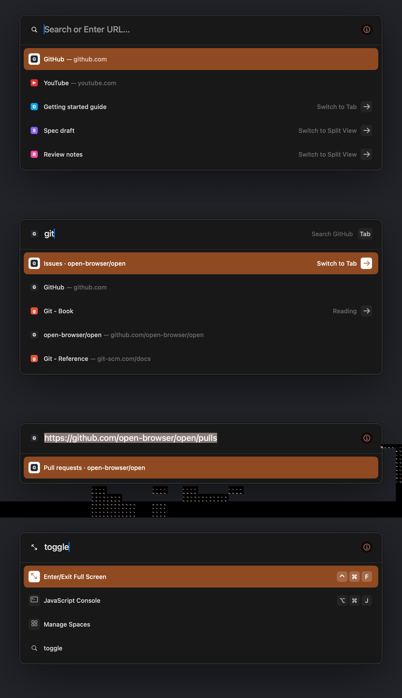
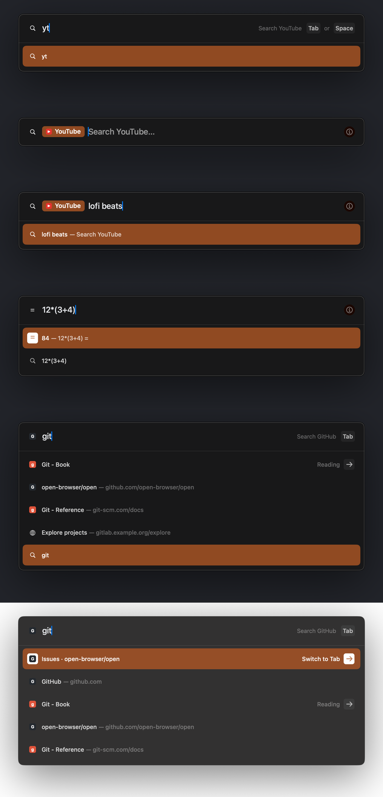
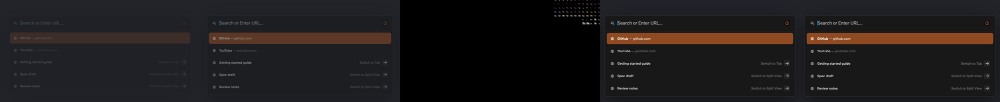

# OpenCommandBar: the command bar UI (M3)

Status: implemented. Package targets in [OpenKit](../Packages/OpenKit/Package.swift): the library `OpenCommandBar`, the tokens file `OpenDesign/CommandBarTokens.swift`, and the dev executable `commandbar-render`.
No third-party dependencies. No unit tests (AGENTS.md rule 6): the bar is checked end to end through its real views, the real `SuggestEngine`, and real AppKit key and mouse events in an offscreen window, and compared pixel by pixel with Arc's captures.

Sources: [interaction-states.md](re/interaction-states.md) §9 (captured command bar), [features-core.md](re/features-core.md) §4 (behavior), [suggest.md](suggest.md) (the engine), [design.md](design.md) (tokens and the comparison method). Frame ids (F0063, A0120) refer to the capture session indexed in `.re/runtime/sessions/index-20261024.json`. Marks: **measured**, **fitted** (chosen to minimize the comparison error), **guess**.





The screens above are our renders of synthetic data (`commandbar-render screens`): empty Cmd+T, typing "git", Cmd+L, actions with keycaps, the "Tab or Space" hint, the Site Search chip (empty and with a query), the calculator, a scrolled list, and the edge style over a white page.

## 1. Modules

| Part | Role |
|---|---|
| `CommandBarController` | Owns the overlay. Sends each text change to `SuggestEngine.query`, applies its snapshots, handles keys and the mouse, and reports choices as `CommandBarIntent`s through `CommandBarDelegate`. No engine code. |
| `CommandBarView` | The overlay: a transparent view the App puts over the whole window content. It holds the shadow and the panel and catches clicks outside the panel. |
| `PanelView`, `MaterialView`, `EdgeView` | The panel: translucent material, input row, separator, result list, edge. |
| `InputRowView` | Leading icon, Site Search chip, text field (own field editor), placeholder, (i) button or Site Search hint. |
| `ResultsView`, `ResultRowView` | Up to 12 rows, 5 visible, one shared selection layer. |
| `Presentation.swift` | `Suggestion` → drawn row (`CommandBarRow`), input (`CommandBarInput`), copy. |
| `FaviconStoreSource` | Synchronous favicon lookups over the `FaviconStore` actor (main-actor cache per origin, async fill). |
| `OpenDesign/CommandBarTokens.swift` | `CommandBarMetrics`, `CommandBarShadow`, `CommandBarMaterial`, `CommandBarRole`, and the provisional `Motion.commandBar*` tokens. |
| `commandbar-render` | Renders, comparison with Arc captures, keyboard and mouse flows, the keystroke bench, `check` for `tools/verify-all.sh`. |

## 2. API

```swift
let bar = CommandBarController(engine: suggestEngine)
bar.delegate = self                       // CommandBarDelegate
bar.favicons = FaviconStoreSource(store: faviconStore)
bar.theme = CommandBarTheme(style: sidebarContext.style(for: space))
bar.backdrop = CommandBarBackdrop(color: pageBackground, image: optionalContentSnapshot, imageScale: 2)
window.contentView?.addSubview(bar.view)  // above the web content and the sidebar, full size
bar.view.frame = window.contentView!.bounds; bar.view.autoresizingMask = [.width, .height]

bar.present(CommandBarRequest(mode: .newTab, profileID:, spaceID:, currentTabID:, currentTabURL:,
                              currentTabTitle:, allowsRemoteSuggestions:, searchEngineID:))
bar.dismiss(reason: .programmatic)
```

Intents (`CommandBarIntent`):

| Intent | When | App action |
|---|---|---|
| `.open(url, destination, modifiers)` | navigate and history rows | Open in a new Today tab (`.newTab`, Cmd+T) or the current tab (`.currentTab`, Cmd+L). |
| `.search(query:url:siteSearchID:destination, modifiers)` | typed search, suggested query, Site Search | Same, with the final search URL. |
| `.switchToTab(id, spaceID:)` | Switch to Tab rows | Switch to `spaceID` first when it is another Space, then select the tab. |
| `.runAction(id:spaceID:)` | action rows | Run the command with this id (`ActionRegistry` ids, docs/commands.md). `spaceID` is the target of "Focus on \<Space\>". |
| `.copy(text)` | calculator row | Copy the answer (and show a toast). |
| `.showHelp` | the (i) button | guess: open command bar tips. |
| `.dismissed(reason)` | Esc, click outside, programmatic | Return focus to the web content. |

`commandBar(_:didChangePresentation:mode:)` reports open and close. With `.newTab` the App sets `SidebarContext.isNewTabCommandBarOpen`, so the sidebar "New Tab" row looks selected during Cmd+T and not during Cmd+L (F0063 vs F0049).

`presentPreview(_:)` shows fixed rows without a query (renders, design review).

## 3. Measured spec

All values are points from the panel's outer top-left corner, at 1x (window 2216×1394). Tokens live in `CommandBarMetrics` and `CommandBarRole`.

### 3.1 Geometry

| Part | Value | Mark, evidence |
|---|---|---|
| Panel width | 766 (x 725…1490) | measured, F0049, F0063 |
| Panel height | 79 + 50 × rows (1 row 129, 4 rows 279, 5 rows 329) | measured, F0055, F0063, F0052. interaction-states §9.1 said 339 for 5 rows; the outer edge is at 856, so 329. |
| Panel with no rows | 64 (input row only) | guess |
| Position | centered in x; top = (H − 339) / 2 (528 at H 1394), same for any row count | measured top 528 in every frame; formula guess beyond one window height |
| Corner | 12 pt, continuous | fitted (edge curve ≈ 18 px, F0063) |
| Input row | 64 tall; separator 1 pt at y 64, full inner width | measured, F0063 |
| Leading icon | `[23, 23, 18, 18]`, glyph ink 12×12 | measured, AX and pixels |
| Text field | x 53, y 20, h 23 (AX); text ink at x 54 | measured |
| (i) button | `[W − 47, 19, 26, 26]`, 24 pt circle | measured |
| Hint group | right edge at W − 22; keycaps 24 tall, radius 5, label ± 4 pt | measured, F0061 |
| Rows | `[8, 69 + 50 i, 750, 50]`; 5 visible, up to 12 held, scrolled | measured, AX |
| Selection | `[2, 2, 746, 46]` in the row, radius 8 continuous | measured, fitted radius |
| Row icon | 16×16 at `[16, 17]`; plate 24×24 at `[12, 13]`, radius 5 | measured |
| Row text | title at x 44, baseline row + 30; subtitle "— …" 4 pt after the title's whole-point width; URL subtitles middle-truncated at 278 pt | measured and fitted |
| Accessory | arrow plate 24×24, 15 pt from the row's right end; label ends 8 pt before it | measured |

### 3.2 Colors and type

| Element | Value | Evidence |
|---|---|---|
| Panel material | `fill = tint · 0.885 + saturate(backdrop, 1.95) · 0.115`, tint #171716 | fitted on 4 backdrops: dark page F0063 (#181819), empty purple Space A0327 (#1D1A1E), olive A0526 (#2A2416), white page A0120 (#323031); RMS 0.37 levels |
| Edge over a dark page | 1 pt black 0.93, then 1 pt white 0.23 inside | measured, F0043–F0063 |
| Edge over light pages, photos, empty Spaces | one opaque #3E3E3E line, no inner ring | measured, A0120, A0121, A0327, A0526 |
| Edge switch point | backdrop luma 47/255 | guess between 36 (dark style) and 58 (light style) |
| Shadow | one Gaussian, σ 48 pt, 24 pt down, black 0.51; not under the panel | fitted on F0063 vs F0064 (RMS 0.007); A0120 shows a uniform fill to the edge |
| Separator | white 0.10 (`CommandBarHairlineDividerColor`) | measured #2F2F30 |
| Selected row | theme `dark.focus` with its alpha over the panel (#B85727 a 0.8075 → #9A4B26); default theme indigo, extended sRGB | measured F0063, A0120 (same alpha over a lighter fill); A0327 |
| Input text | 18 Medium, #E5E7EA; selected text #F2F2F5 | fitted |
| Text selection | theme `dark.subtitle` (#807571 exact) | measured, F0048 |
| Caret | system accent (#007AFF), 1 pt | measured |
| Placeholder | "Search or Enter URL…", 18 Medium, white 0.55 | measured text, fitted color |
| Row title | 13 Medium, white 0.80; white on the selected row | measured |
| Subtitle, "Switch to Tab", Space name, hint label | white 0.33 (`CommandBarTextSecondaryColor`); hint label 12.75 Regular | measured, fitted size |
| Plates (arrow, keycaps, action icons) | white 0.05; arrow white 0.66; selected row: white plate, arrow in the focus color | measured |
| (i) circle | theme `dark.backgroundExtra` (#190700 exact); glyph white 0.57 | measured |
| Favicon on the selected row | on a white 24 pt plate | measured F0061, F0063 |

### 3.3 What a row shows

| Kind | Title — subtitle | Icon | Right side | Evidence |
|---|---|---|---|---|
| navigate | "\<url\> — \<url\>", or "\<page title\> — \<url\>" after a history merge | favicon, else globe | — | F0040 |
| history | "\<title\> — \<url\>" | favicon, else globe | — | F0048 |
| switchToTab | title | favicon | "Switch to Tab", "Switch to Split View", or the tab's Space name + arrow | F0063, A0121, A0327 |
| search, searchSuggestion | the query | magnifier | — | F0052 |
| action | title | SF Symbol on a plate | shortcut keycaps | F0063 (plate); keycaps guess |
| calculator | "84 — 12*(3+4) =" | "=" on a plate | — | guess |
| siteSearch | the query — "Search \<Site\>" | magnifier | — | guess |
| siteSearchHint | not a row: shown as the input's trailing hint | — | — | F0040, F0061 |
| Cmd+L, current page | the page title, no subtitle | favicon | — | F0048 |

The input's leading icon follows the first row: magnifier for searches and an empty field, globe for a typed URL without a favicon, the favicon when known (F0040, F0052, F0061). In Cmd+L it is the page's favicon.

## 4. Behavior

| Input | Result | Evidence |
|---|---|---|
| Cmd+T (`.newTab`) | Empty field, rows for the empty query, row 1 selected | F0063 |
| Cmd+L (`.editCurrentURL`) | Field holds the current URL, fully selected; typing replaces it | F0048 |
| `.searchTabs` | Tab rows only; placeholder "Search Tabs…" | placeholder guess |
| Typing | One query per committed text change. Marked IME text does not query; composition end submits exactly one query. Paste replaces CR/LF with spaces and caps visible input at 2,048 characters before querying that same text. | implementation; flows 36–44, 64–65 |
| Later snapshots | Before the user moves the selection it stays on row 1, so it changes only when the top hit changes. After a move it stays on the same suggestion id. | features-core §4.3 rule 8 (guess there); our rule |
| Up / Down | Move the selection; stop at the ends; the list scrolls by whole rows | menus-and-hotkeys "normal list rules" (guess) |
| Return | Acts on what is highlighted on screen at the key press (what you see is what you get). Only if NO snapshot exists yet for the current text does Return wait for that text's first snapshot, then open its top row. It never waits for history or remote providers. An empty first snapshot consumes the pending Return without opening anything. | lead rule; flows 30, 52–57; F0041 shows selection |
| Esc | Closes with `.dismissed(.escape)`, typed text or not. A second Esc is not the bar's (it reaches the App's Exit command). | F0052 → F0053; docs/commands.md |
| Tab | With a hint: enters Site Search; the trigger word becomes the chip. Without: normal AppKit focus traversal; Shift+Tab also traverses normally. | features-core §4.6 rule 15 (hint); accessibility rule, flow 50 |
| Space | After a site's exact name or keyword ("yt", "youtube"): enters Site Search; the hint then reads "Tab or Space". A prefix ("you") stays text. | F0040 shows "or Space"; exact-match rule guess |
| Backspace on an empty scoped query | Leaves Site Search | features-core §4.6 rule 16 |
| Pointer move over a row | Selects it (real moves only; rows sliding under a still pointer do not) | features-core §4.7 rule 17 (guess) |
| Click a row / outside / (i) | Choose / close (`.clickOutside`) / `.showHelp` | outside click guess |
| Cmd+I | Show command bar help while the input is focused; Tab is available for Site Search or normal focus traversal. | implementation; flow 49 |
| Cmd / Shift / Option + Return | Reported in the intent's `modifiers`; no other behavior | Arc names `CommandBarSelectionOptions`, but no capture or string proves the keys |

During IME composition, Return, Tab, Esc, Space, and arrows go to the input method. Return commits composition without choosing a result. Each present and dismiss unmarks composition and clears the field editor's own undo stack. Presentation before window attachment focuses the input when its view gets a window.

Rows expose AX buttons with the title as their label, subtitle and accessory as their value, and a press action. Selection changes post `selectedChildrenChanged` and an announcement with the row label. The field's native placeholder matches the drawn placeholder. The (i) control is a labeled AX button and Cmd+I opens its help.

The field editor has spelling, grammar, completion, substitutions, and data detection off: URLs must not be "corrected", and each check costs work per keystroke.

## 5. Motion (provisional)

No capture holds a mid-animation frame of the bar: the AX frames during open and close (F0060, F0064) show a collapsed layout, not a scale. Arc's toasts and theme editor scale up (F0144, A0465), so the bar likely does too (guess).

| Token | Value |
|---|---|
| `Motion.commandBarOpen` | fade in (0.13 s ease-out) and scale 0.96 → 1, spring response 0.22 s, damping 0.9 |
| `Motion.commandBarClose` | fade out and scale → 0.98, 0.12 s ease-in |
| Selection change | none (it jumps) |



## 6. Performance

`commandbar-render bench`: the field editor inserts one character at a time for 30 typical queries (words, two words, hosts, URLs, arithmetic, actions); the controller queries the real engine over a 5,000-tab model and a 100k-URL history; the first snapshot is applied; AppKit lays out, draws, and commits. 2x, release build, Apple M5 Pro, 3 runs × 436 keystrokes while a Chromium build ran (load average 8–9 on 18 cores), so these are upper bounds.

| Measure | Result | Budget |
|---|---|---|
| Keystroke → rows drawn, main-thread CPU | p50 1.58–1.77 ms, p95 2.60–3.30 ms | 8 ms |
| Keystroke → rows drawn, wall | p50 1.74–1.90 ms, p95 4.25–4.84 ms, max 9.5 ms | 8 ms |
| Parts (CPU p50): text change + engine query / snapshot apply / layout + draw + commit | 0.59–0.62 / 0.60–0.64 / 0.44–0.50 ms | |
| Rows redrawn per keystroke | 1.8 (unchanged rows are not redrawn) | |
| History snapshot merge, main thread (off the keystroke path) | p50 0.65–0.72 ms, p95 1.4–1.9 ms | |

Profiling (`sample`) found three costs, now fixed: a forced panel layout on every snapshot (CPU p50 3.4 → 2.2 ms); SF Symbols redrawn as vectors on every row draw (now one bitmap per symbol, color, and scale); and AppKit text checking running per keystroke in the field editor (now off). Under heavier load (load average 18–23) earlier builds reached wall p95 10 ms while CPU stayed under 6 ms: wall time on this machine depends on the build running next to it.

## 7. `commandbar-render`

```text
commandbar-render render (--state NAME | --scene FILE.json) --out FILE.png [--scale 1|2] [--size WxH] [--backdrop-color #RRGGBB]
    states: empty, typing-git, cmd-l, space-hint, site-chip, site-search, calculator, actions, scrolled
commandbar-render compare --arc CAPTURE.png --ours RENDER.png --scene FILE.json --out DIR [--title TEXT]
commandbar-render ax [--state NAME] # dump the rendered overlay AX tree
commandbar-render flows       # keyboard and mouse flows
commandbar-render check       # flows + a render of every state + the keystroke budget (tools/verify-all.sh)
commandbar-render bench [--tabs 5000] [--history 100000] [--scale 2]
commandbar-render screens --out DIR [--scale 2]
commandbar-render motion --out DIR
```

States run through the real engine over a synthetic world (neutral titles, public site names, our own theme colors and letter icons). A scene file instead gives fixed rows, a theme JSON, and a backdrop PNG, to match one Arc capture. Scene files that copy a capture's titles hold personal data, so they stay in `.re/` (git-ignored).

Rendering uses the method of design.md §6 (a deep copy of the layer tree rendered by `CARenderer`). The harness window is never on screen, so AppKit can mark its backing stores purgeable; under memory pressure a store can be dropped before the snapshot. The renderer redraws every view right before each snapshot, checks the page corner and the panel fill, and retries.

## 8. Comparison with Arc

Method (design.md §7): both PNGs in sRGB (the captures converted through their embedded display profile); ink boxes against a plane fitted to a 1 px ring give position errors; text and glyph cores, fill samples, and single pixels give CIEDE2000. Arc's caret (system blue) is removed before measuring. The backdrop under our panel is the capture taken without the bar where one exists (F0045 for F0048, F0053 for F0052/F0055, F0059 for F0058, F0064 for F0061/F0063, F0098 window 2 for A0327) and a flat page color otherwise (A0120). Favicons are replaced by a neutral square and masked. Titles are compared numerically but blanked in the side-by-side images. This file names elements only.

Targets: position ≤ 1 pt, ΔE00 ≤ 2.

### 8.1 Per capture

| Capture | State | Elements | Worst position (pt) | Mean position (pt) | Worst ΔE00 | Mean ΔE00 |
|---|---|---|---|---|---|---|
| F0063 | Cmd+T, empty, 4 rows, theme | 33 | 1.0 | 0.08 | 1.83 | 0.33 |
| F0048 | Cmd+L, URL selected, 5 rows | 30 | 2.0 | 0.35 | 1.93 | 0.36 |
| F0061 | typing a host, "Search Google [Tab]" | 33 | 1.0 | 0.15 | 1.93 | 0.36 |
| F0052 | typing, 5 search rows | 27 | 1.0 | 0.05 | 1.73 | 0.35 |
| F0058 | typing, 5 search rows | 27 | 1.0 | 0.10 | 1.73 | 0.35 |
| F0055 | typing, 1 row | 19 | 1.0 | 0.17 | 1.73 | 0.44 |
| A0327 | Space without a theme, Space-name accessory | 37 | 1.0 | 0.10 | 1.67 | 0.42 |
| A0120 | white page (light edge style), split row | 37 | 6.0 | 0.27 | 2.47 | 0.55 |

### 8.2 Per element (F0063)

| Element | Position error (pt) | ΔE00 |
|---|---|---|
| Shadow left / right / top / bottom (4, 4, 3, 4 points) | — | 0.37 / 0.32 / 0.31 / 0.44 |
| Panel edge top / bottom / left / right | 0.0 / 0.0 / 0.0 / 0.0 | — |
| Panel outer line, pixel by pixel (18) | — | 0.40 |
| Panel inner line, pixel by pixel (18) | — | 0.02 |
| Panel fill (5 points) | — | 0.00 |
| Separator | 0.0 | 0.29 |
| Input leading icon (magnifier) | 0.0 | 0.91 |
| Input placeholder | 1.0 | 0.18 |
| (i) circle / glyph | 0.0 / 1.0 | 0.51 / 0.81 |
| Row 1 selection | 0.0 | 0.41 |
| Row 1 favicon plate | 0.0 | 0.00 |
| Row 1–4 titles | 0.0 | 0.05–0.17 |
| Row 1 arrow plate (selected) / arrow | 0.0 / 0.0 | 0.00 / 1.83 |
| Rows 2–3 arrow plates / arrows | 0.0 / 0.0 | 0.00 / 1.01–1.07 |
| Rows 1–3 "Switch to Tab" | 0.0 | 0.02–0.08 |
| Row 4 action plate / symbol | 0.0 / 0.0 | 0.00 / 0.24 |

Other states: text selection fill 0.00 (F0048); selected input text 1.0 pt / 0.65; history subtitles 0.0–1.0 pt / ≤ 0.09; hint label 1.0 / 0.30 (F0061); globe 1.0 / 1.85–1.93; Space-name label 1.0 / 0.66 (A0327); default-theme selected arrow 0.0 / 1.67.

### 8.3 What still differs, and why

| Difference | Size | Why |
|---|---|---|
| Text selection box (F0048) | 2 pt at its right end | AppKit's field editor highlights from the text origin to the line's end; Arc's starts 1 px earlier and ends 2 px earlier. The text itself matches (0 pt). |
| Split View row (A0120 row 3) | title 6 pt left | Arc draws one row per Split with a wider plate holding both pane icons. `OpenSuggest` returns one row per pane; we show the pane's favicon and "Switch to Split View". Needs a split row from the engine. |
| Shadow below the panel over a white page (A0120) | ΔE 2.47 | No clean frame of that page without the bar exists; the page is not uniform (pink at the sides, blue-gray below) and we use one flat color. |
| Glyph ink boxes | ≤ 1 pt | SF Symbols are not Arc's art. Sizes are fitted on macOS 27.2 (26B5112a); symbol metrics changed once during this work, so re-fit after OS updates (`compare` shows it at once). |
| Light macOS appearance, Little Open, the search-suggestion privacy notice, inline autocomplete | not built or not compared | No capture (interaction-states §19). Arc has `CommandBarAutocompleteSuggestion`; nothing shows its look. |

## 9. Flows (`commandbar-render flows`)

Real key events go through the window and the bar's field editor; mouse events go to the hit-tested views; the engine is the real `SuggestEngine` over the synthetic world. 68/68 pass, including 33 review regression checks. `check` adds a render of every state at 2x and the keystroke budget: 78/78.

| # | Flow |
|---|---|
| 1 | Cmd+T reports presentation (sidebar New Tab highlight) |
| 2 | "git" + Return → the top hit's intent |
| 3 | Return closes the bar |
| 4–5 | Down ×2 selects row 3; Return → row 3's intent |
| 6 | Up at row 1 stays; Down stops at the last row |
| 7–8 | Cmd+L prefills the current URL, fully selected; row 1 is the current page (title, no subtitle) |
| 9 | Cmd+L does not report a New Tab presentation |
| 10 | Typing replaces the selected URL |
| 11–12 | Esc closes with `.dismissed(.escape)`; a second Esc reaches nothing in the bar |
| 13 | Cmd+L + Return → open the URL in the current tab |
| 14–15 | "youtu" shows "Search YouTube [Tab]"; "youtube" also offers Space |
| 16–17 | Tab enters Site Search (chip, empty query); Return searches YouTube |
| 18 | Backspace on an empty Site Search exits the scope |
| 19–21 | "yt" shows Tab or Space; "yt" + Space enters Site Search; "you" + Space stays text |
| 22 | Calculator + Return → copy 84 |
| 23–24 | "toggle sid" shows the sidebar action with keycaps ⌘ S; Return → run `toggle-sidebar` |
| 25–26 | "sprint" → Switch to Tab row; Return → switch to that tab in its Space |
| 27 | A tab in another Space shows the Space name |
| 28–29 | Without a move the selection follows the top hit; after a move a later snapshot keeps the chosen row (a 200 ms local stub stands in for the search engine) |
| 30 | Return right after typing waits for that query |
| 31–34 | Hover selects row 3; click row 3 → its intent; click outside → `.clickOutside`; click (i) → `.showHelp` |
| 35 | Empty Cmd+T: row 1 selected, Return acts on it |
| 36–44 | Japanese IME composition: zero queries while marked, one on unmark/commit; Return only commits; Tab/Esc/Space/arrows stay with the input method |
| 45–51 | Rendered AX tree: button labels, values, selection, press action, native placeholder, help through AX/Cmd+I, Tab traversal, shortcut values |
| 52–55 | Pending Return is cleared by a new query, present, dismiss/reopen, or an empty first snapshot |
| 56–57 | Return opens the visible highlighted row while providers are pending, or the top row of the current text's first snapshot |
| 58–59 | Boundary arrows preserve selection; Up at row zero does not set `userMovedSelection` |
| 60–61 | Real favicon SQLite store: all same-origin waiters and rows update; FIFO miss eviction permits retry |
| 62–63 | Preview rows without backing suggestions return nil safely, including Return |
| 64–65 | Multiline Unicode paste is capped at 2,048 characters; further typing preserves visible/query equality |
| 66–67 | Dismiss/reopen and present while open clear composition and undo |
| 68 | Present before attachment focuses the field, selects Cmd+L's URL, and accepts replacement typing |

### 9.1 Review findings

| Finding | Fix | Flow result |
|---|---|---|
| 1. IME composition | Guard queries and command handling while marked; batch composition edits and submit once on commit. | PASS, 36–44 |
| 2. Accessibility | AX row buttons with label/value/press, selection notifications and label announcements, native placeholder, labeled help with Cmd+I, normal Tab traversal without a hint. | PASS, 45–51; `commandbar-render ax` dumps the rendered tree |
| 3. Pending Return lifetime | Clear on query/present/dismiss; bind to generation and text; consume only a current-text row or discard an empty first snapshot. | PASS, 52–55 |
| 4. Return lead rule | Use the visible highlight immediately; defer only until the current text's first snapshot, never provider completion. | PASS, 30, 56–57 |
| 5. Boundary arrows | Set `userMovedSelection` only when the index changes. | PASS, 58–59 |
| 6. Favicons | Keep every waiter per origin; notify all with their own page URL; bound misses and images with one FIFO. | PASS, 60–61 |
| 7. Selected suggestion | Check `suggestions.indices.contains` before indexing. | PASS, 62–63 |
| 8. Paste and long input | Normalize CR/LF and cap at 2,048 characters in the editor's should-change path; query exactly the visible text. | PASS, 64–65 |
| 9. Undo | Use a private editor undo manager; unmark and clear it on present/dismiss. | PASS, 66–67 |
| 10. Delayed focus | Focus the field in `viewDidMoveToWindow` while presented, preserving Cmd+L selection. | PASS, 68 |

The eight Arc comparisons in §8 were rerun after these fixes. All eight generated element tables match the saved pre-fix tables exactly. The §8 comparison tables remain unchanged, including the existing differences in §8.3. No visual tokens or committed screenshots changed.

## 10. What the App and the engine must provide

App (window and wiring):

1. Add `bar.view` over the window content, full size, above the web view and the sidebar; present on Cmd+T / Cmd+L / new window, and close on Cmd+L when open (`toggleOpenOmnibox:`). Fill `CommandBarRequest` from the window: Profile, Space, current tab id, URL, title, the search engine, and "Include search engine suggestions".
2. Set `bar.theme` from the focused Space (`CommandBarTheme(style:)`) on every Space switch.
3. Set `bar.backdrop` before `present`: the page's dominant or background color (the engine can report it), and optionally a snapshot of the web content for the blur. Without it the bar assumes a dark page (#22242A).
4. Give `bar.favicons = FaviconStoreSource(store:)`, and `insert(_:for:)` icons the engine delivers.
5. Handle every `CommandBarIntent` (§2). Route `.runAction` ids through `CommandDispatcher` (docs/commands.md: the registry feeds `ActionRegistry`, so ids match). Show a toast for `.copy`.
6. On `didChangePresentation`, set `SidebarContext.isNewTabCommandBarOpen` for `.newTab`. On `.dismissed` and after an intent, give focus back to the web content.
7. Keep Esc for the App's Exit command once the bar is closed (the bar consumes only its own Esc).

Engine (`OpenSuggest`) gaps seen against Arc:

1. Empty Cmd+T: Arc lists open tabs ("Switch to Tab") and the help action first (F0063, A0327); `OpenSuggest` ranks top history first.
2. Split View: Arc shows one row per Split with both panes; `OpenSuggest` returns one row per pane.
3. Inline autocomplete (`CommandBarAutocompleteSuggestion`): not provided.
4. The one-time search-suggestion privacy notice (features-core §4.5 rule 13): not built.

## 11. Open questions

1. What do Cmd, Shift, and Option + Return do? (Reported as modifiers only.)
2. Is the edge style chosen by the page's color scheme or by backdrop luminance? (We use luminance.)
3. Does the panel turn light in light macOS appearance? (Not captured; we keep it dark.)
4. Open and close timing (needs a 60 fps recording).
5. The Site Search chip's look and the scoped placeholder text (no capture of the scoped state).
