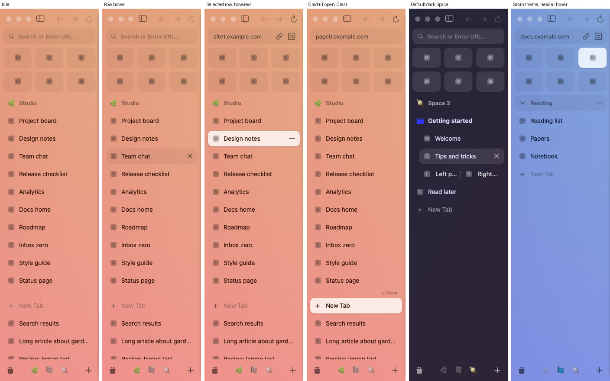
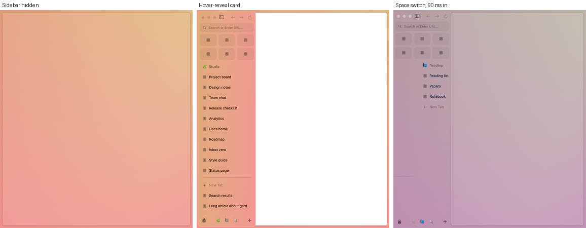
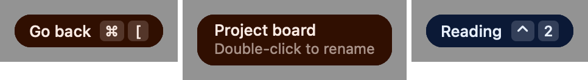

# Open design system and sidebar (M2)

Status: implemented. Package: [OpenKit](../Packages/OpenKit/Package.swift), targets `OpenDesign`, `OpenSidebar`, and the dev executable `sidebar-render`.
No third-party dependencies. No unit tests (AGENTS.md rule 6): the sidebar is checked end to end through real views in an offscreen window, and compared pixel by pixel with Arc's captures.

Sources of the measured values: [runtime-observations.md](re/runtime-observations.md) (idle window), [interaction-states.md](re/interaction-states.md) (states, motion), [design-tokens.md](re/design-tokens.md) (asset catalog tokens). Frame IDs (F0013, A0222) refer to the capture session indexed in `.re/runtime/sessions/index-20261024.json`. This file adds the values that the comparison loop fitted. Every fitted value names its evidence. Marks: **measured**, **fitted** (chosen to minimize the comparison error), **guess**.

## 1. Modules

| Target | Role |
|---|---|
| `OpenDesign` | Tokens (colors, metrics, type, motion), Space theme parsing and rendering (`SpaceThemeStyle`, `ThemeField`, `ThemeBackgroundView`), our own grain, the web panel chrome layer, the icon map. AppKit only. |
| `OpenSidebar` | The sidebar column: toolbar row, URL field, favorites grid, Space pager with header and tab list, bottom bar, menus, tooltips, drag and drop. Bound to `OpenModel`. Reports every action as a `SidebarIntent`. |
| `sidebar-render` | Dev tool: offscreen PNG renders with forced states, comparison with Arc captures, end-to-end checks, a 1,000-row bench, a synthetic snapshot. |

## 2. Tokens (`OpenDesign`)

### 2.1 Colors

Every catalog color from `design-tokens.md` §1 is a `DesignColor` (light and dark `RGBA`, color space kept per token): `Core`, `SidebarColors`, `CommandBarColors`, `GrayScale.gray` / `.grayA` / `.indigo`, `MenuColors`. `BrandBlue` is `Core.brandBlue` (Display P3 `#3139FB`).

"Light" and "dark" follow the content appearance of the Space, not the macOS setting (§3.4). The sidebar paints through role tokens in `SidebarRole`. Each role points to a catalog token where one fits within ΔE 2, else to a fitted value.

| Role | Light | Dark | Evidence |
|---|---|---|---|
| Tab title | theme `light.title` | theme `dark.title`; default theme `#DDDEFF` | F0001 core pixels equal the stored `#320E00`; F0079 core `#D9DAFA` corrected for anti-aliasing |
| Split-row titles | theme title | default theme white 0.80 (`ForegroundPrimary`) | F0079 |
| Space title | black 0.45 `SidebarForegroundDarker` | white 0.55 (fitted) | F0001 ΔE 0.40 (0.48 / `GrayA10` gave 1.8); F0079 |
| "New Tab" label | black 0.30 `SidebarForeground` | white 0.45 | F0001, F0079 |
| URL placeholder | black 0.30 `SidebarForeground` | white 0.30 (fitted) | F0001, F0079 |
| URL host (page loaded) | black 0.60 `CommandBarPlaceholderText` | same token | F0015 ΔE 0.35 |
| "New Tab" plus | black 0.48 `GrayA10` | white 0.51 (fitted) | F0001, F0079 |
| Magnifier | black 0.40 (fitted) | guess | F0001 core black ≈ 0.38 |
| Toolbar glyph, enabled (and the sidebar toggle always) | black 0.56 `GrayA11` | `GrayA11` | F0001 toggle core ≈ 0.56; Arc's AX says the toggle is disabled, but it draws enabled |
| Toolbar glyph, disabled; every chrome glyph in an inactive window | black 0.22 `GrayA8` | `GrayA8` | F0001 back/forward; inactive capture `arc-window-5245.png` |
| Bottom plus | `GrayA11`; inactive 0.30 | white 0.62 (fitted) | F0001, F0079, inactive capture |
| Home (our glyph) | black 0.52; inactive 0.26 (fitted for our shape) | white 0.59; inactive 0.30 (session 2 peaks, so lower bounds; was a guess) | F0001, inactive capture; session 2 03/0001, 0016 (`re/interaction-states.md` §20.1) |
| URL field and tile fill | `SidebarItemBackground` (`#0E0F10` 0.05 P3) | `#FAFBFF` 0.10 | ΔE ≤ 0.61 on 7 elements |
| URL field under the pointer | `SidebarItemHoveredBackground` (`#0E0F10` 0.10 P3) | `#FAFBFF` 0.15 | F0033 vs F0032 (§16) |
| Hover-reveal card stroke | `SidebarBorderColor` white 0.30 | same | F0129 `#696875` over `#272739` (§16) |
| Row hover, header hover, New Tab hover | `SidebarItemBackground` | same | F0013 ΔE 0.45, F0031 0.49, F0079 0.81 |
| Button hover plate | black 0.07 `GrayA4` | `GrayA4` | F0024 ΔE 0.38, F0027 0.72 |
| Selected row, selected tile, "New Tab" during Cmd+T | theme `light.background`, opaque | white 0.20 `TabCellBackgroundCurrent` | F0015 ΔE 1.05, F0016 1.15, F0063 2.00, F0066 2.03. Session 2 (default dark theme): row 0.19 (03/0001); **change pending:** a selected Favorite tile is white ≈ 0.44 (07/0140), not 0.20; in an inactive window the row drops to 0.10 and the tile to 0.24 with a 2 px white ≈ 0.36 ring (03/0016, 07/0163). Default theme in macOS Light: row `#F4F3F5` (20/0015). `re/interaction-states.md` §20.3, §20.11 |
| Selected shadow | black 0.20 `TabCellShadowSelected`, radius 1.5, 1 pt down | none (the dark token is clear) | F0014 edge profile |
| Pinned/Today divider | black 0.15 `SidebarSeparator` | white 0.15 | F0066 ΔE 0.33 |
| "Clear" | `SidebarForeground`; `SidebarForegroundDarker` on hover | same tokens | F0041 |
| Row close and unload glyphs | black 0.56 `GrayA11` | `GrayA11` | F0013 ΔE 1.39, F0015 1.23 |
| Switcher, other Spaces | emoji in grayscale (Rec. 709 luma) at opacity 0.55 | same | F0001 two-channel fit gives 0.48 at full coverage; 0.55 matches the darkest pixels at 12 pt |
| Tooltip | fill theme `light.title`; text theme `light.background` (guess); keycaps text at 18 % (guess) | same | F0021–F0033 fill exact |
| Split cells in a selected split row | black 0.07 `TabCellChildBackground` (guess: no light capture) | white 0.07 | F0081 ΔE 1.34 / 1.39 |
| Peek badge plate | `TabCellChildBackground` | same | F0090 ΔE 0.76 (F0101 white ≈ 0.075) |
| Source row while its Peek shows | `SidebarItemBackground` (black 0.05; guess) | white 0.10 | F0090 ΔE 0.09 |
| Toolbar row / bottom bar under a Peek | opacity 0.43 / 0.52 (fitted) | same | F0090 glyphs ΔE ≤ 1.98 |

### 2.2 Metrics (`Metrics.swift`)

All values are points at sidebar width 228, top-left origin. Widths that scale use `W` (sidebar width).

| Area | Value | Mark |
|---|---|---|
| Traffic lights | 16 pt buttons `[12/35/58, 16, 16, 16]`; the system draws 12 pt circles centered in them, at x 20 / 43 / 66, y 24. On the hover-reveal card 5 pt further right and down; hidden while the sidebar is hidden | measured (AX F0001, F0129, F0131; F0001 pixels) |
| Toolbar buttons | 32×32 at y 7; toggle x 77; back / forward / reload at x `W − 106 / W − 72 / W − 38` (pitch 34, reload 6 pt from the edge); hover plate = button frame, radius 6 | measured |
| URL field | `[8, 46, W − 16, 36]`, radius 10 continuous; magnifier `[14, 52, 24, 24]`; placeholder origin x 42, baseline y 69; host origin x 21; copy and Site Control `[W − 70 / W − 42, 49, 30, 30]`; hover darkens the fill, same frame | measured, text origin fitted |
| Favorites | inset 8, gaps 8, tile height 47, radius 10; columns = balanced rows of at most 4 (1, 2, 3, 4 → one row; 5 and 6 → 3 columns, the short row left-aligned); no favorites: an 8 pt section | measured for 1–6 (session 2 07/0043–0139, F0016); 7 and more guess. **Change pending:** with no Favorites Arc shows the dashed "Drag to add Favorites" card (105 pt section at width 228) until it is dismissed; our 8 pt section is fitted to the window-only sidebar (§16) and stays only for the dismissed state (guess) (`re/interaction-states.md` §20.3) |
| Space header | 36 pt band; icon frame `[13, 5, 26, 26]`; title origin x 44, baseline 23; hover fill `[8, 0, W − 16, 36]`, chevron in place of the icon, "…" at the right. Without favorites the band starts at y 90, 8 pt below the URL field | measured, text origin fitted |
| Tab list | 3 pt spacer row, then 41 pt rows; favicon `[17, y + 11, 18, 18]` (16 ink); title origin x 44, baseline y + 25; fill `[8 + indent, y + 2, W − 16 − indent, 36]`, radius 10 continuous | measured, baseline fitted (ink bottom at y + 24) |
| Close / unload | `[W − 39, y + 7, 26, 26]`; the title then ends at its left edge | measured |
| Folders | 16 pt indent per level; folder title 14 Semibold | measured |
| Split row | cells of `(W − 16 − indent − 4) / n`; icon at cell + 0, title at cell + 28, divider 10 pt left of the next cell | measured at depth 1 (icons x 33 / 129) |
| Selected split row | card = the selected fill; pane cells `[12 + indent + i·pitch, y + 6, pitch − 4, 28]`, radius 8; no divider | measured F0081 (`[12, y+6, 100, 28]`, `[116, y+6, 100, 28]`) |
| Peek badge | plate `[W − 38, y + 8, 24, 24]`, radius 6; favicon 16 pt ink centered; title ends at `W − 39` | measured F0090, F0101 |
| "/" mark | 2 × 14.5 pt stroke, 0.14 rad, centered 3 pt left of the title origin at y + 19.5; title + 2 pt | measured F0090, F0101 |
| Row title truncation | 1 pt kept free at the right (2 pt with the inset) | fitted: F0001, F0081, F0090 truncation points |
| Divider row | 17 pt; 1 pt line at y + 7 from x 18 to W − 18; with "Clear" the line ends at W − 66, arrow `[W − 58, y + 3, 12, 9]`, label x W − 46 | measured |
| Bottom bar | 50 pt; Home `[8, 9, 32, 32]`; plus `[W − 40, 9, 32, 32]`; switcher items 36×34 at pitch 34, centered in `[42, 0, W − 84, 50]`; plate = item inset 1 | measured |
| Web panel | `[W, 10, winW − W − 10, winH − 20]`, radius 6, shadow black 0.25 radius 3 offset 1; hidden sidebar `[10, 10, winW − 20, winH − 20]` | measured |
| Hover-reveal card | `[5, 5, W, H − 10]`, radius 12 circular; 1 pt stroke `SidebarBorderColor` (white 0.30) on the outermost pixels inside the card; shadow black 0.17, σ 4 pt, no offset | measured (F0129, F0130); corner and shadow fitted (§16) |
| Hover-reveal zones | dwell 0.15 s (outer edge 0.16 s) in: the left edge (x 0…6, held −20…15), the strip left of the window (50 pt, held 250), the top-left corner (40 pt wide, −15…20), the traffic-light region (to y 50); the card stays while the pointer is on it or in a zone and hides 0.15 s after it leaves | decoded (§16); zone unit 10 and exit delay guess |
| Sidebar width | default 228 (a double-click on the resize edge resets to it); minimum 164; maximum 500; dragging past the minimum slides the sidebar out while the button is still down, and Cmd+S then restores the width from before the drag; at 207 and below the toolbar keeps only Back, Forward, and "More options" (28 × 28 at y 9) | measured (session 2 06/0009–0088, `re/interaction-states.md` §20.1). **Value change:** minimum was a 180 guess; the drag-to-hide point is past 164 (≈ pointer x 65–85, notes only) |

### 2.3 Typography

System font (SF Pro) only. We ship no fonts.

| Element | Size and weight | Evidence |
|---|---|---|
| Tab title, "New Tab" | 14 Regular | NCC 0.992–0.994 |
| Folder title | 14 Semibold | F0079 ink width |
| Space title | 13 Semibold | NCC 0.994 |
| URL placeholder | 13 Medium | NCC 0.991 |
| URL host (page loaded) | 13 Regular | F0015: ink width 59 vs 61 for Medium |
| "Clear" | 11 Semibold | F0041 ink 27×8 |
| Tooltip | 13 Medium; second line 12 Regular | AX frames; weight guess |
| Header emoji | 14 pt, 1 pt above center | NCC 0.988 (F0001) |
| Switcher emoji | 12 pt, 1 pt above center | NCC 0.983 (F0001) |
| Command bar input / rows | 18 Medium / 13 Medium | interaction-states §9 |

Labels draw with Core Text at an exact baseline (`TextLabel`). The text origin sits 1 pt inside Arc's AX text frame for rows, "New Tab", and the placeholder, and 3 pt inside for the Space title. This puts every measured ink box on Arc's pixels (0 pt error on 11 row titles).

### 2.4 Motion (provisional)

Arc keeps its springs in compiled code. The capture has about 0.47 s between frames, so only progress points exist. All animations use these tokens, so a better capture changes one place.

Capture session 2 measured Arc's motion in a screen video (`re/interaction-states.md` §20.12; PR #104 records the same video in §13.1 there and edits the rows below, so they are not changed here). **Values that change:** Space switch slide: a critically damped spring with response **0.20 s** (not 0.30), settled ≈ 0.27 s; folder expand ≈ 0.20 s (ease-out) and collapse ≈ 0.25 s (close to our 0.22 s); command bar open and close: **no animation**; Cmd+S hide and show ≈ 0.10 s (spring response ≈ 0.1 s, damping 0.9–1.0), the show starting ≈ 0.29 s after the key; hover-reveal card in: spring response ≈ 0.16–0.18 s, damping ≈ 0.8–0.86 (3 pt overshoot), out ≈ 0.10 s ease-in-out; copy toast in ≈ 0.20 s, shown ≈ 4.95 s, out ≈ 0.16 s; theme popover in ≈ 0.20 s, out ≈ 0.19 s. Not measured: the tooltip delay, the hover and selection fades, the swipe snap, the theme cross-fade (both test Spaces had the same theme), Peek.

| Token | Value | Evidence |
|---|---|---|
| Space switch slide | spring, response 0.30 s, critically damped | fitted with the cross-fade to both progress pairs |
| Space theme cross-fade | linear, 0.21 s | model gives slide 0.645 / fade 0.50 and 0.855 / 0.78; measured 0.65 / 0.53 (A0222) and 0.88 / 0.77 (A0227) |
| Swipe snap | spring, response 0.26 s, damping 0.92 | guess |
| Hover fade / selection fade | 0.08 s / 0.12 s | guess |
| Row insert, remove, folder expand | 0.22 s, AppKit outline slide | measured "< 0.5 s" |
| Tooltip fade | 0.12 s, delay 0.6 s | guess; fade-out seen (F0026) |
| Hover-reveal card slide | spring, response 0.30 s, critically damped (`Motion.sidebarToggle`); transform of the card layer, its shadow, and the traffic lights only | guess: A0439 and A0440 are 1 s apart |
| Hover-reveal dwell, exit | 0.15 s, 0.15 s | dwell decoded (§16); exit guess |

## 3. Space themes

### 3.1 Input

`SpaceThemeStyle(theme:system:)` reads `SpaceTheme.importedArcThemeJSON`, the raw Arc `windowTheme` (schema in runtime-observations §3.3). It supports `blendedGradient` (2 base colors and 2 overlay colors) and `blendedSingleColor`. It reads `noiseFactor`, `intensityFactor`, `translucencyStyle`, `contentOverBackgroundAppearance`, `isVibrant`, both semantic palettes, and `primaryColorPalette.shaded` (accent). Without JSON it uses the mapped gradient stops. Without either it uses the default theme (§3.5). Parsed styles are cached by value.

### 3.2 Rendering model (`ThemeField`)

The field is computed on the CPU into a 64×64 float image (extended sRGB) and stretched over the window by the GPU. It is rebuilt only when the theme, the active state, or the window aspect ratio changes. The steps:

1. Two linear gradients in window uv space: base (angle 111°, length × 1.015, center offset 0.021) and overlay (angle 146.3°, length × 0.332). Each gradient parameter is computed at the 4 window corners, clamped to 0…1, and interpolated over the 2 triangles of the window quad (bottom-left to top-right diagonal), like a per-vertex varying.
2. Colors mix in OKLab. The base parameter is scaled by 4/3, so the base reaches its end color at 75 % of its line. An overlay whose first stop is clear fades in the second stop's own color, not black.
3. The overlay composites over the base in linear light. The result is encoded to sRGB with a sign-preserving transfer, so extended components stay valid.
4. The result is drawn at alpha 0.64 over a neutral underlay: gray 0.694 when the window is active, 0.83 when inactive (`translucencyStyle: light`).

Evidence for the structure: Arc's theme shader library (`ARC_WindowThemeUI`, `default.metallib`) has entry points `gradientVertex`, `gradientFragment`, `overlayVertex`, `overlayFragment`, `renderVertex`, `renderFragment`. The vertex stage uses `dot`, `clamp`, and `sqrt` (the per-vertex projection). The fragment stage holds the published OKLab constants: the LMS to linear sRGB matrix (4.0767417, −3.3077116, 0.2309699, −1.2684380, 2.6097574, −0.3413194, −0.7034186, 1.7076147) and the inverse cube matrix (0.3963378, 0.2158038, −0.1055613, −0.0894842, −1.2914855). It also holds the sRGB exponent 1/2.4 with `sign`, and `pow`. The angles, scales, alpha, and underlay grays are our fits to the captures. Our code is our own implementation of these facts. No shader code was copied.

### 3.3 Why Arc's window looks lighter than the stored colors

The stored stops are saturated (`#FF8558`, `#F0E941`, `#FF5598` in Space 1). On screen the top-left reads `#F2A686`, about 27 % lighter. Two things cause this (fitted, RMS 1.3–1.6 / 255 on two Spaces):

- The gradient layer draws at about 64 % opacity (`intensityFactor` 0.8 on both fitted Spaces).
- Under it lies a light, neutral material (`translucencyStyle: light`, `isVibrant: true`). It reads gray 0.694 while the window is active and 0.83 while inactive. On a real active window this material is vibrancy over the desktop, so the true underlay varies with the wallpaper. We use the fitted constant. The App can swap in an `NSVisualEffectView` later if a vibrant capture shows a difference.

### 3.4 Text appearance

`contentOverBackgroundAppearance` picks the semantic palette ("light" content uses `light.title` and dark text), not the macOS appearance. Each Space page sets its own `NSAppearance` from it, so every token in that page resolves against the right side. A Space without a theme follows the macOS appearance. Measured: macOS was Dark, yet Space 1 drew `light.title` (runtime-observations §3.3).

### 3.5 Default theme

Spaces without a stored theme draw measured corner colors: dark TL `#252538`, TR `#322438`, BL `#2C2437`, BR `#342237` (macOS Dark). Background ΔE 0.59 on F0079. Its text colors are in §2.1. The light variant was a guess; capture session 2 measured it in macOS Light (20/0015, `re/interaction-states.md` §20.11): sidebar top `#DBDBF3`, top-right margin `#ECE0E4`, sidebar bottom `#E8E0ED`, bottom-right margin `#F1E2E2` (lavender to pink). **Change pending:** our light corners (`#EDEDF1` …, `SpaceThemeStyle.defaultTheme`) differ by ΔE00 4.7–9.1. Light text: tab title `#0F1152`, "New Tab" `#9E9CAB`, URL host `#53545D`; URL field and tiles `#D1D1E8`.

### 3.6 Grain

Our grain is hashed white noise (`Grain.tile`), not Arc's tiles. It is one 100 pt tile, black with noise in alpha, repeated by two replicator layers (no large bitmaps). Monochrome multiply by `g` at strength `a` equals a black overlay of alpha `a · (1 − g)`, so plain source-over composites it. Strength: peak darkening `noiseFactor × 0.1`. This gives about ±1 % at `noiseFactor` 0.35, like the capture's 1st / 99th percentile spread (0.975–1.017).

### 3.7 Space switches

`ThemeBackgroundView` holds the current theme layer and, during a switch, an incoming one. `crossfade(to:animated:)` fades the incoming layer in. `beginTransition(to:)` + `setTransitionProgress(_:)` + `endTransition(commit:)` let a swipe drive it. A second request for the same target does not restart a running fade.

## 4. Icon map

SF Symbols where one fits. Sizes are tuned so the 1x ink box matches Arc's (measured boxes in the last column; "=" means our ink box now equals Arc's in the comparison).

| Glyph | Ours | Size, weight | Arc ink (1x) |
|---|---|---|---|
| Sidebar toggle | `sidebar.left` | 16 Regular | 19×15 (ours 18×14) |
| Back / forward | `arrow.left` / `arrow.right` | 16 Regular, 1 pt down | 14–15×12 (=) |
| Reload / stop | `arrow.clockwise` / `xmark` | 16 Regular, 1 pt down | 14×17 (=) |
| Magnifier | `magnifyingglass` | 12.5 Regular | 12×12 (=) |
| Copy URL | `link` | 14 Medium | 15×14 (ours 15×15) |
| Site Control Center | `slider.horizontal.2.square` | 18 Regular | 16×16 (=) |
| "New Tab" plus | `plus` | 13 Medium, 1 left 1 down | 11×10 (=) |
| Row close | `xmark` | 13 Semibold | 10×10 (=) |
| Row unload (loaded pinned) | `minus` | 17 Semibold | 14×2 (=) |
| Header chevron | `chevron.down` / `chevron.right` | 12 Bold | not measured |
| Header "…" | `ellipsis` | 13 Bold | not measured |
| "Clear" arrow | `arrow.down` | 9 Semibold | AX 12×9 |
| Audio / muted | `speaker.wave.2.fill` / `speaker.slash.fill` | 11 | session 2: outline glyphs (speaker with waves / slashed speaker), ink 19×13 / 16×16, in a 26×26 button `[41, y + 7]` right after the favicon; the title moves to x 69 (12/0022, 0027; `re/interaction-states.md` §20.7). **Change pending:** our glyphs are filled and sit after the title |
| Bottom plus | `plus` | 17 Medium | 14×14 (=) |
| Home (Library) | our vector `CustomIcon.library`: a filled box, a lid, two items above | 14×16 ink | 14×16 (=) |
| Folder closed / open | our vector `CustomIcon.folder` in the Space accent | 18 pt frame | shape not matched (§9) |
| Untitled Space mark | our vector `CustomIcon.planet` (Arc shows a planet for its named icon "planet") | 14 pt box | visual only |
| Missing favicon | our letter tile `CustomIcon.letterFavicon` (cached) | 16 pt | — |

## 5. Sidebar (`OpenSidebar`)

### 5.1 View tree

```
SidebarView (flipped, layer-backed, width = window.sidebarWidth)
├── SpacePagerView ─ PagerStrip ─ SpacePageView per Space (built on first use, kept)
│                                  ├── SpaceHeaderView (icon, title; hover: fill, chevron, "…")
│                                  └── PageScrollView ─ SidebarOutlineView (one column, rows 3 / 17 / 41 pt)
├── FavoritesView ─ NSCollectionView + FavoritesLayout (our layout, fixed metrics)
├── URLFieldView (fill, magnifier or host, copy and Site Control buttons)
├── ToolbarView (toggle, back, forward, reload; the system draws the traffic lights)
└── BottomBarView (Home, switcher items, plus)
```

The host window owns a `ThemeBackgroundView` behind the sidebar and the web panel and assigns it to `SidebarView.themeBackground`. The App owns the window, the traffic lights, and the web content. `WebPanelChromeLayer` draws the panel's radius, shadow, and empty-state fill.

### 5.2 Data flow

- The sidebar never changes the model. Every action becomes a `SidebarIntent` sent to `SidebarDelegate`. `ModelSidebarActions` maps the model-only intents to `BrowserModel` commands. The App handles the rest (engine, command bar, sharing, dialogs).
- Structure: one `BrowserModel` observer receives `TreeChange` events. Each page keeps the child lists the outline knows (root and each loaded folder). A change turns into a sequential diff (`ListDiff.steps`) applied as `removeItems` / `insertItems` / `moveItem` inside one `beginUpdates` block. A move between two displayed lists becomes one `moveItem`. The lists are edited in place, so a 1,000-row list is not copied per step. After the first build the outline never calls `reloadData` (checked by `SidebarDiagnostics.fullReloads`).
- Properties: views read model values inside `draw`, `layout`, or `updateLayer` through `tracked(_:invalidate:)`, a wrapper on `withObservationTracking`. A title, favicon, audio, or theme change redraws only the views that read it. Logic that needs the new value (selection, folder expansion, focused Space) uses `ObservationLoop`, which runs on the next main-actor turn.
- Rows: view-based outline with reuse (`makeView(withIdentifier:)`). A tab row has 3 layer-backed views. The close and audio buttons and the "/" mark are built only when shown (this cut the scroll p95 by about a third, §11).

### 5.3 States

| State | Behavior | Evidence |
|---|---|---|
| Row hover | fill; close × (Today) or − (loaded pinned) at the right | F0013, F0015 |
| Selected | fill + shadow, follows `selectedNodeBySpace`; no button unless hovered | F0014, F0066 |
| "New Tab" during Cmd+T | `context.isNewTabCommandBarOpen = true`: selected fill, label and plus in the title color; the selected tab loses its fill | F0063 |
| Divider and "Clear" | divider only with Today tabs; "↓ Clear" while the pointer is on the divider row | F0041, F0066 |
| Folder | glyph open or closed in the Space accent, 14 Semibold, click toggles, children indented 16; animated expand and collapse | F0072, F0079 |
| "/" mark | a pinned tab whose host or path left its pinned URL; title shifts 2 pt | A0414; geometry F0090, F0101 |
| Selected split row | card with one cell per pane, no divider; no mark on the focused pane | F0081 |
| Split selected | the toolbar keeps only the sidebar toggle | F0081, F0082 |
| Peek open | source row: badge with the Peek favicon (also while another row is selected); lighter fill while the Peek shows; URL field and toolbar follow the Peek page; toolbar row and bottom bar dimmed, URL field, Favorites, and list not dimmed | F0090, F0101 |
| Space header hover | fill, chevron (collapses Pinned), "…" menu | A0413 |
| URL field | placeholder with magnifier; with a page, the host; copy and Site Control buttons while the pointer is over the sidebar (guess); the fill darkens under the pointer | F0015, F0016, F0033 |
| Inactive window | toolbar and bottom glyphs take the disabled tones; the theme underlay lightens | inactive capture |
| Switcher | current Space in color, others gray at 0.55 | F0001 |
| Hidden sidebar / hover-reveal | host hides the sidebar and the traffic lights; `presentation = .floatingCard` draws the card (rounded clip, stroke, its own prepared background); the host adds `RevealCardShadowView` below it, slides both, and moves the lights onto the card | F0128–F0131 |

### 5.4 Space pager and swipe

Pages sit at `index × W` in a strip. A focus change slides the strip with a spring from its current presentation position, so a switch during a switch continues smoothly. Every page between the old and the new Space is shown during the slide (Arc passes through them, A0227). The background cross-fades at the same time. A two-finger horizontal scroll (phases began / changed / ended, momentum ignored) drags the strip one page at most, with rubber banding at the ends. It drives the cross-fade interactively. On release it switches when the drag passed half a page, or 8 % with a fast flick. Then it springs to the focused page. `PageScrollView` hands horizontal gestures from the tab list to the pager.

### 5.5 Drag and drop

Pasteboard type `com.open.sidebar.node` (local, the node ID) plus the URL for tabs. Drop targets map to model commands:

| Drop | Intent |
|---|---|
| Root list, above the first pinned row … right after the last pinned row | `.move(to: .spacePinned, index)` |
| Between the divider and the first Today row | `.move(to: .spaceToday, 0)` |
| Inside Today | `.move(to: .spaceToday, index)` |
| Onto a folder / between folder children | `.move(to: .folder, end / index)` |
| Onto a tab or split row | retargeted to just above it, in its parent |
| Favorites gap | `.addFavorite` / `.moveFavorite`; folders and splits are refused (model rule) |
| URLs from other apps | `.openURL(url, in: parent, index)` |

A same-parent move downward subtracts one, because the model counts the position after removal.

### 5.6 Menus and tooltips

Context menus are native `NSMenu`s built per target, in the captured order: Today tab (F0115), pinned tab (F0116), folder (F0119), and Space on the title or empty space (F0117). Favorite and bottom plus menus were guesses; capture session 2 shows both (`re/interaction-states.md` §20.3, §20.8). **Change pending:** Favorite tile: Copy Link · Share ▸ · — · Change Icon… · Rename… · Mute · Customize Page… · Edit Pinned Page ▸ · — · Open in Split View · Duplicate · Move to ▸ (Profiles, not Spaces) · — · Remove Favorite. Plus button: an Arc popover with a bottom arrow, not an `NSMenu`: New Space · New Folder · — · New Easel ⌃⇧E · New Boost · — · New Split ⌃⇧= · New Tab ⌘T (Easels are out of scope for Open). Session 2's Today tab menu is longer than F0115's (Share, Change Icon…, Rename…, Mute, Customize Page…, Duplicate, and Archive Tab · Archive Tabs Below with the ⌥ alternates Archive Other Tabs · Archive Tabs Above); why F0115 was shorter is not known. The split row menu follows Arc's menu builder (`re/menus-and-hotkeys.md`, "Split row menu"): Separate All Tabs · Add Tab… · Convert to Vertical/Horizontal Split View · — · Tab Options · one submenu per pane (Separate from Split View · — · Mute · Copy Link · Copy Link as Markdown · — · Archive Item) · — · Duplicate · Move to · — · Archive Item. Each item sends an intent. "Rename…" starts the inline editor.

Tooltips are our own capsule (`TooltipView`) in a borderless child panel: 27 pt tall, radius = height / 2; two lines 42 pt. Fill is the theme's `light.title`. Keycaps follow the label. Placement: below toolbar buttons, above the bottom bar, beside the pointer on rows. Delay 0.6 s and fades are guesses.

### 5.7 Animations and offscreen windows

Structural and Space-switch animations run only when the window is visible (`animatesSidebarChanges`). AppKit never completes an animated collapse in a window that is never shown, and nobody would see it. `SidebarDiagnostics.forceAnimations` turns them on for frame captures.

## 6. `sidebar-render`

```text
sidebar-render render --snapshot DIR --out FILE.png [--size WxH] [--scale 1|2] [--space N] [--width W]
                      [--select ROW] [--hover TARGET] [--loaded] [--new-tab-open] [--hidden] [--reveal]
                      [--inactive] [--appearance light|dark] [--page] [--switch-to N --at SECONDS] …
sidebar-render tooltip --snapshot DIR --title TEXT [--subtitle TEXT] [--keys "⌘,["] --out FILE.png
sidebar-render compare --arc CAPTURE.png --ours RENDER.png --out DIR [--rows N] [--today N] [--hover-row I]
                       [--selected-row I] [--page-loaded] [--depths …] [--split-rows …] [--skip …]
sidebar-render check          # end-to-end checks, exits non-zero on failure
sidebar-render bench [--rows 1000]
sidebar-render synth --out DIR [--rows N]
```

Rendering: the composed window (`RenderScene`: theme background, web panel chrome, stand-in traffic lights, the real `SidebarView`) goes into a borderless window that is never shown. The window reports the requested backing scale, so 2x works on a 1x display. AppKit lays out and draws as usual. A deep copy of the layer tree is then rendered by `CARenderer` into a Metal texture. This path supports masks, shadows, replicators, and layer contents. With `--switch-to`, the copy uses presentation values to capture a frame of the transition.

## 7. Comparison method

1. Snapshot: copy `StorableSidebar.json`, `StorableWindows.json`, and `StorableLinkRouting.json` from `~/Library/Application Support/Arc` to a temp folder (read-only), then `openkit import-arc --arc-dir <copy> --out <snapshot>`. We used the copies taken at capture time, so the tree matches the frames. Render-only edits match a frame's exact state: `--clear-today`, `--drop-today N`, `--untitled N`, `--insert-folder-tab` (older snapshots omit Arc's welcome items).
2. Render the same window size and sidebar width at 1x (the captures are 1x).
3. `compare` loads both PNGs into sRGB. Core Graphics converts the capture through its embedded display profile, as runtime-observations §0 asks.
4. Elements come from the metrics (toolbar glyphs, URL field parts, each tile, header icon and title, each row title, fills, "New Tab", divider, bottom glyphs, background samples, panel fill). For each element, a plane `a + b·x + c·y` is fitted to the luminance of a 1 px ring around its region. Ink = pixels at least half of the peak contrast away from the plane. Position error = the largest of the 4 edge differences between the two ink boxes, in points. Fills scan the middle row and column against the sample's contrast. Emoji use the contrast-weighted centroid.
5. Color: fills compare the mean of a sample rectangle; text and glyphs the mean of their core pixels (≥ 85 % of peak contrast); the background averages ΔE over 70–140 points. ΔE is CIEDE2000.
6. Masks in the side-by-side and diff images: favicons, tile icons, the web panel, the system traffic lights, and the window corners. Output: `table.md` and `side-by-side.png` (Arc | Open | diff × 4).

Personal data stays in `.re/` (git-ignored). This file shows element names only. The screens in §10 come from the synthetic snapshot.

## 8. Results

### 8.1 Error per state

Targets: layout error ≤ 1 pt, fill and text ΔE00 ≤ 2.

| State | Frame | Elements | Worst position (pt) | Mean position (pt) | Worst ΔE00 | Mean ΔE00 |
|---|---|---|---|---|---|---|
| Static, active window | F0001 | 31 | 1.0 | 0.08 | 1.59 | 0.56 |
| Static, inactive window | `arc-window-5245.png` | 31 | 1.0 | 0.04 | 1.17 | 0.67 |
| Row hover | F0013 | 33 | 1.0 | 0.07 | 1.59 | 0.59 |
| Selected pinned row, page loaded | F0015 | 33 | 1.0 | 0.10 | 1.73 | 0.65 |
| Selected favorite tile | F0016 | 30 | 1.0 | 0.11 | 1.73 | 0.65 |
| Sidebar toggle hover | F0024 | 28 | 1.0 | 0.08 | 1.59 | 0.61 |
| Home hover | F0027 | 28 | 2.0 | 0.16 | 1.59 | 0.64 |
| "New Tab" hover | F0031 | 28 | 1.0 | 0.08 | 1.59 | 0.61 |
| Cmd+T open ("New Tab" selected, divider) | F0063 | 36 | 1.0 | 0.09 | 2.00 | 0.60 |
| Today tab selected, 6 Today rows | F0066 | 38 | 1.0 | 0.09 | 2.03 | 0.62 |
| Default dark Space, folder, split, child hover | F0079 | 31 | 1.0 | 0.11 | 1.77 | 0.58 |
| Yellow theme | F0070 | 23 | 1.0 | — | 1.95 | — |
| Blue theme with grain (intensity 1.0) | F0069 | 19 | 1.0 | — | 2.38 | — |

### 8.2 Static state, per element (F0001)

| Element | Position error (pt) | ΔE00 |
|---|---|---|
| Background, sidebar column (101 samples, max 0.87) | — | 0.58 |
| Panel fill, empty state (11 samples, max 0.94) | — | 0.51 |
| Toolbar: sidebar toggle | 1.0 | 0.78 |
| Toolbar: back | 0.0 | 0.23 |
| Toolbar: forward | 1.0 | 0.31 |
| Toolbar: reload | 0.0 | 0.17 |
| URL field fill | 0.0 | 0.37 |
| URL field magnifier | 0.0 | 0.69 |
| URL field placeholder | 0.0 | 0.43 |
| Favorite tiles 1–6 (fill) | 0.0 | 0.29–0.61 |
| Space icon (centroid) | 0.2 | — |
| Space title | 0.0 | 0.40 |
| Row titles 1–10 | 0.0 | 0.25–0.73 |
| "New Tab" plus | 0.0 | 1.32 |
| "New Tab" label | 0.0 | 0.41 |
| Bottom: Home | 0.0 | 0.55 |
| Bottom: plus | 0.0 | 1.59 |

State elements (other frames): row hover fill 0.0 pt / 0.45; close × 0.0 / 1.39; selected row fill 0.0 / 1.05; unload − 0.0 / 1.23; selected tile 0.0 / 1.15; toggle hover plate 0.0 / 0.38; Home hover plate 0.0 / 0.72; "New Tab" hover fill 0.0 / 0.49; "New Tab" selected fill 0.0 / 2.00; divider 0.0 / 0.33; URL host 0.0 / 0.35; copy button 1.0 / 0.48; Site Control 0.0 / 1.73; dark hover fill 0.0 / 0.81; dark row titles 0.0 / 0.40.

## 9. What still differs, and why

| Difference | Size | Why |
|---|---|---|
| Selected fill at lower rows | ΔE 2.00–2.03 (1.05 near the top) | Arc's selected fill varies slightly with position: at row y 709 its blue channel is 2–5 levels above `light.background`. No simple blend (white, `backgroundExtra`, partial alpha) fits both positions. The spread is at the ±2-level capture noise. |
| Blue grain Space | background ΔE 1.39 (max 2.4) | The theme fit used two Spaces with `intensityFactor` 0.8. This Space has 1.0 and grain 0.35. A per-intensity alpha made it worse; a better fit needs more themes (theme editor captures). |
| Home glyph on hover | 2 pt | Arc draws a larger Home glyph on hover (ink 16×17 vs 14×16 at rest). Its HomeButton bundle holds Lottie hover animations, so this is likely an animation frame (guess). We keep a still glyph; the animation is open. |
| Toggle, forward, copy ink boxes | 1 pt | SF Symbol shapes differ slightly from Arc's art. |
| Folder glyph | shape | Arc's open folder has an outlined back and a lighter rim. Ours is a simpler two-tone shape in the same accent. |
| Inactive switcher emoji | darkest pixels within 10 levels | Arc's desaturation method is not known; ours is luma at 0.55. |
| Traffic lights | not compared by `sidebar-render compare` | System drawn; the renders draw stand-ins and the comparison masks them. The real window's lights are checked separately (§16). |
| Favicons | not compared | Masked; renders have no engine favicons. |
| Light-mode default theme, dark tokens without a dark capture, motion numbers, favorites column rule for counts other than 6 | guesses | No capture yet (interaction-states §19). |

## 10. Screens (synthetic snapshot, our renders only)

`sidebar-render synth` builds three Spaces with neutral titles and our own theme colors (a warm gradient, a blue gradient with grain, and an untitled default Space with a folder and a split).







## 11. Performance

`sidebar-render bench --rows 1000`, release build, 2x, Apple M5 Pro. Three runs while a Chromium build ran (load average ≈ 25), so these are upper bounds.

| Measure | Result |
|---|---|
| Build + first layout + first display, 1,000-row Space (cold process) | 74–84 ms |
| Same, second sidebar with warm caches | 26–36 ms |
| Scroll, 337 steps of 120 pt (layout + display of new rows) | median 3.1–3.5 ms, p95 5.5–5.6 ms (budget 8.33 ms at 120 Hz) |
| `moveNode` ×200 (model + diff + layout + display) | median 0.9–1.5 ms, p95 5.7–7.4 ms |
| `newTab` / `closeTab` ×100 | median 0.41–0.75 ms, p95 ≤ 1.6 ms |
| Space switch to an unvisited Space (builds its page) | 17–22 ms |
| Space switch back (page kept) | 7–12 ms |
| Full reloads | 1 per page built; 0 from edits |
| Rows match the model after 400 edits | yes, all runs |

Two fixes came from profiling: building the close and audio buttons on demand (scroll p95 from 8–12 ms to 5.5 ms), and editing cached child lists in place (move p95 from 13–20 ms to 6–7 ms).

## 12. End-to-end checks

`sidebar-render check` drives the real view stack in an offscreen window: 125 checks, all passing: the prior 81, 22 model-followup checks, and 22 from §15. Covered: rows match the model after `newTab`, `pinTab`, `moveNode`, `createFolder`, folder collapse and expand, `makeSplit` and `unsplit`, `closeTab` and its undo, `clearToday` and its undo (divider goes and comes back); no `reloadData` during edits; favorites add and remove; clicks (a mouse-down delivered to the hit-tested view, the mouse-up through the event queue) on a pinned row, a folder, "New Tab", and the URL field reach the delegate and the model; context menu item order for 4 targets; drop-target mapping for 4 positions; a Space switch moves the pager and the theme; a swipe switches Spaces and a short swipe snaps back.

## 13. Model and import changes needed

Implemented by the model followups:

1. `setPinnedSectionCollapsed(spaceID:collapsed:)` and `setMuted(tabID:muted:)`
   register undo/redo and emit no `TreeChange`. `ModelSidebarActions` calls them.
2. `TabLiveState.hasWebContent` is observable and never persisted. Hovered pinned
   tabs and Favorites show “−” while true and “×” otherwise. “−” sends
   `SidebarIntent.unloadTab(id)` to the App; engine wiring is still pending.
3. Untitled imported Spaces keep `title == nil`. The sidebar header and switcher
   use `BrowserModel.displayTitle(for:)`: “Space N” for the current 1-based position.
4. `SpaceIcon.named` preserves Arc's identifiers. A recreated mapping resolves
   them to checked SF Symbols; unknown names use a reported neutral fallback.
5. `welcomeToArc` items import as ordinary tabs, including archive records, and
   count as imported. Their stored title and timestamps are retained. Arc's
   payload has no saved URL, so Open uses its public welcome page as the normal-tab
   destination. This is an import policy, not a claim to reproduce Arc's native onboarding.
6. `newTab` defaults to index 0 in Today. An explicit index still wins.

The CLI checks exercise these changes through real model commands, snapshot
save/load, and the offscreen AppKit sidebar. The comparison error table in §8
is retained unchanged.


## 14. PR #33 review corrections (2026-10-25)

Merged `origin/main` before the corrections. The merge kept both the sidebar and sleep targets in `Package.swift`; no conflict repair was needed. The merged package and the final source both built with `nice -n 10 swift build -c release -j 6` in `Packages/OpenKit`. No engine build, unit tests, or desktop input was used for this pass.

| Finding | Fix | Result |
|---|---|---|
| 1. Illegal drops looked accepted; acceptance discarded the command result. | Expose the model's existing `canMoveNode(id:to:)` placement predicate and use it for outline, Favorites, and Space-icon validation. Return the delegate/model Bool through `SidebarContext.send` and drop acceptance. | PASS: self/descendant folders, split-pane sources, and folders/splits in Favorites are refused. A legal pinned folder drop preserves pinned ancestry. Delegate refusals return false. |
| 2. Rows lacked accessibility and outline keyboard navigation. | Expose tab/folder/split rows and favorite tiles as named AX buttons. Folders expose expanded state; split labels name all panes. Label PlateButtons. Keep keyboard focus separate from model selection, with a lazy focus ring. | PASS: the harness dumps real NSAccessibility roles/labels/states, presses a favorite through AX, and sends real NSEvents for Up/Down, Return/Space, Left/Right, and Delete. The model selection, expansion, and archive flow match the events. |
| 3. Pointer movement restarted the tooltip delay. | Return early when the same owner and tooltip are pending or visible. | PASS: 16 pointer movements over the rendered row produce one schedule and one show. |
| 4. Teardown assumed main-actor isolation and left observation loops active. | Use Swift 6.2+ `isolated deinit`; cancel stored loops in Favorites, pager, bottom bar, and Space pages. Cancel Space-icon hover work on exit, drag end, and teardown. | PASS: a second real view stack releases with queued model observations after the harness drains AppKit's autorelease pool. |
| 5. Resizing repeatedly rebuilt the theme field. | Coalesce field work through a one-shot display link. Stretch existing field/grain geometry during `inLiveResize`, and request one refresh from `viewDidEndLiveResize`. Offscreen snapshots flush after layout. | PASS: 120 simulated live-resize steps cause zero field rebuilds during resizing and one after resize ends (limit: two). |
| 6. Favorites mixed moves with insertions/deletions in unsafe batches. | Reload for mixed plans and bulk `.reload` events. Reload offscreen updates as well, so AppKit does not keep stale items awaiting animation. Keep precise simple visible edits animated. | PASS: 32 seeded permutations with two removals and two insertions per `.reload` match the collection count, displayed IDs, and actual tile order each time. The harness forces animation eligibility for this check. No exceptions. |
| 7. Space icons did not support cross-Space drags. | Register sidebar/URL drag types on each icon. Switch Space after a 0.5 s hover without restarting the timer on drag updates. Validate every source, then move it to index zero in the matching Today/Pinned section, preserving each section's input order. | PASS: a mixed three-tab drag switches after the delay, preserves order and pinned URLs, and lands at the section tops. Pane/stale sources and delegate refusals fail. Leaving the icon cancels the pending switch. |

`sidebar-render check`: **81 passed, 0 failed**. Verification uses the real `RenderScene` → `SidebarView` → AppKit destination → delegate → `BrowserModel` flow in `sidebar-render check`. All fixture titles, URLs, pasteboards, and random batches are synthetic. The drag fixture supplies event data only; it does not replace views, validation, or model commands. The AX dump is part of the command output. No personal data is committed.

The Arc comparison repeats §7 with the same capture-time snapshots, 1x renders, sizes, sidebar width, forced states, masks, and compare arguments from `.re/design-compare/run-states.sh`, using the release executable in place of the old debug executable path. All 13 state tables are byte-for-byte unchanged, including every position/color error and the aggregate error rows in §8. Concatenating the 13 `table.md` files in sorted state-name order gives SHA-256 `2e79746492cc775d8b207bc5759084b74f3e96ab88e521c6ab9909790a278448` before and after. Tokens, metrics, colors, and the §8 error tables are unchanged. Raw captures, snapshots, renders, and run receipts remain in git-ignored `.re/`.

One F0031 render from the concurrent harness/comparison run had transient pixel differences, including pixels outside the sidebar. Its cause is not established. Rerunning that exact render/compare command alone produced the baseline PNG and table byte for byte; no source or visual values changed between those runs. The final set contains 13 baseline-identical PNGs as well as the 13 baseline-identical tables.


## 15. M4 visual finish (2026-10-25)

Split View and Peek reach the sidebar. All values come from F0081, F0082, F0090, F0101, and the fast frames A0264–A0271 (`re/interaction-states.md` §§3, 7, 11, 12).

| Change | Arc evidence | Result (§7 method) |
|---|---|---|
| Selected split row: card plus one cell per pane, no divider | F0081 pixels | card 0.0 pt / ΔE 1.53, cells 0.0 / 1.34, 1.39 |
| No focused-pane mark in the row (the plan's `ContentVisible` guess is dropped) | F0081: both cells pixel-identical; focus on pane 2 | both cells measured the same |
| Split selected: sidebar toolbar keeps only the toggle | F0081, F0082 AX and pixels | no ink in both, `sidebar-render check` |
| Peek badge on the source row, also while another row is selected | F0090, F0101 | plate 0.0 pt / ΔE 0.76 |
| Source row fill white 0.10 while its Peek shows | F0090, F0102 | 0.0 pt / ΔE 0.09 |
| Peek dim under the URL field, Favorites, and list; over the toolbar row and bottom bar | F0090 vs F0101 | row titles ΔE ≤ 0.45; toolbar ≤ 0.57; bottom bar ≤ 1.98 |
| URL field and toolbar follow the Peek page; back/forward/reload in the enabled tone under the dim | F0090 AX and pixels | host 0.0 / 0.14 |
| "/" mark: measured stroke; title + 2 pt (was a 4 pt guess) | F0090, F0101 | row title 0.0 / 0.39 |
| Row titles keep 1 pt free at the right when they truncate | AX widths 128, 152, 168 | F0090 source title 0.0 |
| A title box narrower than "…" draws nothing (four-pane split rows overflowed) | — | `sidebar-render check` |
| First hover of a row lays out its new close button | — (bug: zero frame until the next layout) | `sidebar-render check` |
| A Peek badge change reaches only its own row: on or off lays that row out, a new URL or favicon only redraws the badge (per-tab observable state in `SidebarContext`) | — (performance) | `sidebar-render check`: 1 row layout of 14 rows; 0 layouts and 1 draw on a URL change |

Split-row menu: see §5.6.

### 15.1 No regression on the matched states

The historical M4 cohort used release builds of `origin/main` (`33aade1`) and
its branch, one state per process. Its 13 PNGs and tables were byte-identical.
The table below records the Arc worst-value limits and element counts for the
current gate. The lost ignored runner is now committed as
`tools/verification/sidebar-compare-states.sh` (details in §17.1).

**Lead gate, 2026-10-26 (supersedes table-byte and SHA identity):**

1. Every compared element's position error and both Arc/Open ink boxes must be
   identical between main and branch. There is no geometry tolerance.
2. Each element's color metric may differ from main by at most **0.15 ΔE00**.
   This includes the background mean and sampled maximum. RGB strings and table
   bytes can differ because text anti-aliasing differs between builds.
3. Both main and branch must stay within each state's recorded worst position
   and ΔE00 limits below, with the same compared elements and sampling counts.
4. Combined table SHA-256 values are reported for information only. They do not
   gate acceptance.

The runner retains at most three paired attempts per state, as before; every
failed attempt and its reason stays in the receipt and private output folder.
It never changes masks, inputs, or limits to make a state pass.

| State | Frame | Elements | Worst position (pt) | Worst ΔE00 | Main vs branch |
|---|---|---|---|---|---|
| Static, active window | F0001 | 31 | 1.0 | 1.59 | identical |
| Static, inactive window | `arc-window-5245.png` | 31 | 1.0 | 1.17 | identical |
| Row hover | F0013 | 33 | 1.0 | 1.59 | identical |
| Selected pinned row, page loaded | F0015 | 33 | 1.0 | 1.73 | identical |
| Selected favorite tile | F0016 | 28 | 1.0 | 1.59 | identical |
| Sidebar toggle hover | F0024 | 29 | 1.0 | 1.59 | identical |
| Home hover | F0027 | 29 | 2.0 | 1.59 | identical |
| "New Tab" hover | F0031 | 29 | 1.0 | 1.59 | identical |
| Cmd+T open | F0063 | 35 | 1.0 | 2.00 | identical |
| Today tab selected | F0066 | 36 | 1.0 | 2.03 | identical |
| Default dark Space, folder, split, child hover | F0079 | 31 | 1.0 | 1.77 | identical |
| Yellow theme | F0070 | 23 | 1.0 | 1.95 | identical |
| Blue theme with grain | F0069 | 19 | 1.0 | 2.38 | identical |

Worst values equal §8.1 in 12 states. F0016 reads 1.59 instead of 1.73 because the re-derived script skips the URL copy and Site Control buttons there. Element counts differ in six states (F0016, F0024, F0027, F0031, F0063, F0066): the re-derived script skips URL-host, button, and row-title elements whose text or state differs between the snapshot and the capture. The known differences in §9 remain (Home hover 2 pt, F0063/F0066 selected fill ≈ 2.0, blue grain 2.38).

Offscreen renders are not fully deterministic. A run can return an empty image, a few 64 px tiles at the bottom edge can differ, or row text can differ by 1–4 levels. This happens with the main build too (F0063: one of three main runs differed). Each such state was run again alone, up to three times; then the outputs matched. The bottom-band glitch got more frequent under machine load.

## 16. Space editor theme engine (Step 2)

`ThemeColorMath` implements the decoded P3 HSL, luminance bands, harmony,
pad mapping, and appearance rule (`re/design-tokens.md` §6.5). Primary roles
convert to extended sRGB before semantic source-over composition. Evidence:
`space-editor-render math --arc-json <read-only StorableSidebar.json copy>`
reproduces all four stored primary and semantic palettes with maximum
component error 0.000000. The committed documented #FF8558 fixture has
primary error 0.001567 and semantic error 0.002172, within 1/255 and 0.003.
The fixture's table values are clamped, rounded sRGB hex
(`re/runtime-observations.md` §3.3); the private-input check compares full
extended components and prints counts and maximum errors only.

`SpaceThemeStyle` resolves stored editor inputs first, then the unchanged
Arc JSON parser, mapped stops, and default theme. `SpaceStyle.seed(from:)`
only initializes editor state; it does not write the model. The 45 presets
retain each source color space. Page 2 uses three analogous colors, as the
lead specified. Unknown math versions remain stored and use the default
render until their derivation is implemented; they are never reinterpreted
as version 1. The sidebar style cache holds 256 entries and removes the
oldest half when full.

`ThemeTexture` keeps the existing grain bytes and draws Open's own sand,
denim, and tweed. Tiles are shared by texture, noise bucket of 0.05, and
scale. The lead's 2026-10-25 23:58:10 America/Vancouver message adds a base
alpha of `max(0, grainMean - patternMean)` beneath non-grain patterns. Marks
composite over that base; their own peak remains `noiseFactor × 0.1`.
The approach is Open design and needs Step 9 calibration. Non-grain tiles
use 16-bit grayscale plus alpha (four bytes per pixel), so the shared cache
does not need large RGBA float tiles and low-noise bases retain precision.

Editor styles use `ThemeField.layerAlpha(intensity:) = 0.8 × intensity`.
The §4.5 fallback is active for imported themes and mapped stops: their
opacity remains 0.64 until calibration. The F0069 comparison uses the same
19-element selection as the existing result (9 pinned rows; row titles and
New Tab skipped because those states differ in the saved snapshot).

| F0069 | Worst position | Worst ΔE00 | Background mean ΔE00 | Panel mean ΔE00 |
|---|---|---|---|---|
| Step 1 head `2eedbfc`, opacity 0.64 | 1.0 pt | 2.38 | 1.39 | 1.59 |
| Provisional opacity 0.80 on the imported intensity-1 theme | 1.0 pt | 2.93 | 1.62 | 2.51 |
| Step 2, imported fallback 0.64 | 1.0 pt | 2.38 | 1.39 | 1.59 |

The final F0069 PNG and comparison table are byte-identical to the Step 1
baseline. Thirteen sidebar scene PNGs and `sidebar-render check` output
(125 passed, 0 failed) are also byte-identical before and after Step 2.
Private captures and comparison images stay in `.re/`; none are committed.

The new offscreen harness reuses Open's own window composition, comparison
method, and synchronized CARenderer path. At Step 2 it implements:

```text
space-editor-render math [--arc-json FILE]
space-editor-render window --out FILE.png --snapshot DIR|--synthetic [--space N] [--style JSON]
space-editor-render compare --arc CAPTURE.png --ours RENDER.png --spec window --out DIR
space-editor-render check
```

`check` covers M1–M4, M5 texture means at noise 0.25/0.5/1 and scales 1/2,
sand peak contrast, cache sharing, and P1 DTO/icon persistence plus three
frozen pre-Step-1 window PNGs. `tools/verify-all.sh` runs it as `space-editor`.
Editor, form, picker, and live-window acceptance belong to later steps.

## 16. Window chrome polish (2026-10-26)

The user tested the real window on `main` (app-shell #45 and #52) and reported three problems: the traffic lights sat too far top-left and were badly spaced; the Space title had little or no space below the URL field, worst on hover; and the hover-reveal card was glitchy and rough at its edges. This section gives the causes, the fixes, and the evidence. Raw frames, our private PNGs, and RE output stay in `.re/`.

### 16.1 Causes

| Report | Cause |
|---|---|
| Traffic lights | §2.2 gave the 16 pt button frames (`[12/35/58, 16]`). The window placed the button *centers* there. AppKit then laid the title bar out again and put the buttons back at its own spots, (16, 16), (39, 16), (62, 16). Arc's circles are centered at (20, 24), (43, 24), (66, 24). |
| Space title and URL field | With no favorites, the favorites section was 0 pt, so the Space header band began at y 82, where the URL field ends. Its hover fill touched the field. The offscreen compare passes because F0001 has six favorites. The real window has no title bar or safe-area offset: the URL field measures `[8, 46, 212, 36]` there, as in the renders. Arc also darkens the URL field on hover (F0033); Open did not. |
| Hover reveal | The trigger was x 0…8 and the card starts at x 5, so a pointer at x < 5 sat outside the card: it hid after 0.25 s and the edge showed it again 0.35 s later, a loop. Any pointer event outside the zone cancelled a pending reveal. guess (not traced): a mouse-moved event at the real pointer, sent after the sidebar hides, did that, which made the window suite's first reveal after a hide flaky. The card appeared without motion. Each reveal built a new theme background, which renders its field on the next display tick, so the first frame was empty. |
| Card edges | No shadow: AppKit owns the shadow of a view's backing layer, and the card layer clips. The system traffic lights stayed at their window position, on the card's corner and stroke. The corner was continuous radius 10; Arc's is circular radius 12 (§16.3). |

### 16.2 Changes

| Area | Change | Where |
|---|---|---|
| Traffic lights | Centers (20, 24), (43, 24), (66, 24); on the card +5/+5; hidden while the sidebar is hidden. They are placed after AppKit's own title bar layout (`BrowserWindow.layoutIfNeeded` / `displayIfNeeded`) and on every button frame change. Moving one button during AppKit's layout makes it move the others back (seen after the pointer crossed the corner), so placement during layout alone does not hold. | `OpenFeatures/BrowserWindowController.swift` |
| Space header | An empty favorites section keeps one 8 pt inset, so the header band starts at y 90 and its hover fill sits 8 pt below the URL field, as it sits 8 pt below the tiles. | `OpenDesign/Metrics.swift` (`FavoritesMetrics.sectionHeight`) |
| URL field hover | `SidebarItemHoveredBackground` under the pointer, same frame; the field tracks its own bounds (views that do not clip report a visible rect larger than the field). | `OpenSidebar/ChromeViews.swift` |
| Hover reveal | `SidebarRevealController`: Arc's zones and dwell (table below), widened zones while pending or shown, hold over the card or any zone, hide 0.15 s after leaving them all, no re-reveal after a dismissal until the pointer leaves the zones, hide when Open stops being the active app. | `OpenFeatures/SidebarRevealController.swift` |
| Card | Frame and presentation set once, then only the card layer, its shadow, and the traffic lights move (a `transform.translation.x` spring on the render server, `Motion.sidebarToggle`); no layout runs during the slide. The card's theme background is built before the card shows and kept between reveals. Circular radius 12 clip, the 1 pt stroke drawn by the clipping layer inside its bounds, and `RevealCardShadowView` below it. | `OpenSidebar/SidebarView.swift`, `OpenDesign/RevealCardShadowView.swift` |
| Automation | Tagged synthetic pointer events (the reveal then ignores the hardware pointer), `mouse action=hover` (tracking-area enter/move/exit), `appearance`, `window-state` chrome geometry, reveal state, traffic-light frames, `id`, and the pointer position; snapshots composite AppKit overlays over page pixels; `window-frame unconstrained`. | `App/Automation/*`, `docs/automation.md` |

Reveal zones (root coordinates, y down; Arc's `WindowHoverTracker`, interaction-states §13):

| Zone | Rest | Held (pending or shown) | Dwell | Evidence |
|---|---|---|---|---|
| Left edge | x 0 … 6 | x −20 … 15 | 0.15 s | `0x10002fbd4`; unit 10 is a guess |
| Left of the window | 50 pt | 250 pt | 0.16 s | `0x1000301f8` |
| Top-left corner | x 0 … 40, y −15 … 20 | same | 0.15 s | `0x10002fed0`, `0x10002ff7c` |
| Traffic lights | x 0 … 86, y 0 … 50 | same | 0.15 s | `0x100030390` |
| Card | — | the card frame | exit 0.15 s (guess) | "ArcSidebar" region |

### 16.3 Arc evidence and comparison

Method §7: Arc's frames converted from their display profile to sRGB, our live window at 2216 × 1394 and sidebar 228 (500 for the card), 1x, the capture-time snapshot. The card uses Space 4 without its later theme (F0137), like F0129. Element names only.

| Element | Arc | Open | Position error | ΔE00 |
|---|---|---|---|---|
| Traffic light at x 20: circle centroid, px (Arc AX center 20, 24) | (19.96, 24.00) | (19.99, 23.95) | 0.05 | — |
| Traffic light at x 43 | (43.00, 23.99) | (43.00, 23.88) | 0.11 | — |
| Traffic light at x 66 | (65.95, 23.89) | (66.00, 23.96) | 0.07 | — |
| URL field fill, rest (F0032) | `#DA8F74` | `#D98E74` | — | 0.34 |
| URL field fill, hovered (F0033) | `#CF896F` | `#CF8870` | — | 0.28 |
| URL field edges, hovered (rows at x 150) | 46, 82 | 46, 82 | 0 | — |
| Card stroke, left edge | `#696774` | `#696674` | — | 0.79 |
| Card fill inside the stroke (y 700) | `#29253A` | `#292438` | — | 0.66 |
| Card shadow over the page, luminance ratio at +0.5 … +9.5 px | 0.925 0.941 0.957 0.969 0.980 0.984 0.992 0.996 1.000 1.000 | 0.925 0.941 0.953 0.965 0.980 0.984 0.988 0.992 0.996 1.000 | max Δ 0.004 | — |
| Card shadow above / left of / below the card, ratio | 0.948 / 0.949 / 0.961 | 0.948 / 0.949 / 0.949 | max Δ 0.012 | — |
| Card corners, edge x per row (4 corners) | 7.8–8.1, 5.7–5.9, 4.2–4.4, 3.1–3.2, 2.2–2.4, 1.6–1.8, 1.0–1.1, 0.6–0.8 | 8.2, 6.0, 4.4, 3.3, 2.4, 1.8, 1.1–1.2, 0.7–0.8 | max Δ 0.36 px | — |
| Traffic lights on the card (centers) | (25, 29) (48, 29) (71, 29) (AX) | (25, 29) (48, 29) (71, 29) | 0 | — |

The F0001 static comparison (§8, 31 elements) is unchanged: it has six favorites, and the chrome changes do not move any of its elements.

### 16.4 Remaining differences

| Difference | Size | Why |
|---|---|---|
| Card fill near its bottom | ΔE00 10.8 (`#180E3A` vs `#2C2336`); the top, right, and bottom strokes differ with it (2.2, 2.7, 8.4) | Arc's card background darkens toward its bottom; our theme field over the card's tall aspect does not. The stroke matches where the fill matches (left edge 0.79). The theme field was fitted on landscape windows (§3.2). |
| Space header without favorites | ours 8 pt below the URL field; A0361 1–3 pt | Fitted to Arc's 8 pt rhythm. Arc's real zero-favorites state is its favorites empty-state card (not captured); A0361 is the window-only sidebar, a different header. |
| Card slide timing | — | Not captured between A0439 and A0440; the spring is `Motion.sidebarToggle`. |
| Reveal zone unit and exit delay | — | Guesses: the unit (10) comes from a view-store value; the exit delay reuses the 0.15 s debounce. |

### 16.5 Verification

The real app (`OPEN_AUTOMATION=1 tools/build.sh Release`), driven only through the automation channel. New rows in the `window` suite (`tools/e2e/engine_e2e.py`):

| Row | What it checks |
|---|---|
| `native_window` | launch traffic-light centers (20, 24), (43, 24), (66, 24) within 0.5 pt (was 12/35/58, 16) |
| `traffic_lights` | frames at launch, after a resize, in a second (key) window and the first (not key), after full-screen exit; the drawn circle centers in the snapshot within 0.75 px |
| `space_header_url_field` | no favorites: URL field `[8, 46, 212, 36]`, favorites section 8 pt, header band y 90, title baseline y 113, gap 8 pt; the field and the header keep their frames when hovered; both fills change under the pointer |
| `reveal_timing` | lights hidden while hidden; a pass by the edge shorter than the dwell does not reveal; the dwell (0.13–0.35 s); the card settles; lights on the card at +5/+5; an edge walk (x 0…5 and into the card, 15 moves) and a 0.8 s rest never hide it; leaving hides it after the exit delay |
| `card_edges_1x` | snapshot pixels against the same view without the card: corner pixels outside the card, anti-aliased, monotonic edges following a circular radius-12 corner (≤ 0.6 px along the normal), four corners alike, the stroke on all four sides, the shadow on all sides (0.88–0.96 at 1 pt over the page, gone by 9 pt) |
| `card_edges_appearance` | the same in Open's light and dark appearance (light: the stroke is too faint to locate the corner, so stroke, shadow, and edges only) |
| `card_edges_themed` | the same on the synthetic themed Spaces in the window, and in 1x and 2x offscreen renders of the same views (this display is 1x); a 2x row is SKIP when the harness renderer gives no clean render |
| `hide_reveal`, `fullscreen_hover_reveal` | rewritten: condition waits on the card (settled, or gone) instead of fixed sleeps, each sub-condition and its time recorded |

The two rewritten checks failed in about one run of two before (docs/followups.md, PR #53), always on the first reveal after a hide. The reveal itself was not slow. guess (not traced): a pointer event at the real pointer cancelled the pending reveal. Both possible causes are gone: synthetic pointer events carry a tag and the reveal follows only tagged events once a check moves the pointer, and the waits are conditions.

## 17. Sidebar completion S1 (2026-10-26)

`SidebarContext.selection` owns transient multi-selection for one window.
Cmd-click first includes the visible current row (lead decision Q9). Shift-click
and Shift+Arrow use visible tabs, folders, and splits in display order, skipping
all sentinel rows. Esc, plain clicks, and Space switches clear it. Removing or
hiding rows prunes it; moves keep the IDs in display order. Favorites do not join.

Each row observes one `SidebarRowSelectionState.isSelected` flag. A toggle marks
only those row fills dirty, with no cell layout or full outline reload. Current
rows keep their fill and shadow; other selected rows use
`SidebarRole.rowMultiselected` (the existing `TabCellBackgroundMutiselected`
color, documented in [sidebar-completion.md §3](re/sidebar-completion.md#3-multi-select)).
Split pane cells appear only when the split is current. The multi-fill uses the
existing hover geometry and `Motion.hoverFade`.

Verification uses real window events and real offscreen AppKit views in
`sidebar-render check`, plus `sidebar-render bench --rows 1000 --selection`.
MS1–MS6 and MS13 cover current-row inclusion, range extension and shrinking,
keyboard input, empty current state, pruning, folder/split fills, and row order.
MS6 samples the rendered fill in light and dark appearances against the composited
token (ΔE00 0.304 / 0.302, limit 0.5), and checks its exact geometry and shadow.
The selection bench measured p95 0.46 ms with zero row layouts (limit 1 ms and at
most two layouts). Scroll p95 was 2.83 ms; the saved pre-change run was 3.80 ms.
These are local measurements, not a claim that S1 improves scroll performance.
No unit tests, desktop input, or engine build ran. App automation E1–E4 remains
with the later App lane.

### 17.1 Durable 13-state comparison

Lead waiver (review finding S1-1; originally §16.1 before the chrome merge):
S1 retains byte-identical tables as a stricter interim rule. S4 (#99) replaces
it with the lead gate in §15.1; SHA identity then becomes informational.
S1 ships only as the base of S2 (#91), whose press/drag handling completes S1-5.

The old git-ignored runners were lost. The committed replacement is
`tools/verification/sidebar-compare-states.sh`, with a Python helper next to it.
It reconstructs §15.1 with one state per render process, using absolute private
input paths. The snapshot, frame, forced state, size, width, and compare switches
for every state are in the helper. It retains the existing `Compare.swift` masks.
F0079 uses the pre-theme static snapshot and reads the omitted first folder
child's title from that frame's private AX input inside the compare harness.
Blue-theme row text and New Tab differ from its snapshot, as in the earlier
comparison; their ink is excluded. No private value is part of the script.

```sh
tools/verification/sidebar-compare-states.sh \
  /absolute/path/to/.re/design-compare \
  --renderer /absolute/path/to/Packages/OpenKit/.build/release/sidebar-render
```

The runner resolves `origin/main` to an immutable commit, exports its package
source into `/tmp`, and makes a release build. `--baseline-renderer` can reuse an
existing release binary built from `--baseline-ref`. It renders and compares both
binaries sequentially and applies the exact-geometry / 0.15 ΔE00 color-metric /
recorded-Arc-limits gate in §15.1. Table and SHA identity are informational.
Known offscreen nondeterminism (§15.1) permits at most three paired attempts per
state; every attempt is retained and the receipt lists the count. It never
changes or removes table rows to hide a main-versus-branch difference. Outputs
stay in a private `/tmp/open-sidebar-compare-*` directory, including images,
commands' logs, the binary/input SHA-256 receipts, per-state tables, and the
combined tables in sorted state-name order. Captures and snapshots stay in the
main checkout's `.re`.

All 13 per-state worst values and element counts reproduce §15.1, and all 13
main-versus-S1 tables are byte-identical. **Baseline SHA re-derived:**
`f820361b0b4baa3ad4e24b723ca807462f1b195d2f2391997815445ec77455e1`.
The historical `2e7974…a278448` is still printed for comparison. Its original
runner is unavailable. This was the S1 byte-identity gate; the lead replaced it
with the numeric gate in §15.1 on 2026-10-26.
`tools/verify-all.sh` includes `sidebar-compare`: it runs where the private inputs
exist and SKIPs only when those inputs are absent. `SIDEBAR_CAPTURE_ROOT` selects
a different private input root; `SIDEBAR_BASELINE_RENDERER` supplies a prebuilt
main binary. The full local verification run passed every available row.

## 18. Sidebar completion S2 (2026-10-26)

Selection menus use the order in sidebar-completion §3.1. Tabs and splits offer
bulk pin/unpin; mixed selections offer Delete for folders. No menu shows Archive
Folder (lead Q1). Single folder Delete now reaches M2's one-record folder archive.
The folder and Space menu titles use curly quotes. Right-clicking an unselected
row clears the transient selection; right-clicking a selected row in a group
keeps the group and shows its selection menu. Favorites do not join it (Q9's
current-row inclusion remains as implemented in S1).

`ModelSidebarActions` maps move, archive, folder creation at the first selected
slot, pin/unpin, duplicate, Clear keeping IDs, folder archive, and Space export to
M1/M2's atomic commands. Consumed selection clears before the command; a refused
delegate restores it. Pin and Duplicate retain selection. New Folder starts
inline rename after the native outline has applied its changes. Cmd+D,
Cmd+Shift+N, and Delete use this path when the outline has a selection.
`SidebarContext.performSelectionCommand` accepts the existing registry IDs;
`SidebarView.perform(_:)` exposes the same transaction path to later App handlers.

Two App handoff details make the plan concrete:

- `moveNodesToNewSpace(ids:)` carries every selected ID to the New Space form.
  §3.1 requires this action, but §2.2 omitted its enum case. It stays App-owned.
- The selection menu's `deleteFolders(ids:)` contains only folders. Delete on a
  mixed keyboard selection carries all selected IDs in that same intent. The
  App must confirm once, then call `sidebar.perform(.archiveNodes(ids: ids))` for
  one undo step. Cancel preserves the selection. Copy Links, confirmation sheets,
  and the New Space form still belong to the later App lane.

The outline mirrors selection into `selectedRowIndexes` with native highlights
suppressed. Production pasteboard writers emit one item per selected row in
visible order. A plain press on a selected row preserves this native drag hint
until release; a click activates the row, and a drag keeps the group. Successful
outline, folder, Favorites, and Space-icon drops use the bulk model commands.
Refused sources are skipped; an entirely refused drop preserves selection.
Actual drag-session callbacks dim source rows to 0.4 and restore them on end.

Bulk actions buffer only the sidebar's synchronous view events. The model still
emits per-node `TreeChange`s. Each affected parent is reconciled once: departures
first, then final inserts/moves, then expansion and selection sync. Native edits
share an outline update group. This removes per-node layout work without a full
reload. Single-node model events keep the existing incremental path. The initial
50-row move cohort exceeded 16 ms; this batching reduced its p95 to 4.99 ms.
A real Delete-event cohort measured archive p95 4.18 ms with the SQLite sink
attached. The benchmark uses drop/Delete entry points; NSMenu action helper
animation is outside that command-work measurement. Menu actions have separate
functional checks. Selection toggle p95 was 0.22 ms with zero row layouts; scroll
p95 was 2.74 ms in that local cohort. These are load-dependent measurements.

Lead Q14 clarification: Option changes only the tooltip to **Clear unselected
Today tabs**. The label remains **↓ Clear** and its width never changes. The
tooltip updates without pointer movement and resets when the window resigns key. Its action keeps the
current row and selected rows through `clearToday(space:keeping:)`. The Today
menu's Archive Other Tabs is a native Option alternate immediately after Archive
Item. A per-window local flags monitor keeps this correct when web content has
focus. The default Clear geometry is unchanged.

`sidebar-render check` drives real menus, key events, native selected row indexes,
pasteboard writers, drop callbacks, undo, and SQLite archive writes. It covers
MS7–MS12, CU1–CU4, and TF1–TF3, including refused drops, folder records, and an
unhandled App confirmation. It uses no unit tests or substitute views/models.
The drag fixture supplies event metadata; it does not create a global desktop
drag session. `sidebar-render bench --rows 1000 --selection --bulk 50` enforces
the selection and bulk budgets and verifies row consistency with no full reload.
The 13-state runner from §17.1 remains the visual regression gate. CU5 additionally
runs the committed `sidebar-render divider-check` command against the baseline
release renderer: synthetic divider pixels at rest and with Clear must match.
All bounded paired attempts remain in the comparison output directory. Native
App flow E1–E4 and alert/clipboard/form integration remain with the App lane.

## 19. Sidebar completion S3 (2026-10-26)

Unread tabs show a lazy 6 pt accent dot centered at `(W − 26, y + 20)`.
The title reserves 6 pt before it; hover and Peek take priority. A collapsed
folder summarizes unread tabs at any depth, including split panes. Expansion
returns the badge to the visible child. Geometry and accent choice are guesses
from sidebar-completion §2.7 and [SC §9](re/sidebar-completion.md#9-unread-badge).
Design R1 keeps the geometry but uses shadedDark in light Spaces and a lighter
accent in dark Spaces (at least 3:1 in the real light/dark row checks; guess
pending C5). Folder glyph colors remain unchanged.
The spring uses response 0.2 / damping 0.8; clear fades for 0.12 s. Reduce Motion
suppresses both. Theme changes update the accent of an existing dot.

A navigated pinned row swaps its favicon for a 20 pt reset plate on favicon
hover. Its 11 pt Semibold SF Symbol is `arrow.uturn.backward`; Option changes it
to `arrow.up.forward` and "Separate From Pinned Tab" (lead Q10). Normal
activation sends reset through the model. Separate stays App-owned for live host
handoff. The glyph swap fades over 0.08 s. Ordinary pinned rows have no plate.

Expansion synchronizes in one native update/animation group and preserves the
first visible item when it survives the change. Nested folders are included,
even when they have never been opened. The focused harness checks expansion,
collapse, one-step undo, same-value no-op, and no full reload. The release
`sidebar-render bench --expand-all 50` cohort measured p95 5.43 ms for 50 folders
with 10 children each, over 40 command/observation/layout/display rounds (limit
16 ms). No timer, target, dependency, or unit test was added.

`sidebar-render check` covers UB1–UB5, SP1–SP4, EA1–EA3, and TT1–TT2 through
actual rows, events, rendered glyph pixels, tooltips, model commands, and undo.
The Gmail fixture uses the generic cleanup rule and draws "Inbox (3)"; changing
its title updates the displayed row with zero tab-row layouts. New render flags
are `--unread ROW,…` and `--hover-favicon ROW`, combined with `--option-held`.
The new App unread triggers and live Separate host transfer remain A-lane work.

This branch is based on unreviewed M3 PR #78, branch `t3/sidebar-tidy-titles`, at
`7e16e6195c0aef187a50edf7f95f4f5c61149890`. The M3 merge kept its tidy-title
CLI check, stronger B4 removal-order check, and model documentation alongside the
merged M2 archive flow; lane S adds no model implementation changes.

## 20. Sidebar completion S4 (2026-10-26)

`SpaceManagerView` is an injectable Library page from OpenSidebar. It takes a
dedicated `SidebarContext` and an optional `onIntent` closure. The App supplies
its normal intent routing for navigation and confirmations; the default uses
`ModelSidebarActions` for the offscreen harness. Library registration and host
wiring remain M5/A-lane work. No Settings dependency or new target was added.

Columns are 244 pt wide, with 16 pt insets and 12 pt gaps. Their 44 pt
`SpaceControlsView` headers draw the existing Space icon, 13 pt Semibold title,
a Profile chip only with two or more Profiles, and a More menu. The menu has
Turn into Folder destinations and Delete (disabled for the last Space). The
body uses the same `SpacePageView` rows, selection, menus, inline rename, and
production pasteboard/drop paths, without Favorites or a duplicate Space header.
These geometry and lift values remain guesses from completion §3.2.

A native grabber tracking loop moves the column horizontally. Crossing another
column's midpoint changes its slot with the Space-switch spring and one
alignment haptic per crossed slot. Release commits one `moveSpace` intent; Esc
cancels. The card lifts with scale 1.02 and a black 0.25 / radius 8 / y +4 shadow.
The pager now repositions cached pages when Space order changes with no focus
change. Per lead Q5, the bottom switcher has **no reorder gesture**. SW1–SW4 are
intentionally skipped; existing Space-icon tab drops remain checked by MS12.
HG4 checks the two-slot reorder in the Manager instead.

Column shells and headers exist in model order. Row pages and theme backgrounds
build when a column first enters the horizontal viewport and stay cached. The
real 10-Space × 100-row harness verifies the ≤120 ms initial build budget, lazy
scroll-in, and no full reloads of existing pages. Initial page setup fills the
root cache and installs its delegate before the native data source, whose setter
performs the initial reload; the old redundant empty/explicit pair is gone.
Model edits still send per-node events and the Manager batches view updates
through the same transaction path as the sidebar.

`SidebarHaptics` reads `open.advanced.hapticOnTabReorder` at use (default true)
and calls the system performer. Outline, folder, Favorites, and Space-icon node
drops use generic feedback on success; distinct insertion destinations use
alignment. Space swipes emit levelChange once when crossing the half-width
commit threshold. Diagnostic counts record the actual performer calls. No timer
was added. The release harness drives native grabber events, Escape, undo,
cross-column production drop callbacks, preference changes, and real swipe
events for SM1–SM6 and HG1–HG4. Haptic feel needs human review.

`sidebar-render space-manager --out FILE.png [--profiles 2]` renders the real
Library view with neutral synthetic data. `--snapshot` uses an existing snapshot
read-only; `--columns N --rows N --scroll-x X` exercises lazy columns. All
evidence stays outside the repository. No unit tests or App source changes.

S4's renderer dependency is Media Step 3 #92 (`OffscreenRenderer.swift` at
`35c0c41`): CARenderer and read-back share one Metal queue, and CATextLayer is
cloned as text. A scratch main with only that file ported is
`687843162552c6e4f6801930f968b48722c72221`. Two independent release builds were
warning/error-free. Their first comparison had 11/13 byte-identical tables;
static-active and selected-pinned differed only in row-title color metrics, with
identical positions and ink boxes. Full evidence is under
`/tmp/open-sidebar-s4/fixed-main`. That result prompted the lead gate above.
`verify-all` accepts `SIDEBAR_BASELINE_REF` and `SIDEBAR_BASELINE_RENDERER` to
name this renderer-only main dependency explicitly until #92 merges.

S4 review R1: the grabber uses the shared capsule tooltip. Header icon/title align
with the sidebar (13/41 pt), with the grabber at W−58. Lift transforms the content
about the column center; `--lift-column` captures an actual tracking frame.
Manager renders use LibraryContent’s `SettingsTokens.content` background in both
appearances. Dark columns have a 1 pt white 0.30 rim (guess pending C2).
Hidden Managers keep one dirty flag; visibility reconciles cached final parent
lists in one bulk native update, without reloadData or a queued event history.
The earlier SM6 number means **36 ms to first layout**, excluding GPU snapshot
and real favicon loading. C2/C5/C7 values remain guesses until capture session 2.

## 21. Sidebar completion S5 (2026-10-26)

`HoverPreviewTracker` belongs to each `SidebarContext`. It is lazy, uses only
cancellable one-shot tasks, and installs no timer, notification observer, or
event monitor when previews are disabled. It reads the live master, Folders,
Pinned tabs and Favorites, and delay preferences (defaults true/true/true/0.5 s).
Movement inside the same target keeps the original deadline. Folder rows, pinned
rows, and Favorites emit `SidebarHoverPreviewRequest(kind:anchorInWindow:)`;
Today, split rows, and the current tab/tile do not. Reset-plate hover keeps its
action tooltip and takes priority over the row preview. Other row tooltips stay
off while a preview is armed or shown.

The tracker blocks during drag, rename, menu tracking, and Space swipes. Row
actions, Esc, scroll, Space changes, source removal, and window resignation
dismiss it. Outside both row and card, dismissal waits 0.25 s. The App reports
card entry/exit through `setPointerInsidePreview`; a target swap is immediate
while a preview shows or within one second after it hid. Settings disable removes
installed work. Each window has its own state. No preview host or panel is made
by OpenSidebar: A2 handles the live page host, panel placement, frame/scale/fade
animation, and adoption back into the container cache through `.hoverPreview`.
The public `HoverPreviewMetrics` / `Motion.previewIn`, `previewOut`, and
`previewSwap` tokens give that controller the plan's guessed geometry/motion.

`FolderPreviewView` is a native 300 pt card. Its header is 36 pt; its rows are
32 pt, with 16 pt favicons and 13 pt titles. It lists tabs depth-first (including
split panes), shows search above eight tabs, and scrolls after ten rows. Hover
and keyboard selection share the row fill. The real search editor routes
Up/Down into the results and Return to selection. Empty folders say “No tabs”;
a query with no match says “No matching tabs” and Return does nothing. Tab/title
and subtree changes update the card through Observation. It has 4 pt bottom
padding and a 1 pt inner white 0.10 rim in dark (guess pending C4). Content appearance
follows its Space. `PreviewColors.background` is white / #212222, the measured
SC §7 palette fact; all card geometry remains a guess pending capture C4.

Plan/code mismatch: the model does not yet have the theme plan's `iconOverride`
field. A shared `FolderIconView` serves the row and header. It resolves the
Context’s optional `folderIconOverrideProvider`, then `Folder.customIcon`
(SF Symbol name or emoji), then our own folder vector. The header uses the same
Space accent and open/closed state, at `[11,9,18,18]`. Lane S adds no model field. The model also does not expand
the folder chain in `selectNode`; the card sends existing `setExpanded` intents
for its ancestors before selection. `ModelSidebarActions` resolves a selected
split pane to the split and its focused pane. App host selection remains A2.

`SidebarBannerView` shows only after the App sets
`context.autoArchiveBannerRequested` for a real sweep. Eligibility/dismissal
preferences remain live. Got it sends `.dismissAutoArchiveBanner`; the Settings
text link sends `.openProfileSettings` with the focused Space's actual Profile.
The App persists the dismissal for either action; the default model delegate
leaves these intents unhandled. All windows observe preference changes, and the
host can also call `refreshAutoArchiveBanner()` after its write.

The copy uses the Profile's real interval: 1/6/12/24 hours or 7/30 days (lead
Q12). Never means no banner. Card geometry is `[8, H−50−8−h, W−16, h]`, radius
10, padding 12, title 13 Semibold, body 12 Regular / line height 15, button 24.
Height follows wrapping: at width 228 the current six-hour fixture is 123 pt,
and the longer default twelve-hour copy is 138 pt; at 500 it is 108 pt. This
replaces the plan's approximate 106 pt guess without clipping the required copy.
The real tab-list bottom inset is zero. Its frame ends at `H−50−8−h−8`,
8 pt above the card; no row lies beneath the banner. The card fill is opaque,
compositing selected fill over the Space base (default dark: #515160).
Geometry changes once; only the card’s layer
animates (12 pt slide/fade, 0.22 s in / 0.18 s out), so the transition adds no
layout pass per frame. Reduce Motion uses the fade. All banner visual values
remain guesses pending C6.

The CLI renders these real views with `--preview folder:N` and
`--banner auto-archive`; private snapshots stay read-only and neutral fixtures
can supply non-default thresholds. The native flow checks cover HP1–HP6 and
BN1–BN4 using actual pointer/key events, timer deadlines, production drag/menu
callbacks, text editing, the Settings link, Profile changes, and disabled/empty
cases. No unit tests, new dependency/target, App edit, or desktop control.
App E11–E12/E16, live-host reuse, and the sweep trigger remain A-lane acceptance.
The §15.1 numeric 13-state gate and the #92 shared Renderer dependency apply.

S5 review R1: “Open archives tabs that you haven’t used…” keeps the lead’s copy
and curly apostrophe. Message colors are black 0.55 / white 0.70 (guess); the
accent link is darkened/lightened to at least 4.5:1 against the opaque card and
stays underlined in dark. Got it uses GrayA4/5/6 at rest/hover/press (guess).
The preview keeps neutral white/#212222 fill pending C4. The source NSWindow is
captured weakly at show time, so resignation still dismisses after the owner
view is gone. A real-time timer check advances the main run loop in 5 ms slices
for at most 0.6 s and requires the 0.5 s deadline within ±50 ms.
