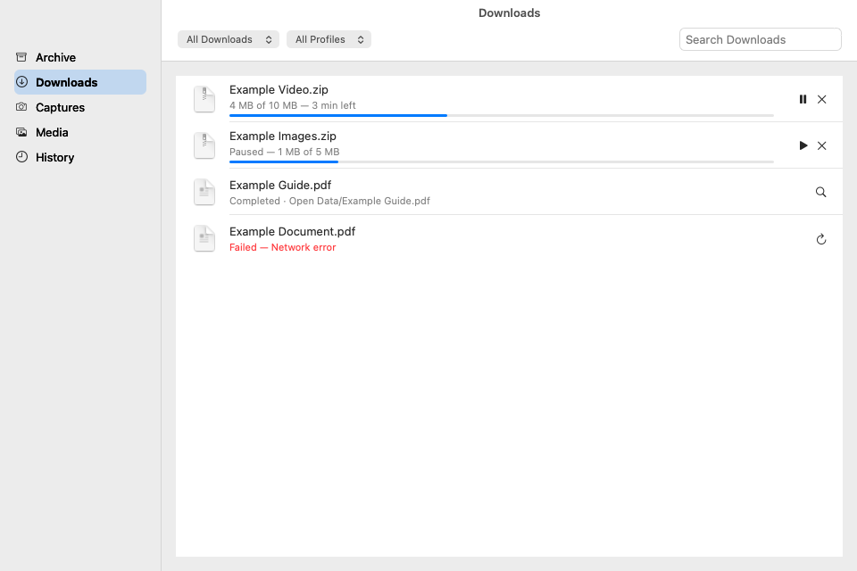
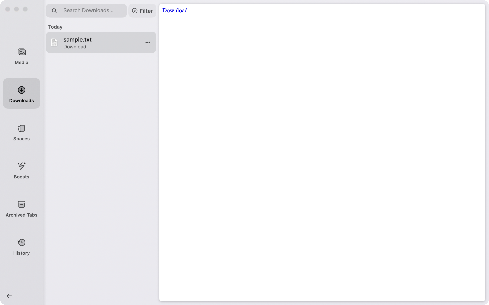

# Library

Library opens inside the active browser window. The left rail contains Media,
Downloads, Spaces, Boosts, Archived Tabs and History. The web page stays visible
on the right. The sidebar Library button toggles the panel; ⌘Y opens History.
Downloads and the existing menu, command-bar, capture and Boost entry points use
the same panel. Little Open routes Library to a standard browser window.

The rail is 112pt wide. Ordinary sections end at x417; Spaces leaves 56pt of the
page visible. The selected tile has a fill. A focus ring appears during keyboard
navigation and clears with pointer input. Foreground and background come from
the active Space, using the sidebar's appearance resolution. Space cards use
their own opaque Space themes, a 0.5pt edge and soft shadow.

Before: the original separate Library, rendered with synthetic data:

After: the in-window panel, captured from the real app with synthetic data:

The new native panel keeps reusable 56pt rows, file icons and asynchronous
QuickLook image/PDF thumbnails. Downloads show numeric progress with an arrow
inside the progress ring. Archive and History retain their existing stores and
actions. Media shows page captures with the page title, or a host-based fallback;
its empty state says that captures appear here. Folder sources and Easels stay
behind default-off feature flags. History always appears.

Search stays separate for each section. Downloads, Archive and History have an
inline filter editor. Boost List/Gallery, Profile and card actions use theme
chips. Destructive actions use native confirmation sheets. Space cards retain
the existing rename, reorder, menu, delete/Undo and tab-navigation paths.

Escape closes a menu, then the filter editor, then clears search, then closes
Library. ⌘F focuses search. Arrow keys move the focused rail tile or list row;
Return opens a row. ⌘⌫ runs its destructive action. Tab follows the rail, search,
Filter and list. All keyboard checks use the application event path.

A completed download places a 39pt file preview over the sidebar Library button.
The newest file is on top; at most three previews stack at 3pt offsets. Hover
shows the filename, click opens Downloads and drag supplies a file URL. The
badge clears on Library open or expires after 60 seconds. The expiry task ends
when the last file expires. Private windows do not show the button.

`OpenLibrary` contains the AppKit panel, controls, reusable rows and filters.
`AppLibrarySession` owns one panel per browser window. Data providers and
`LibraryViewModel` stay shared with their existing stores/actions. No Library
session or view is constructed at launch. Closing stops content subscriptions;
60 seconds later the heavy views and model image caches are released. Reopen cancels
that release. Closing a browser window removes its session and releases its
panel on the next event-loop turn. The old `LibraryWindow`, SwiftUI section views and History feature
flag have been removed.

Open/close uses the 0.12/0.20-second page transition. Sections cross-fade over
0.10 seconds. Reduce Motion uses fades without movement. Closed panels have no
active animation, display link or repeating timer.

The automation socket retains existing Library entry points and adds `library`
state/actions for geometry, rows, search, filters, menus, focus, lifetime and
motion. `tools/e2e/library_overlay.py` and `library_content.py` drive the real app,
with a disposable profile and executable-path cleanup. They send no system
mouse or keyboard events. File/URL pasteboards and native source-drag start are
verified. **Manual check:** drag a download row to Finder and a web upload field;
foreign-app drop/end is unverified by automation.

[Shared contrast measurements](library/contrast.md) retain the known theme
failures. The lead owns the D2 follow-up. Geometry comes from the approved Open
mock-up and the private C capture measurements; all icons are Open's own vectors.
No Arc assets or pixels are included.
