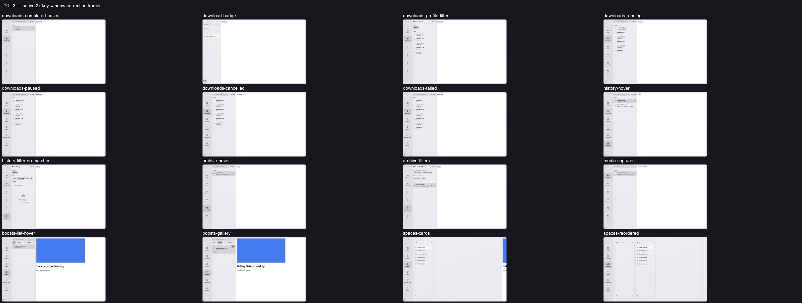

# Library L3 review frames

These existing milestone captures use synthetic data in Open. The browser window
is key. Individual frames are native 2×; the contact sheet combines the wider
L3 set. They contain no Arc pixels or personal browsing data.

| Correction | Existing real-app frame |
|---|---|
| Selected rail tile uses fill; completed files use real icons | [Completed download and hover](downloads-completed-hover.png) |
| Running download uses arrow/ring and numeric byte text | [Running download](downloads-running.png) |
| Capture title and real image thumbnail | [Media captures](media-captures.png) |
| Space cards use their own themes and omit New Tab | [Space cards](spaces-cards.png) |
| Boost controls use theme chips | [List and hover](boosts-list-hover.png), [Gallery](boosts-gallery.png) |
| Completed-download badge covers the Library button | [File badge](download-badge.png) |

The full private L3 set also retains Archive/History filters, menus, failed/paused/
cancelled transfers and reordered Spaces with their socket receipts.

The [shared contrast measurements](../contrast.md) remain a known finding owned
by the lead. They compare the real sidebar first; this change uses the same theme
tokens.

Manual checks still required: drag a completed file to Finder and to a web upload
field. The automation socket proves the native source session and file pasteboard;
foreign-app drop/end remains unverified.
