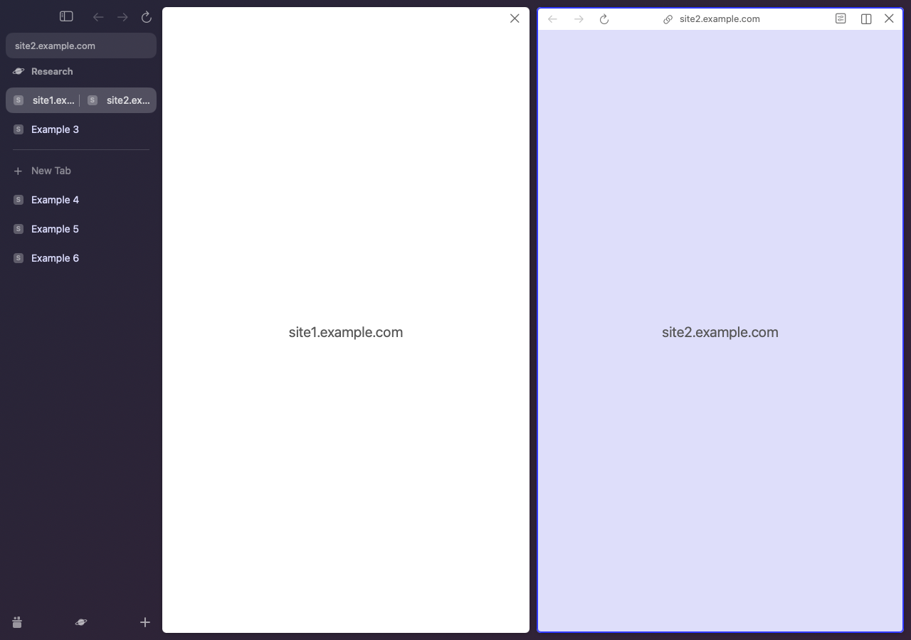
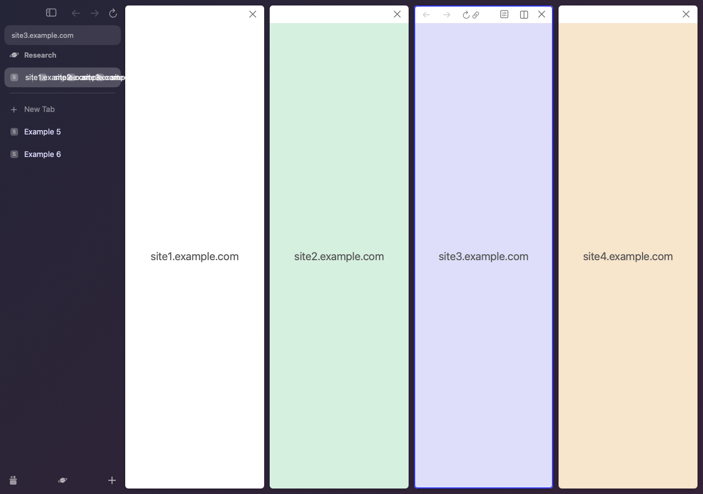
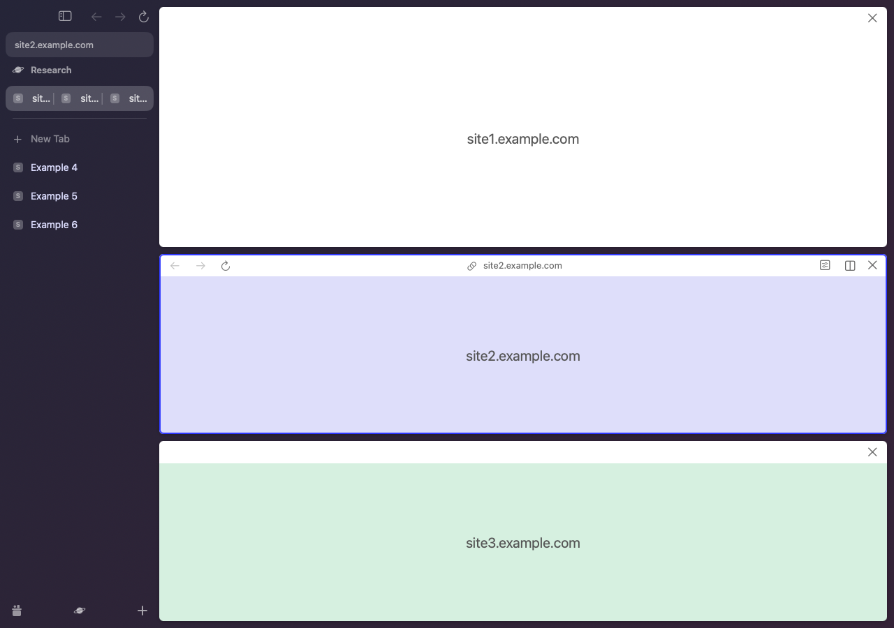
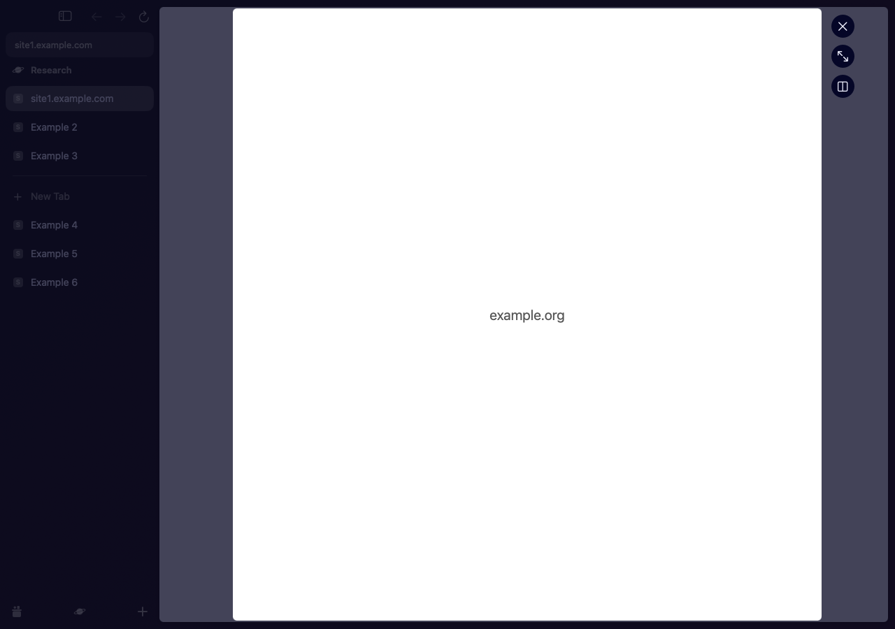
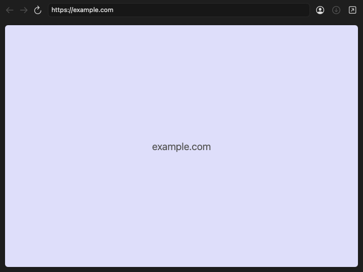

# M4 — Split View, Peek, and Little Open

2026-10-25. Implementation and verification: GPT-6.1, fake web hosts only.

Steps 1–7 of `plans/m4-split-peek-littleopen.md` are implemented. The lead appendix supplies the registrable-domain policy, 200 pt minimum, promotion of the same live host, and Little Open defaults. Steps 8–9 remain outside this change: intake, global hotkey, default-browser change, engine build, and the M4 engine adapter are not claimed here. Main gained the M1 App shell during this review fix; the merge is included, and its App target now declares the OpenFeatures product dependency. Replacing that shell with these controllers remains the App/engine integration step.

## Source organization

`OpenFeatures` is the production library for Split View, Peek, Little Open, the shared web-content container, and app visibility. All production controllers, views, and host protocols live once in `Packages/OpenKit/Sources/OpenFeatures/`. The App target declares this library as a product dependency; its M4 integration supplies the engine adapter. This follows the lead's review correction to the plan's original pre-App placement.

The library depends on OpenModel, OpenDesign, OpenSidebar, OpenSleep, OpenRouting, OpenCommands, OpenSuggest (the existing ICANN Public Suffix List), and OpenStore (the window controller's existing snapshot-save integration). `features-render` imports OpenFeatures and keeps only its fake host, scripted CLI scenarios, SQLite/sleep harness adapters, and renderer/comparator. `Compare.swift` and `OffscreenRenderer.swift` remain source symlinks to the sidebar harness. Unknown suffixes use the last two DNS labels; IP literals and localhost compare exactly.

The model adds only `addPane`, `setSplitFractions`, and `setSplitOrientation`. All three have command undo. Divider movement changes view frames during the drag and writes one undoable fraction update on release. Existing OpenDesign values and OpenSidebar source are unchanged by this feature. New M4 metrics and fitted default Peek colors live in the additive `FeatureMetrics.swift`, with evidence comments.

The shared container creates the focused host first, defers other split hosts to the next main-queue turn, and keeps at most eight hidden hosts. A generation plus host identity guards every callback. Placeholder/sleeping tabs do not create hosts. Peek expands by transferring the same host and preserving its history and click count. Exception (PR #53, fork patch P1, lead decision 2026-10-26): with Chrome style tabs (the default), a sidebar tab must be a tab of the window's hidden Chrome window, and a Peek page is Alloy. Expanding then closes the Peek page and loads its current URL in a Chrome host (one reload; history and form state are not kept). Links a Peek page opens in a new tab open as ordinary tabs (no `window.opener`). Little Open uses the routing plan's smaller content protocol through one adapter and rebuilds its container on a confirmed profile change. Sessions never enter the sidebar model.

## Verification

Build only: `nice -n 10 swift build -c release -j 6`, from `Packages/OpenKit`. No unit tests, Arc launch, computer use, desktop input, or additional agents. All feature windows are offscreen and never ordered on the desktop. Static exports wait for the fake loading callbacks, then rehost the view tree in the sidebar harness’s scaled sRGB offscreen window before CARenderer capture. The temporary defaults suite is removed on exit. Synthetic SQLite and snapshot files stay in temporary or git-ignored directories.

| Check | Result |
|---|---|
| Release build (`nice -n 10 swift build -c release -j 6`) | PASS; zero warnings/errors |
| `features-render check` | PASS, 114/114; original scenario IDs and all review cases covered |
| `sidebar-render check` | PASS, 103/103 (main expanded the original 81 checks) |
| `openkit commands-demo DIR` | PASS, 115/115 (main expanded the original 66 checks) |
| `openkit suggest-check` | PASS, 31/31 |
| `openkit sleep-demo DIR` | PASS, 105/105 |
| `commands-dump` | PASS, exit 0; missing=0, extra=0, different=0 |
| `openkit roundtrip DIR` | PASS |
| Routing | PASS, A1–A10 through verify-all; A11 roundtrip/commands; A12–A17 through 107 extra real CLI decisions |
| `tools/verify-all.sh --keep-logs` | PASS, 13 available checks; commandbar-render SKIP (target absent) |
| `features-render bench` | 200 four-pane layouts; see timing below |
| F0081 Split comparison | PARTIAL: all geometry within 1 pt; two fallback colors exceed ΔE00 2 |
| F0090 Peek comparison | PASS: worst position 1 pt, worst ΔE00 1.86 |

The feature harness covers S1–S6, P1–P5, L1–L3, V1, and C1. It exercises actual AppKit view/controller/model paths, snapshot save/reload, and the real SQLite ArchiveStore. Only WebContentHost is fake. Divider movement and C2/C3 drops use the controller's shared handler directly. Pane focus uses a synthetic window-local NSEvent through the container's input handler and the hit-tested fake page. These checks do not claim an OS drag session or desktop input. Visibility minimizes by setting the harness window-state override, as permitted by V1.

`tools/verify-all.sh --keep-logs` was run after merging main through PRs #36 and #37. The earlier run against pre-#37 main failed the data-root lock, SleepStore reopen/performance checks, and the sidebar summary parser. Those raw failure receipts remain under `.re/m4/`; they are not counted as passing. The current-main run passed every available check. The absent commandbar-render target was skipped; importing live Arc data was not requested by that runner.

The main merge required adapting the harness to `ArchiveStore(fileURL:)`, throwing `SnapshotStore.saveNow`, optional Space titles, and `TabLiveState.hasWebContent`. No merge conflict or Package.swift union repair was needed.

Four-pane layout benchmark (fake views only): `200 layouts: median 0.008 ms, p95 0.009 ms`. This is not engine tab-switch performance.

## PR #40 review fixes — 2026-10-25

| Finding | Fix | Result |
|---|---|---|
| Structural: production code in dev executable | Moved all 14 production Scene files into the existing OpenFeatures library; exposed the controller content view as NSView and the shared window-local key path. Kept fake hosts and CLI infrastructure in features-render. | PASS: release build; unchanged harness 83/83 after the move, before behavior fixes. |
| 1 HIGH: stale fractions after pane removal | takePane drops the removed share and normalizes surviving shares. Undo restores the exact saved array. SplitLayout applies the plan's viewport-dependent 200 pt clamp and equal scaling in narrow windows. | PASS: R1 covers 4→3, [0.5,0.3,0.2] middle close → 5:2 shares summing to 1, exact undo/redo, and both minimum-size paths. |
| 2 HIGH: Favorite Peek hidden | refresh recognizes Favorites through profile ownership instead of requiring Space selection. | PASS: R2 opens a visible Favorite Peek, changes Space within that profile, and dismisses through the window's Escape key path. Host closes. |
| 3 MED: Peek callback retention cycle | Callbacks capture the item UUID and weak host/controller, then resolve the current stack entry. Empty-stack cleanup removes the hosted view. | PASS: R3 holds all three old callbacks across dismissal; the weak host becomes nil. Stale callbacks do nothing. |
| 4 MED: ignored split promotion failures | Checks addPane/makeSplit results. Refusal beeps and preserves the Peek. Favorites are rejected before creating a tab; a failed attempted split removes its new candidate. | PASS: R4 Favorite Split returns failure through the beep branch, keeps the same live Peek, and creates no tab. Existing P3 still promotes the same host on success. |
| 5 MED: repeated visible notifications | Sends only visible.subtracting(previous) and previous.subtracting(visible). A single queue drains new wakes without cancelling them on duplicate notifications. | PASS: R5 uses the real SleepController and SQLite store; duplicate notifications preserve queued wakes, leave activity stamps unchanged, and preserve hidden times. |
| 6 LOW: Little Open visibility | One updateVisibility path derives isVisible && !isMiniaturized && occlusionState.contains(.visible), including resurface, become-key, deminiaturize, and occlusion delegate callbacks. Close clears the flag. | PASS: R6 offscreen window remains hidden through all callbacks and resurface. V1 uses an explicit synthetic visible-session override. Native visible/minimized/covered transitions remain an App-phase gate. |
| 7 LOW: unknown suffix domain fallback | Reuses canonical DNS spelling and the PSL; missing rule falls back to the last two labels. inet_pton preserves exact IP comparison; localhost stays exact. | PASS: R7 runs real navigation interception for .internal, .lan, an unlisted IDN suffix, IPv4, IPv6, and localhost. |
| 8 LOW: recursive layout per drag event | Updates slot/page frames and lays out pane chrome only. Does not force layout through the embedded web subtree. | PASS: R8 divider drag changes frames without increasing the fake page's layout count before the normal layout pass. |
| 9 LOW: hardcoded web focus | Builds RoutingContext from the actual first responder and restricts split-focus keys to a web-content responder. | PASS: R9 synthetic window-local Ctrl+Shift+2 works from the page and stays unconsumed in the actual sidebar outline and AppKit text fields. |

The post-fix release build has zero warnings/errors. `features-render check` passes **114/114**. Raw receipts stay in `.re/m4-review/`. No unit tests, computer use, Arc launch, engine build, or delegated work was used. The previous captured-frame color limits below remain separate from these behavior checks.

Final review verification followed the merge of `origin/main` at `c3dedcfcfebbea18789e731933a01c8de24cbba2` (M1 App/engine foundation and engine patch decisions). Both OpenFeatures and main's OpenWeb target are present once; Package.swift merged without conflicts. The final code was checked at `5ad38d9`, followed only by the App product-dependency declaration and this report. App/engine compilation was not run under the package-only build instruction.

`features-render check`: **114 passed, 0 failed** on the merged code. `tools/verify-all.sh --keep-logs`: **13 PASS, 1 SKIP, 0 FAIL**. `commandbar-render` is the only skip because the target does not exist. Live Arc-data import was not selected. Build output: `build exit=0 warning_lines=0 error_lines=0`. Exact receipts: `.re/m4-review/verify-final/summary.txt`, `.re/m4-review/verify-final/results.tsv`, and `.re/m4-review/features-merged.log`.

| Check | Result | Seconds |
|---|---|---|
| build | PASS | 8 |
| commands-demo | PASS | 0 |
| roundtrip | PASS | 0 |
| suggest-check | PASS | 12 |
| commands-dump | PASS | 1 |
| route | PASS | 1 |
| favicons | PASS | 1 |
| sleep-demo | PASS | 0 |
| adblock-perf | PASS | 1 |
| adblock-catalog | PASS | 0 |
| profiles | PASS | 2 |
| sidebar-render | PASS | 17 |
| commandbar-render | SKIP | 0 |
| boosts | PASS | 3 |

## Visual finish — 2026-10-25

Design owner pass on the held-back sidebar visuals and the Split/Peek comparison. Every value is measured on the captured frames (`re/interaction-states.md` §§3, 7, 11, 12; split-row menu from Arc's code, `re/menus-and-hotkeys.md`). Tokens and metrics: `design.md` §2 and §15.

| Area | Change | Evidence |
|---|---|---|
| Split row, selected | The selected fill becomes a card; each pane gets a cell `[12 + i·pitch, y+6, pitch−4, 28]`, radius 8, `TabCellChildBackground`; no divider. | F0081 |
| Focused pane in the row | No mark, as in Arc: both cells are pixel-identical with focus on pane 2. The plan's `TabCellBackgroundContentVisible` guess is dropped. | F0081, F0082, A0264–A0271 |
| Sidebar toolbar with a split | Back, forward, and reload hide; each pane bar has its own. | F0081, F0082 AX and pixels |
| Peek badge | The source row shows the Peek page's favicon on a 24 pt plate at `W − 38`; it stays while another row is selected and goes with the Peek. The favicon comes from the Peek host's favicon callback. | F0090, F0101 |
| Peek source row and chrome | Lighter fill (white 0.10) while the Peek shows; URL field and toolbar follow the Peek page. | F0090, F0102 |
| Peek dim | The dim moves under the sidebar: it darkens the background and pages, not the URL field, Favorites, or list. The toolbar row and bottom bar take fitted opacities. The sidebar now takes clicks while a Peek is open (Arc: F0101); a click on the dim still dismisses. | F0090 vs F0101 |
| Split-row menu | Separate All Tabs · Add Tab… (disabled at 4) · Convert to Vertical/Horizontal Split View · — · Tab Options · one submenu per pane (Separate from Split View · — · Mute · Copy Link · Copy Link as Markdown · — · Archive Item) · — · Duplicate · Move to · — · Archive Item. New intents: `separatePane`, `setSplitOrientation`, `addTabToSplit`. | Arc builder `0x102eccc9c` |
| Pane bars | The bar takes the page's reported color (`pageBackgroundColor`). The unfocused pane shows back, forward, copy, host, and Close. The host group is centered on whole points; narrow bars truncate the host or drop the group. | F0081 AX and pixels |
| Titles | Four-pane split titles narrower than "…" draw nothing instead of overflowing. Row titles keep 1 pt free when they truncate. The "/" mark uses the measured stroke and a 2 pt title shift. | F0081, F0090, F0101 |
| Bug | A row's first hover now lays out its new close button (it kept a zero frame until the next layout). | `sidebar-render check` |

| Check (release build, merged `origin/main` `33aade1`) | Result |
|---|---|
| `nice -n 10 swift build -c release -j 6` | PASS, no warnings or errors |
| `features-render check` | PASS, 147/147 (114 earlier + 16 visual-finish + 17 review-round scenarios) |
| `sidebar-render check` | PASS, 125/125 (103 earlier + 22 visual-finish checks) |
| F0081 chrome / sidebar | worst 1.0 pt, ΔE00 1.62 (20 elements) / 1.0 pt, 1.76 (33) |
| F0090 chrome / sidebar | worst 1.0 pt, ΔE00 1.86 (14) / 1.0 pt, 1.98 (31) |
| 13 matched sidebar states (`design.md` §15.1) | byte-identical PNGs and tables, main vs branch |
| `tools/verify-all.sh --keep-logs` | 14 PASS, 0 SKIP, 0 FAIL |

## PR #50 review round 1 — 2026-10-25

| Finding | Fix | Result |
|---|---|---|
| HIGH: a selected two-pane split that collapses (pane menu "Separate from Split View" or "Archive Item") left `selectedNodeBySpace` on the removed split, so the window showed nothing | In the model: a collapse (`removePane`, `closeTab` on a pane) moves every window selection from the split to the remaining tab; `unsplit` moves it to the focused pane (else the first). Undo puts the split back and selects it again; redo repeats. The controllers no longer re-select after these commands (that added a no-op undo step). `docs/model.md` records the rule. | PASS: RR1 runs both pane menu items through the real sidebar menu, then undo and redo; Separate All Tabs keeps the focused pane. Without the model fix, 5 RR1 checks fail and the earlier S5 collapse scenario fails. |
| MEDIUM-HIGH: a Peek's source row was fixed at open time, so after a split was made from the source tab, or the source split was dissolved, the Peek could not show again and Esc and the dim were out of reach | `PeekController.sourceNodeID(of:)` reads it on each refresh: the split that holds the source tab, else the tab (Favorites unchanged). The sidebar sync uses the same function. | PASS: RR2 makes a split from a Peek's source tab and selects it; dissolves a split under a pane's Peek and selects the source tab; Esc then dismisses. Without the fix, 3 RR2 checks fail. |
| MEDIUM: `pageBackgroundColor` had no change signal | `WebContentHost.onPageBackgroundChange`; `WebContentContainer` binds it next to the URL, title, loading, and favicon callbacks and updates that pane's bar. The Little Open adapter forwards it. The fake host reports a navigation's color only after loading ends, as a late engine color would. Engine TODO: `docs/engine-api.md`, "Page background color". | PASS: RR3 checks a late navigation color and a later page color change without a controller refresh. Without the binding, both fail. |
| LOW-MEDIUM: every Peek URL or favicon change laid out every visible row | Per-tab observable badge state in `SidebarContext`: a row's layout observes only "badge shown", and the badge view observes the page while drawing. Row fills and the chrome dim observe only the shown Peek's source row (`peekSourceNodeID`), not its URL or loading state. | PASS: a badge appearing lays out 1 row of 14; a URL and favicon change lays out 0 rows and draws the badge once. |

Not in this round: `copyLink` and `duplicate` have no handler in the window controller yet; the app-shell plan (`plans/app-shell.md` §4) owns them.

## Captured-frame comparison

Reference files are the full-session `0081-213221/win-5245.png` (Split View) and `0090-213238/win-5245.png` (Peek), under the shared git-ignored `.re/runtime/sessions/20261024-213009-session-full/`. Capture metadata and geometry: `re/interaction-states.md` §§7, 11–12. ICC conversion: `re/runtime-observations.md` §0. Pixel method: `design.md` §7.

Both references are 2216×1394 at 1x. The tables were re-run on 2026-10-25 for the visual finish; the earlier receipts in `.re/m4/` were lost with their worktree. The run script is `.re/vf/run-m4.sh`. Render inputs, all render-only and kept in `.re/`:

- The capture-time Arc copy (21:36, after the session), imported with `openkit import-arc`, then patched back to what the frames show: sidebar width 228 and Space 4 with the default theme (the user changed both later, at F0126 and F0137), and the folder tab's saved title. For F0090 the source tab is also marked as away from its pinned URL (the "/" in the frame).
- F0081's Today split, made during the session and not saved: `features-render split --seed-today-split URL=TITLE`.
- Page titles stay as saved (`--keep-titles`), and each fake page reports the captured page's color (`--page-color HOST=RRGGBB`; see the next section).

The chrome tables (`features-render compare`) cover pane and Peek chrome. The sidebar tables (`sidebar-render compare` on the same render) cover the full sidebar with the new elements: the selected split card and its cells (`--selected-split-row`), split titles at the pane pitch (`--pitch-split-titles`), and the Peek source row (`--peek-row`, `--peek-shown`). Web content, favicons, traffic lights, and corners are masked in the private side-by-side images. No captured image or user data is committed.

### The F0081 ΔE00 13.29 and 8.95 misses: masking, not chrome

Both misses measured page-derived pixels, not chrome:

- The pane 1 bar fill (Arc `#DEDEFA`, Open `#FFFFFF`) is the page's own color. Arc's bar takes the page's reported color (lavender page → lavender bar, white page → white bar). Our bar drew the Space fallback, because the fake page did not report a color. It is not a chrome token.
- The unfocused Close glyph (Arc `#656470`, Open `#747474`) has the same tint in both: black ≈ 0.55 over the bar. Over lavender it reads `#656470`, over white `#747474`. The miss came from the bar under it.

Fix: `WebContentHost` now reports `pageBackgroundColor` (`TODO(engine)`: the engine reports the page's background or theme color), and the 32 pt bar takes it; the Space background stays the fallback. In the comparison, the fake page for each pane reports the captured page's color as an input (pane 1 `DEDEFA`, pane 2 `FFFFFF`; the hosts stay in the `.re/` run script). The real page's top pixels are content (`#A8AAC7` ± 13), so this is the page's reported color, not a pixel sample. The bar-fill rows are kept, labeled as inputs; every other row measures chrome over the same page color. The unfocused Close glyph now reads ΔE00 0.66.

### M4 split, 1x, ICC to sRGB (chrome)

| Element | Position error (pt) | ΔE00 | Arc color | Open color | Arc ink box (px) | Open ink box (px) |
|---|---|---|---|---|---|---|
| Pane 1 outer frame (AX top-left vs rendered view geometry) | 0.0 | — | — | — | 228,10 984×1374 | 228,10 984×1374 |
| Pane 1 32 pt bar (AX top-left vs rendered view geometry) | 0.0 | — | — | — | 228,10 984×32 | 228,10 984×32 |
| Pane 1 bar fill = page color (input) | — | 0.00 | #DEDEFA | #DEDEFA | — | — |
| Pane 2 outer frame (AX top-left vs rendered view geometry) | 0.0 | — | — | — | 1222,10 984×1374 | 1222,10 984×1374 |
| Pane 2 32 pt bar (AX top-left vs rendered view geometry) | 0.0 | — | — | — | 1222,10 984×32 | 1222,10 984×32 |
| Pane 2 bar fill = page color (input) | — | 0.00 | #FFFFFF | #FFFFFF | — | — |
| Focused ring core | — | 0.11 | #3139FF | #2F39FF | — | — |
| Unfocused Back glyph | 1.0 | 1.55 | #A8A8BD | #ADADC3 | 243,22 13×10 | 244,22 12×10 |
| Unfocused Forward glyph | 1.0 | 1.07 | #A8A8BD | #ACACC1 | 280,22 13×10 | 281,22 13×10 |
| Unfocused Copy URL glyph | 1.0 | 0.24 | #686875 | #696876 | 676,21 13×12 | 676,21 13×13 |
| Unfocused Host label | 1.0 | 0.32 | #5E5E6A | #5E5E6A | 699,22 42×9 | 700,22 41×9 |
| Unfocused Close glyph | 0.0 | 0.66 | #656470 | #636370 | 1185,20 12×12 | 1185,20 12×12 |
| Focused Back glyph | 1.0 | 1.47 | #C1C1C1 | #C7C6C6 | 1237,22 13×10 | 1238,22 12×10 |
| Focused Forward glyph | 1.0 | 1.04 | #C2C2C2 | #C6C6C6 | 1274,22 13×10 | 1275,22 13×10 |
| Focused Reload glyph | 0.0 | 0.54 | #7B7B7B | #7A7A79 | 1311,20 12×14 | 1311,20 12×14 |
| Focused Copy URL glyph | 1.0 | 0.26 | #787878 | #787878 | 1652,21 13×12 | 1652,21 13×13 |
| Focused Host label | 1.0 | 0.86 | #6B6B6B | #6D6D6D | 1675,24 78×9 | 1676,24 76×9 |
| Site Control glyph | 1.0 | 0.14 | #7B7B7B | #7B7B7B | 2109,18 16×16 | 2110,19 14×14 |
| Split menu glyph | 0.0 | 1.62 | #757575 | #717171 | 2146,20 14×14 | 2146,20 14×14 |
| Focused Close glyph | 0.0 | 0.39 | #737373 | #747474 | 2179,20 12×12 | 2179,20 12×12 |

Worst position error 1.0 pt, worst ΔE00 1.62, 20 elements.

### F0081 sidebar, 1x, ICC to sRGB

| Element | Position error (pt) | ΔE00 | Arc color | Open color | Arc ink box (px) | Open ink box (px) |
|---|---|---|---|---|---|---|
| background (sidebar column) (111 points, max ΔE 0.93) | — | 0.58 | #292438 | #2A2437 | — | — |
| toolbar: sidebar toggle | 1.0 | 0.94 | #A3A4AC | #A1A1A9 | 84,16 18×15 | 84,16 18×14 |
| toolbar: back | — | — | — | — | — | — |
| toolbar: forward | — | — | — | — | — | — |
| toolbar: reload | — | — | — | — | — | — |
| URL field fill | 0.0 | 0.50 | #3A3A4C | #3B3A4C | 8,46 212×36 | 8,46 212×36 |
| URL field host | 0.0 | 0.32 | #ADADB5 | #ADADB4 | 22,62 76×9 | 22,62 76×9 |
| favorite tile 1 | 0.0 | 0.48 | #3A3A4C | #3B3A4C | 8,90 65×47 | 8,90 65×47 |
| favorite tile 2 | 0.0 | 0.63 | #3A3A4C | #3B3A4C | 81,90 65×47 | 81,90 65×47 |
| favorite tile 3 | 0.0 | 0.75 | #3A3A4C | #3C3A4C | 155,90 65×47 | 155,90 65×47 |
| favorite tile 4 | 0.0 | 0.54 | #3A3A4C | #3B3A4C | 8,145 65×47 | 8,145 65×47 |
| favorite tile 5 | 0.0 | 0.63 | #3A3A4C | #3B3A4C | 81,145 65×47 | 81,145 65×47 |
| favorite tile 6 | 0.0 | 0.72 | #3A3A4C | #3C3A4C | 155,145 65×47 | 155,145 65×47 |
| Space icon (centroid Δ -0.4, 0.6 px) | 0.6 | — | — | — | — | — |
| Space title | 0.0 | 0.37 | #9A9AA3 | #9B9AA3 | 45,213 50×12 | 45,213 50×12 |
| row 1 title | 0.0 | 0.41 | #D9DAFA | #D8D9FA | 44,253 70×11 | 44,253 70×11 |
| row 2 title | 0.0 | 0.39 | #D9DAFA | #D8D9FA | 61,294 97×14 | 61,294 97×14 |
| row 3 title | 0.0 | 0.36 | #D7D8F8 | #D7D8F8 | 60,336 93×10 | 60,336 93×10 |
| row 4 title | 0.0 | 0.36 | #D7D8F8 | #D6D7F8 | 61,376 148×14 | 61,376 148×14 |
| row 5 title | 0.0 | 0.38 | #D8D9F9 | #D8D8F9 | 60,418 76×13 | 60,418 76×13 |
| row 6 title | 0.0 | 0.37 | #D8D9F9 | #D8D9F9 | 60,458 145×14 | 60,458 145×14 |
| row 7 split title 1 | 0.0 | 0.16 | #CCCCD0 | #CDCCD0 | 63,499 45×13 | 63,499 45×13 |
| row 7 split title 2 | 0.0 | 0.16 | #CFCFD3 | #CFCFD3 | 158,500 21×10 | 158,500 21×10 |
| row 8 split card fill | 0.0 | 1.53 | #505060 | #524F60 | 8,586 212×36 | 8,586 212×36 |
| row 8 split cell 1 fill | 0.0 | 1.34 | #5D5C6A | #5E5C6B | 12,590 100×28 | 12,590 100×28 |
| row 8 split cell 1 title | 0.0 | 0.34 | #DCDCDF | #DCDBDE | 47,598 57×14 | 47,598 57×14 |
| row 8 split cell 2 fill | 0.0 | 1.39 | #5D5C6A | #5F5B6B | 116,590 100×28 | 116,590 100×28 |
| row 8 split cell 2 title | 0.0 | 0.38 | #DBDBDE | #DBDADE | 151,598 57×11 | 151,598 57×11 |
| Pinned/Today divider | 0.0 | 1.35 | #464656 | #484656 | 18,533 192×1 | 18,533 192×1 |
| New Tab plus | 1.0 | 0.67 | #92919B | #94929C | 20,559 11×10 | 20,558 10×11 |
| New Tab label | 0.0 | 0.61 | #85858F | #86848F | 45,557 54×11 | 45,557 54×11 |
| bottom: Home | 0.0 | 1.76 | #9E9BA4 | #99959E | 17,1361 14×16 | 17,1361 14×16 |
| bottom: plus | 0.0 | 0.19 | #A7A3AC | #A7A3AB | 197,1362 14×14 | 197,1362 14×14 |

Worst position error 1.0 pt, worst ΔE00 1.76, 33 elements.

Back, forward, and reload have no ink in either image: with a split selected, the sidebar toolbar keeps only the toggle.

### M4 peek, 1x, ICC to sRGB (chrome)

| Element | Position error (pt) | ΔE00 | Arc color | Open color | Arc ink box (px) | Open ink box (px) |
|---|---|---|---|---|---|---|
| Peek panel frame (AX top-left vs rendered view geometry) | 0.0 | — | — | — | 427,12 1590×1370 | 427,12 1590×1370 |
| Close control hit frame (AX top-left vs rendered view geometry) | 0.0 | — | — | — | 2030,21 35×33 | 2030,21 35×33 |
| Expand control hit frame (AX top-left vs rendered view geometry) | 0.0 | — | — | — | 2030,64 35×33 | 2030,64 35×33 |
| Split control hit frame (AX top-left vs rendered view geometry) | 1.0 | — | — | — | 2030,107 34×32 | 2030,107 35×33 |
| Peek panel edge profile (AX top-left vs rendered view geometry) | 0.0 | — | — | — | 427,12 1590×1370 | 427,12 1590×1370 |
| Close circle | 1.0 | 0.05 | #050627 | #050627 | 2030,21 35×33 | 2031,21 33×33 |
| Close glyph | 0.0 | 1.70 | #E2E3F6 | #DEDFEE | 2041,32 12×12 | 2041,32 12×12 |
| Expand circle | 1.0 | 0.15 | #050627 | #050627 | 2030,64 35×33 | 2031,64 33×33 |
| Expand glyph | 1.0 | 1.51 | #E7E8FB | #E6E8F6 | 2040,74 14×14 | 2040,73 15×15 |
| Split circle | 1.0 | 0.05 | #050627 | #050627 | 2030,107 34×32 | 2031,107 33×33 |
| Split glyph | 1.0 | 1.49 | #E3E4F7 | #E3E4F3 | 2040,116 14×14 | 2040,117 14×14 |
| Scrim sidebar top | — | 0.25 | #0A0A1E | #0B0B1E | — | — |
| Scrim sidebar center | — | 1.19 | #0F0A1E | #0D0B1E | — | — |
| Scrim sidebar bottom | — | 1.86 | #110A1E | #0D0B1E | — | — |

Worst position error 1.0 pt, worst ΔE00 1.86, 14 elements.

### F0090 sidebar, 1x, ICC to sRGB

| Element | Position error (pt) | ΔE00 | Arc color | Open color | Arc ink box (px) | Open ink box (px) |
|---|---|---|---|---|---|---|
| background (sidebar column) (111 points, max ΔE 2.00) | — | 1.02 | #0E0A1E | #0D0B1E | — | — |
| toolbar: sidebar toggle | 1.0 | 0.17 | #464655 | #474755 | 84,16 18×15 | 84,16 18×14 |
| toolbar: back | 0.0 | 0.35 | #454553 | #464654 | 131,18 14×12 | 131,18 14×12 |
| toolbar: forward | 1.0 | 0.57 | #454553 | #474655 | 165,18 15×12 | 165,18 14×12 |
| toolbar: reload | 0.0 | 0.24 | #454553 | #464554 | 199,15 14×17 | 199,15 14×17 |
| URL field fill | 0.0 | 0.23 | #222335 | #232335 | 8,46 212×36 | 8,46 212×36 |
| URL field host | 0.0 | 0.14 | #A3A3AA | #A3A3AA | 21,59 126×12 | 21,59 126×12 |
| favorite tile 1 | 0.0 | 0.23 | #222335 | #232335 | 8,90 65×47 | 8,90 65×47 |
| favorite tile 2 | 0.0 | 0.22 | #232335 | #232335 | 81,90 65×47 | 81,90 65×47 |
| favorite tile 3 | 0.0 | 0.25 | #232335 | #242335 | 155,90 65×47 | 155,90 65×47 |
| favorite tile 4 | 0.0 | 0.21 | #222335 | #232335 | 8,145 65×47 | 8,145 65×47 |
| favorite tile 5 | 0.0 | 0.21 | #232335 | #232335 | 81,145 65×47 | 81,145 65×47 |
| favorite tile 6 | 0.0 | 0.24 | #232335 | #242335 | 155,145 65×47 | 155,145 65×47 |
| Space icon (centroid Δ -0.4, 0.6 px) | 0.6 | — | — | — | — | — |
| Space title | 0.0 | 0.24 | #8E8E97 | #8E8E97 | 45,213 50×12 | 45,213 50×12 |
| row 1 title | 0.0 | 0.38 | #D8DAF9 | #D8D9F9 | 44,253 70×11 | 44,253 70×11 |
| row 2 title | 0.0 | 0.45 | #D8D9F9 | #D7D8F9 | 61,294 97×14 | 61,294 97×14 |
| row 3 title | 0.0 | 0.37 | #D6D8F7 | #D5D6F7 | 60,336 93×10 | 60,336 93×10 |
| row 4 title | 0.0 | 0.39 | #D7D8F8 | #D6D7F8 | 63,376 111×14 | 63,376 111×14 |
| row 4 Peek source fill | 0.0 | 0.09 | #242335 | #242335 | 24,364 196×36 | 24,364 196×36 |
| row 4 Peek badge plate | 0.0 | 0.76 | #353444 | #333343 | 190,370 24×24 | 190,370 24×24 |
| row 5 title | 0.0 | 0.36 | #D7D9F8 | #D7D7F8 | 60,418 76×13 | 60,418 76×13 |
| row 6 title | 0.0 | 0.39 | #D7D9F8 | #D7D8F8 | 60,458 145×14 | 60,458 145×14 |
| row 7 split title 1 | 0.0 | 0.14 | #C6C6CA | #C6C6CA | 63,499 45×13 | 63,499 45×13 |
| row 7 split title 2 | 0.0 | 0.28 | #CAC9CD | #C9C9CD | 158,500 21×10 | 158,500 21×10 |
| row 8 title | 0.0 | 0.44 | #D8D9F9 | #D7D8F9 | 45,598 97×14 | 45,598 97×14 |
| Pinned/Today divider | 0.0 | 0.40 | #30303F | #303040 | 18,533 192×1 | 18,533 192×1 |
| New Tab plus | 1.0 | 0.67 | #84848D | #86868F | 20,559 11×10 | 20,558 11×11 |
| New Tab label | 0.0 | 0.10 | #777680 | #777680 | 45,557 54×11 | 45,557 54×11 |
| bottom: Home | 0.0 | 1.94 | #524C5B | #4E4D5B | 17,1361 14×16 | 17,1361 14×16 |
| bottom: plus | 0.0 | 1.98 | #575260 | #565562 | 197,1362 14×14 | 197,1362 14×14 |

Worst position error 1.0 pt, worst ΔE00 1.98, 31 elements.

- F0081 reference SHA-256: `03db75e2d74ae9fbd90c39580ef54cf234cb7b401d866326cec2b74210b109be`.
- F0090 reference SHA-256: `331513f7eb49660200d7479204788d777acc8251f1ebc8482aa3c0ee90399a7f`.

The 70% default Peek scrim tint was fitted against the three F0090 sidebar samples in the chrome table; the earlier `#0E0019` tint was a guess. Default circle fill and glyph tint were fitted from the F0090 core pixels. Geometry follows the measured 33 pt circle inside a 35 pt hit frame. The toolbar-row and bottom-bar dim opacities (0.43, 0.52) are fitted on the F0090 glyph cores.

## Screens — synthetic data only

The following five PNGs contain only generated Spaces, `example.com`/`example.org` hosts, and solid-color fake pages. They use 1x capture. The split and Peek screens are 1280×900; Little Open is 720×540. Page labels identify the fake host; no Arc image, favicon, or captured web content appears in them.

Two panes, focus on the second pane (selected split card in the sidebar; unfocused bar with back, forward, copy, host, and Close):

Four panes, focus on the third pane (narrow bars truncate the host; the focused bar drops it; split titles too narrow for "…" draw nothing):

Three vertical panes, custom fractions 0.4/0.3/0.3:

Peek over a synthetic pinned source (badge on the source row, lighter source fill, dimmed toolbar row and bottom bar, Peek host in the URL field):

Little Open with the disabled Downloads control:

## Limits and deviations

Resolved by the visual finish (2026-10-25, below): the first pane bar's page color, the sidebar split cells and Peek badge, the split-row menu, four-pane title overflow, and the unfocused pane's controls.

- The pane bar uses `WebContentHost.pageBackgroundColor`. The App now reads the page color after loading ends; it falls back to the Space color before the answer. Live changes without a load-end event still wait for an engine color signal (docs/engine-api.md).
- Peek dim: Arc's dim fits a multiply in linear light (≈ 0.165 on R and G), not one sRGB alpha. Open keeps the fitted sRGB scrim for the background and fits separate opacities for the toolbar row (0.43) and the bottom bar (0.52); their glyphs land within ΔE00 1.98. Arc shows no dim while the Peek loads (F0089) or while the pointer is on its buttons (F0108–F0114); Open always dims an open Peek (guess about Arc's rule; not built).
- Light-content Spaces: the split cells, badge plate, and Peek source fill use the light halves of their tokens (guess: every capture is in the dark default Space).
- Narrow panes and four-pane rows have no capture. Host truncation in the pane bars, hiding the host group when fewer than about three characters fit, and blank split titles below the width of "…" are guesses.
- A Peek opened from a split pane or a Favorite tile has no capture. The badge shows only on tab rows; a split source row gets the lighter fill (guess); Favorite tiles get neither.
- Divider keyboard resizing remains skipped, as §3.4 permits. Motion values are provisional and respect Reduce Motion; an offscreen static comparison does not validate animation timing.
- Main App window selection is an injection hook. Little Open now embeds the real OpenCommandBar in its bar state and uses an edit-URL overlay in page state (routing Step 6a). Little Open's no-main-window move is verified at model level. Global shortcuts, AppleEvents, downloads, real link-menu/download metadata, native browser focus, page-color reporting, and engine assumptions A1–A7 remain App/engine gates.

## App host binding contract (app shell B review)

`WebContentHostFactory.makeHost` returns an optional host. The App refuses
creation while the engine or profile is unavailable and queues navigation.
`adoptHost(_:as:)` runs before a promoted Peek host is bound under a new model
ID; the App rebinds the host and its factory indexes without making a new page.

`WebContentHost.liveState` and `onLiveStateChange` carry loading/progress,
navigation history, audio and crash state. Only the container binding writes
engine state into the model, after checking its generation and cache identity.
Closing invalidates that binding first. `remainingLiveState(for:)` preserves a
shared model row when another window still owns a host. Full profile teardown
clears runtime metadata, including favicon and crash state.

The window keeps the M4 Peek backdrop/badge/toolbar wiring lazy. Split collapse
uses the model's selection retargeting. Refresh binds all visible split panes;
the single-pane path avoids its former duplicate refresh. The render harness
passes the F0001 dimensions explicitly for its measured-panel scenario, while
the production controller uses the persisted window frame by default.

## Little Open library, capture session 2 — 2026-11-05

Routing Step 6a replaces the historical 720×540 Little Open view above. A new
blank window is 490×329, 20 pt from the pointer screen's visible top/right.
A committed non-blank URL grows that window to 1185×832 with its top-right
fixed, clamped to the visible screen with 20 pt margins. Page minimum is
360×240. The page fills the window below the 47 pt title bar. New windows do
not cascade or save frames. A duplicate key-down timestamp within 0.05 s is
ignored; distinct presses and calls without a timestamp create new windows.

The title bar uses fixed solid dark fills (guess: the captured material and
tint source are unknown), a multi-Profile chip, host without `www.`, copy-link
without a toast, and the most recent Profile Space's "Open in" pill. The
chevron opens a Profile-scoped, searchable picker with Up/Down, Return and
Escape. The first page window shows the 32 pt intro band once; the layout is
a guess. Frame/paint values and evidence are in `LittleOpenMetrics`.
Calculator and action selections keep a surviving blank window usable by
restoring its embedded input and close control. A callback that closes the
session does not restore the bar.

`nextExpiry(now:)` and `onChange` let the App's single `ExpirySweeper` schedule
per-Profile deadlines. The library has no periodic timer. Archive rows keep
`.autoArchived` and `littleOpen:<id>`; manual close, moves and Close All do
not archive. `stateForAutomation` exposes read-only session/window state.

Evidence and current counts: [Step 6a verification](../Packages/OpenKit/FeatureRenders/little-open/verification.md).
The three PNGs there are offscreen synthetic views, not a native pixel
comparison with Arc. The App still shows its stub. App routing, global/menu
same-press timestamps, native focus/key delivery, App sweeper wiring and the
B9/B10 native comparison remain Step 6b work. No App source changes are in
this library milestone.
