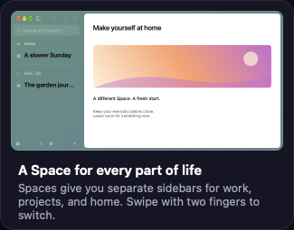

# Step 4 collected gate findings

## Document Picture in Picture: first-session object corruption

The Release M5 gate at `60918f9d` lost the App during the local Document PiP
`Runtime.evaluate` `start()` path. The report is
`~/Library/Logs/DiagnosticReports/Open-2026-11-11-040602.ips` on M5.
It records `EXC_BAD_ACCESS` / `SIGSEGV`, address `0x2121212121212121`, on
`CrBrowserMain`:

1. `objc_release + 8`
2. `DocumentPictureInPicture.present(settings:screen:) + 432`
3. `MediaCoordinator.openDocumentPictureInPicture(_:openerTabID:factory:) + 740`
4. `MediaCoordinator.pictureInPictureDidOpen(_:)`
5. `OEWebContent.oe_pictureInPictureOpened:`
6. `OEMediaHandler::OnPictureInPictureOpened`
7. `open_engine::OpenDocumentPipHost::Show`

The crashing release replaces the stored `window`. The retained M5 executable
(UUID `735e4fa1-cd35-30e1-95c3-a39c8d959360`) supplies the attribution:
`xcrun lldb --batch` static `disassemble` shows the inlined initializer reading
`DocumentPictureInPicture.window`'s field offset at `0x100323e28`, before the
class metadata accessor at `0x100323e68`. That field-offset global is zero in
the file (`memory read -f x -s 8 -c 4 0x100f4b850`). The cached zero is then used
by `str xzr, [x0, x19]` at `0x100323e7c` after allocation. It writes the object
header instead of the now-resolved optional-window field. The later assignment
in `present` releases that uninitialized field at `0x100240bb8`.

M5 uses Apple Swift 6.4 (`swiftlang-6.4.0.34.1`). The same source built on M1
with Swift 6.4.2 (`swiftlang-6.4.2.1.9`) emits the initializer separately and
reads the field offset after allocation/metadata initialization. Its fresh
three-pass real-App Document PiP loop passed, as did the complete Media
Document PiP and Meet auto-PiP rows. The complete Media diagnostic retained its
independent idle-CPU failure; it is not a green qualification receipt.

Replaying the exact M5 App on M1 reproduces object corruption in 10.79 s with
only a fresh local Document PiP page, open, and close. That report is
`~/Library/Logs/DiagnosticReports/Open-2026-11-11-042005.ips` on M1:
`EXC_BAD_ACCESS` in `_swift_release_dealloc` through
`AutomationController.runMediaCommand`. The public screen worker retained the
failed diagnostic at `.re/docpip-m5artifact-negative-r1/`; its delayed report is
also retained there. The differing release site does not change the invalid
first-session initialization shown by the executable.

The App fix marks `DocumentPictureInPicture.init` `@inline(never)` to keep
allocation and field initialization behind the metadata-initialized boundary.
The existing full `media_document_pip` row tests creation, 400×300 page transfer,
close/element return, reopen, and navigation cleanup. `media_meet_auto_pip`
checks the automatic path. Their assertions and deadlines remain unchanged.
The final M5 gate must build and exercise this fix with the affected compiler.

## Harness findings

- W31's exact label list omitted the existing second card-3 label exposed for
  W36 sampling. Expect both `A slower Sunday` and `The garden journal`.
  Layout, contrast, pixel limits and negative controls remain unchanged.
- The synthetic hover exit preceded native motion, but the final tracking-area
  rebuild still read the old tagged pointer. The unmodified real-App M1 loop
  reproduced stuck traffic-light hover on three of three exits, including a
  one-second observation. Publish the new point after native delivery and
  before that rebuild. Keep pre-motion exits for Favorites.
- The Bitwarden one-time first-install-tab wait followed an intentional App
  quit/relaunch. Require its committed URL and live content during the first
  installation, before window-close flows. Retain the 30-second bound and all
  popup assertions.

- The installed-extension registry precedes `didInstall`'s queued App toast.
  An M1 confirmation observed the installed extension with zero shown toasts.
  Wait up to three seconds for that specific real toast before asserting its
  unchanged three-second lifetime and Pin accessory. No sleep substitutes for
  the toast predicate.
- The new X19 Profile also starts Dark Reader's first-install help tab. The
  focused unchanged X19 sequence failed `X19_profile_switch` once and
  `X19_extra_tab_profile` once, with safe cleanup. Another unchanged run
  passed when the help tab committed before the popup became visible. The
  retained receipts are `.re/x19-sequence-bc2c577a-{negative-r1,diagnostic-r2,diagnostic-r3}/`.
  Wait at most 30 seconds for that actual Profile-specific help tab and live
  content, then close that tab and restore the main window's original Space
  before the native popup click. The initial setup repair incorrectly expected
  a new window; `space-create` focuses the new Space in the existing window.
  Its explicit readiness row failed safely and remains retained. This
  also restores the later routing row's intended absence of a Profile-B main
  window. Keep the existing popup, target, routing and 15-second predicates;
  record the final popup state if the original assertion fails.

The original failed full gate is `.re/step4-full-m5-60918f9d-r1/`:
1535 PASS, 5 FAIL, 2 DEFERRED, 2 BLOCKED, 13 NOT_RUN. The delayed Media crash
stopped Relaunch preflight and all remaining screen stages. It does not qualify.
The intermittent Profiles deletion observation is recorded separately in
`docs/followups.md`, per LEAD 04:00; its cause remains unresolved.

## Welcome label contrast

The selected card-3 label changed from 4.4350 to 4.8139 at AW 1x and from
4.6293 to 4.9510 at M1 2x. The other card-3 label measures 4.5821 / 4.9139.
All eight appearance/activity matrix states pass the unchanged 4.5 floor;
the selected label meets the 4.7 design target. Only ink lightness changed.
The native font, geometry and motion remain unchanged. The 2x frame is from
`17d2a73e` and the 1x frame from `bc5b157a`; App/Packages/Engine source is
byte-identical through the timing-policy changes.

## Import main-thread lag

The valid M1 timing receipt at `.re/step4-m1-39922990/timing/` records
`import-robust/timing_main_responsive` FAIL: maximum 78.070 ms against the
unchanged 50 ms limit. Both slots were held. Pre-load1 was 3.460/3.161,
ten seconds apart; there is no after-run load condition. Phase maxima were
`writeArchive` 66.249 ms, `readArchive` 49.690 ms and `landSidebar` 44.655 ms.
History passed at 1,069.096 ms and idle passed at 0.399%. Earlier valid
samples measured 26–51 ms. The phase values do not prove a sole cause.
LEAD 08:20 approves this exact performance-lane deferral. [#314](https://github.com/SergeSerb2/open/issues/314)
tracks moving the write/landing work off the main thread or splitting it
into slices ≤8 ms. The original receipt is retained unchanged.

A later valid M1 sample at `b9531ac3` passed all import assertions: maximum lag 46.919 ms, writeArchive 33.828 ms, landSidebar 13.090 ms, History 1,027.408 ms and idle 0.398%, with pre-load1 3.294/3.348. Its raw gate rejects the now-stale exact exception. Remove that active exception and re-evaluate the raw PASS rows; retain the original valid failure and #314. No product input changed and no fix is claimed. Receipt: `.re/step4-m1-b9531ac3-all/timing-import-robust/`.

## Paused media CPU

The valid `b9531ac3` M1 Measure sample records 0.5892% with a paused card
and 0.0434% without, a 0.5458-point delta against the unchanged 0.5 limit.
Pre-load1 is 3.340/3.060. A same-product focused real-App confirmation
records 0.5922/0.0469%, delta 0.5453, pre-load1 3.369/3.299. Both slots
were held and the ten-second quiet rule passed. Cleanup is safe, with no
crash or dialog. All process windows are complete and all animation/pending
collapse counts are zero. The DOM audio element is paused and its clock
stays fixed in every sample. The browser comparison passes.

The second run identifies the audio utility subtype as
`audio.mojom.AudioService`: 0.4823/0.4098/0.4114/0.4118% in the with-card
windows. Renderer CPU is about 0.11–0.21%. Those contributions drop after
closing the card. This is attribution to recorded processes, not a sole
cause or a fix. Follow-up [#316](https://github.com/SergeSerb2/open/issues/316).
The full quiet Media stage is still required; its earlier preflight launched
no App. Raw receipts are `.re/step4-m1-b9531ac3-all/timing-measure/` and
`.re/step4-focused-receipts/idle-r1/`. No exception is active for these rows.

## Icon readback on the 2x display

A focused real-App M1 run on `b9531ac3` returns the correct selected/applied
ID and a 1024 px picker image for all five choices, with no error. AppKit's
application image is 2048 px on that display, including after a 300 ms wait.
The observer's old 1024 px guard returns nil before comparing any pixels.
The candidate observer compares at the actual native 1x/2x raster size,
retaining exact bytes, output colour space and component precision. Each
read-back buffer is bounded to 2048×2048 RGBA float32 (64 MiB). Functional
product code is unchanged. The harness now retains every returned field.
Positive qualification of this candidate is still pending. Original negative:
`.re/step4-focused-receipts/icon-r1/`.
