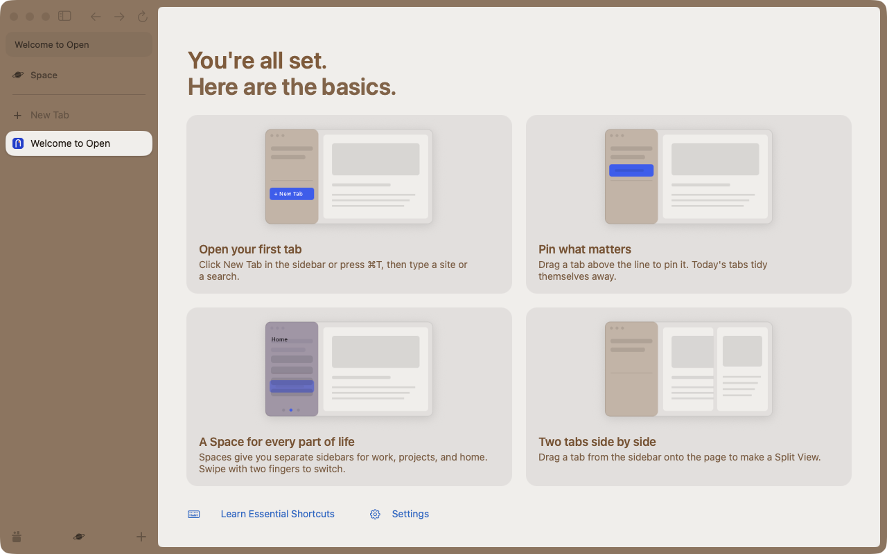
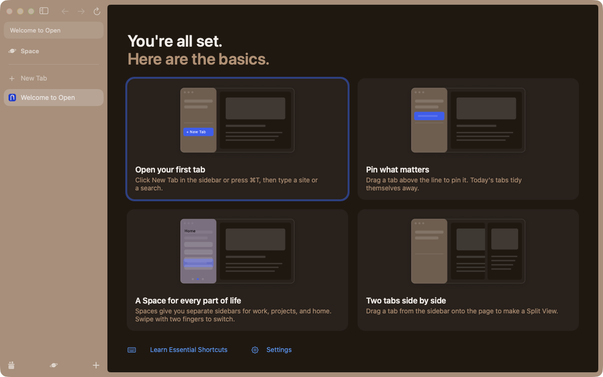

# Welcome contrast evidence

Real Open App, M5, synthetic warm Space theme. The existing automation command
sets `NSApp.appearance`; the user's macOS appearance stays unchanged. A second
owned Open process establishes inactive state beside the uncovered Welcome
window. Every row checks native key state, app activation, theme, app appearance,
visibility, non-occlusion and window-server capture before accepting its pixels.

Each PNG's embedded ICC profile is converted to sRGB. The modal pixel color in
the actual native label bounds supplies the surface. The median of the 12
strongest glyph-core pixels supplies the text color. WCAG relative luminance uses
the sRGB transfer function. Antialiased edge pixels are excluded. Header, title
and body values below are the minima across both headers, all four card titles
and all four body labels. The title gate is stricter than the requested 3:1.

| Space | App appearance | Window | Header >=3:1 | Titles >=4.5:1 | Body >=4.5:1 |
|---|---|---|---|---|---|
| light | Light | active | 4.763 PASS | 5.252 PASS | 4.729 PASS |
| light | Light | inactive | 4.763 PASS | 5.252 PASS | 4.729 PASS |
| light | Dark | active | 4.763 PASS | 5.252 PASS | 4.729 PASS |
| light | Dark | inactive | 4.763 PASS | 5.252 PASS | 4.729 PASS |
| dark | Light | active | 6.021 PASS | 13.886 PASS | 5.437 PASS |
| dark | Light | inactive | 6.021 PASS | 13.886 PASS | 5.437 PASS |
| dark | Dark | active | 6.021 PASS | 13.886 PASS | 5.437 PASS |
| dark | Dark | inactive | 6.021 PASS | 13.886 PASS | 5.437 PASS |

Both illustration labels and both footer links also meet 4.5:1:

| Space | App appearance | Window | + New Tab | Home | Shortcuts link | Settings link |
|---|---|---|---|---|---|---|
| light | Light | active | 4.719 PASS | 4.853 PASS | 4.600 PASS | 4.593 PASS |
| light | Light | inactive | 4.719 PASS | 4.853 PASS | 4.692 PASS | 4.705 PASS |
| light | Dark | active | 4.719 PASS | 4.853 PASS | 4.692 PASS | 4.705 PASS |
| light | Dark | inactive | 4.719 PASS | 4.853 PASS | 4.692 PASS | 4.705 PASS |
| dark | Light | active | 4.719 PASS | 4.797 PASS | 6.231 PASS | 6.231 PASS |
| dark | Light | inactive | 4.719 PASS | 4.797 PASS | 6.231 PASS | 6.231 PASS |
| dark | Dark | active | 4.719 PASS | 4.797 PASS | 6.231 PASS | 6.231 PASS |
| dark | Dark | inactive | 4.719 PASS | 4.797 PASS | 6.231 PASS | 6.231 PASS |

The New Tab label stays white on an opaque blue pill in both appearances. All
active illustration elements share the same blue, approximately `#335EF2`, from
the `#3D6BFF` seed by changing only OKLab lightness. Its 5.2:1 model target leaves
room for tiny antialiased glyph cores. Home keeps passing visible ink; its warm
light-theme ink needed a lightness correction on the layered sidebar surface, including the underlying heading row.

The original foreground-token control independently failed all four light-Space
cases at header **2.536:1**, title **2.861:1**, and body **2.214:1**. Active and
inactive text ratios matched; Welcome had no extra inactive tint. That control
predates illustration-frame metadata, so its missing-label flags do not establish
a dark-Space text failure. Its patch, binary hash, captures and detailed receipt
remain in `.re/welcome-contrast/negative-*` and `old-palette.patch`.

Two representative captures:

All eight PNGs, individual glyph coordinates/RGB values and `ratios.json` are
retained in `.re/welcome-contrast/matrix-1794251517470465000/`. Engine framework SHA-256:
`346199271164fc90ceff0535f171be279635645e94093ec870e0cb704f2dc5dd`
(main #266, approved by CHILD-RULES 32).
